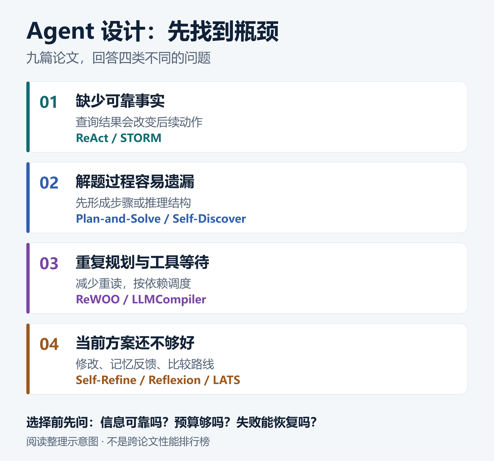

# Agent 设计别急着堆框架：用九篇论文看清规划、反思与搜索的边界

[知识库首页](../README.md) · [完整专题](../docs/agents/README.md)

> **本文主线**：认出瓶颈 → 对照机制 → 手算成本与耗时 → 检查失败边界 → 设计公平比较。

把模型接上工具之后，下一步是什么？很多方案会继续添加规划器、反思器、多角色和搜索树。流程图越来越完整，真正运行时却可能更慢、更贵，也更难知道错误从哪一步开始。

问题不在于这些机制没有用，而在于它们解决的是不同困难。**缺少事实、步骤安排不好、等待太长、判断信号不可靠，需要的是四类不同的改进。**

这篇文章把九篇代表论文放回同一条问题线上：先认出任务里的瓶颈，再决定需要增加哪一种机制。文中的计算是教学算例；论文实验的模型、任务和预算不同，不把它们当成同场排行榜。



*教学整理示意图：同一方法可能涉及多个问题，图中突出它在本文里的主要作用。*

## 1. 先问：你缺的是事实，还是步骤？

假设用户要求：“查明一家公司某一年度的营收、员工数和业务结构，并解释与上一年度的差异。”这是一个用于说明流程的例子。

第一步不是让模型写出更长的分析，而是找到年份正确、来源可靠的报告。报告没找对，后面再多次反思也只会围绕错误材料润色。

系统让模型提出下一步动作，由程序执行查询，再把真实返回内容交给模型继续判断，这种能够根据中间结果调整行动的系统，通常称为 **Agent，也就是智能体**。

在 [ReAct](https://arxiv.org/abs/2210.03629) 中，语言推理与外部行动交替发生。它有用的地方在于：刚查到的事实可以改变下一步。例如，报告提到某业务已被重新分类，下一次查询就应该寻找调整后的对比口径，而不是照旧把两年的数字相减。

但如果题目所需的信息已经全部给出，模型只是容易漏掉中间步骤，主要困难就变了。[Plan-and-Solve](https://aclanthology.org/2023.acl-long.147/) 通过先形成计划、再执行来处理这类问题；[Self-Discover](https://arxiv.org/abs/2402.03620) 则研究如何选择、改写并组合适合一类任务的推理结构。

两者都不能代替查证。**更完整的步骤，可以减少遗漏；它不会凭空补上缺失的事实。** 同样，模型能写出一个正确的计划，也不保证执行时每个数都算对。

## 2. ReWOO 省的是什么？先把“未知值”和“未知路线”分开

有时，我们暂时不知道某个结果，却已经知道拿到结果后要做什么。

例如，要查询某位研究者的导师出生在哪里，暂时不知道导师姓名，但后续处理方式很清楚：先查导师是谁，再用这个姓名查出生地。未知的是一个值，不一定是整条路线。

[ReWOO](https://arxiv.org/abs/2305.18323) 利用这一点，先把步骤和结果引用安排好，再执行工具，最后结合证据形成答案。前一步的返回结果可以保存在一个位置，例如 `E1`；后一步需要姓名时，再把 `E1` 的实际内容填进去。

这不等于“不需要观察”。真实工具结果仍然被使用，只是不必每取得一个结果，就让主规划过程重读全部历史、重新决定后续步骤。

为什么可能节省输入成本？看一个简化算例。

假设完成任务需要四轮规划。每轮都重新发送 1000 个单位的固定说明；每一轮新增 200 个单位的历史材料，并在之后的轮次中重复发送。仅计算四次规划请求读入的材料：

```text
固定说明：4 × 1000 = 4000
历史重读：0 + 200 + 400 + 600 = 1200
合计：5200
```

如果某个分离规划与汇总的方案，两次固定输入分别为 1000，最终一次读入四份合计 800 的证据，则这部分是 2800。这里的单位可以理解为模型处理的文本片段数，也就是 token；数字只是用于解释重复计算。

**这不是一个完整成本比较，更不是论文实测的节省倍数。** 输出长度、工具中的额外模型调用、失败重试、缓存折扣和汇总开销都还没有计入。

这套设计的适用边界也很清楚：如果工具返回“目标不存在”，或者返回结果会改变后续任务类型，系统就需要分支处理或重新规划。给未知结果起一个变量名，不能消除未知路线。

## 3. LLMCompiler 解决的，是依赖和等待

减少模型重复读材料，与减少工具等待，是两个不同问题。

继续看报告查询例子。找到报告后，营收、员工数和业务结构可以分别读取；解释差异需要等这些结果回来。把“哪一步必须等哪一步”写清楚，程序才能安排并行。这种带方向、没有循环依赖的关系图，叫有向无环图，通常缩写为 DAG。

[LLMCompiler](https://arxiv.org/abs/2312.04511) 的核心之一，就是显式表达工具任务及依赖，让程序调度已具备输入条件的任务。

假设各步耗时如下，忽略规划和调度开销：

| 步骤 | 必须等什么 | 教学设定耗时 |
|---|---|---:|
| 找到报告 | 用户问题 | 2 秒 |
| 读取营收 | 报告 | 4 秒 |
| 读取员工数 | 报告 | 3 秒 |
| 读取业务结构 | 报告 | 5 秒 |
| 统一核对口径 | 三项读取结果 | 1 秒 |

全部串行，需要 2 + 4 + 3 + 5 + 1 = 15 秒。若三项读取确实独立，理想情况下只等其中最慢的一项，需要 2 + 5 + 1 = 8 秒，比例为 15 / 8 = 1.875。

**三个任务同时跑，并不等于整体快了三倍。** 前置查询和最终核对仍然要做，最慢的依赖路线决定了完成时间。这条决定完成时间的路线，叫关键路径。

现实里还要补上服务限流、连接数量、失败重试和新依赖。如果“读取营收”发现必须另外下载重述文件，关键路径就变了；如果三个工具都会修改同一份数据，就不能仅凭“看起来独立”把它们同时发出去。

因此，ReWOO 和 LLMCompiler 的区别可以落到两个问题：**是不是重复请模型规划了？是不是让本来可以独立的工具白白排队了？** 先知道浪费在哪里，再谈优化。

## 4. 自我修改、反思和搜索，究竟改进了什么？

生成了一段答案以后，常见的下一句提示是“请检查并改进”。但不同方法保存的对象、看到的反馈、重新尝试的范围并不一样。

[Self-Refine](https://arxiv.org/abs/2303.17651) 研究的是“生成答案—提出反馈—修改答案”。它主要围绕当前产物进行改进。反馈如果只是“再准确一点”，下一轮很难知道该改变什么；指出“结论没有来源”或“漏掉了空输入”，才对应具体动作。

[Reflexion](https://arxiv.org/abs/2303.11366) 则把一次尝试得到的反馈整理成可供后续尝试使用的文字经验。这种记忆通常进入后续上下文，并不等于模型权重发生了更新。

假设代码在空字符串上报错。一次有用的经验应该说明触发条件、失败行为和下一次该检查的地方。只写“要更加小心”，几乎没有提供新的判断依据。

更关键的问题是：反馈本身是否可靠？如果测试遗漏了大小写规则，错误实现通过了测试，系统可能把错误保存成“成功经验”。反思能够传播有效经验，也可能传播错误结论。增加反思轮数之前，应先检查它依据什么来判断好坏。

[LATS](https://arxiv.org/abs/2310.04406) 又多做了一步：保留多条候选行动路线，用价值估计和访问次数来分配后续搜索。它不只是把同一个答案改十遍，而是在不同可能之间探索、比较和回退。

这里有个经常被忽略的前提：**环境能不能回退？** 在隔离环境里运行候选代码，可以重新开始；已经发出的邮件、实际完成的交易，却不能像树上的一个节点那样被丢弃。搜索算法中的“尝试”与现实世界中的“执行”，必须有清楚的边界。

## 5. STORM 的提醒：内容更全面，关系也可能写错

长文生成还会遇到另一种困难：一个问题最初被理解得太窄，搜到的材料集中在同一个角度。

[STORM](https://aclanthology.org/2024.naacl-long.347/) 把重点放在写作前的调查，通过不同视角拓展问题，再搜集材料、组织提纲和生成文章。它帮助我们看到，写作质量不仅取决于最后一段生成提示，还取决于前面究竟问过哪些问题。

但材料齐全与结论可靠不是同一件事。来源一说“业务被重新分类”，来源二说“某个分部收入下降”，不能直接拼成“经营恶化导致收入下降”。两句话可能各有出处，连接它们的因果关系却没有证据。

检查生成报告时，除了确认引用是否存在，还要检查：**引用真的支持这一句话吗？一句话里的事实和因果，是不是被分别验证了？** 这是对写作系统的设计启发，不是声称 STORM 已解决事实核验。

## 6. 怎样比较，才不会把“花更多钱”误当成“设计更好”

一种方法生成一次，另一种搜索五十次，再比较最终正确率，可以回答“完整系统最后谁更好”，却不能单独证明组织方式更有效。

我更关心下面两种比较：同样预算下，谁完成更多任务；达到相近质量时，谁花的时间与费用更少。

真正做实验时，至少固定模型版本、任务集合、可用工具和可见资料。预算不同可以设置几个档位，但要记录总输入输出、工具次数、失败请求、整体时间，以及用户真正关心的结果。

例如，“成功”应明确为报告中的指定字段正确、有可核对的来源、没有越权操作，而不能只看最终文字是否流畅。首次成功率、允许多次重试后的成功率，也不能混称为一个“准确率”。

这是一套建议的实验设计，本文没有据此运行新的综合实验。

## 7. 把九篇论文落回一张选择表

| 当前主要困难 | 优先考虑的机制 | 最先检查的代价或前提 |
|---|---|---|
| 新事实会改变下一步 | ReAct 的行动与观察循环 | 工具是否可靠、何时停止 |
| 信息已给出，却经常漏步骤 | Plan-and-Solve；Self-Discover | 计划是否真的被正确执行 |
| 未来步骤大致已知，历史反复重读 | ReWOO 的结果引用与分离规划 | 分支变化后怎样恢复 |
| 独立工具串行等待 | LLMCompiler 的依赖调度 | 限流、共享资源、关键路径 |
| 当前答案有可描述的具体缺点 | Self-Refine 的反馈与修改 | 反馈是否增加了有效信息 |
| 重复尝试仍犯同类错误 | Reflexion 的尝试间经验 | 反馈是否可信、记忆是否过期 |
| 有多条值得比较的路线 | LATS 的候选搜索 | 预算、状态回退、答案选择规则 |
| 调查角度太少，长文覆盖不足 | STORM 的写作前调查 | 引用支持与事实关系核验 |

把这张表用于自己的任务时，最好再写一句可检验的选择理由：

> 因为当前主要问题是三个独立只读查询排队等待，我先把依赖关系显式化；在相同工具、相同问题和相同正确性要求下，比较整体耗时与失败率。如果并行后限流重试更多，就重新判断调度方案。

这比“我们用了多 Agent、记忆、反思和树搜索”更容易指导下一步实现，也更容易知道什么时候该停。

## 原文与继续阅读

上文各方法名称均链接到原论文。更完整的机制、公式、实验条件、反例与自测，见本知识库的 [Agent 论文专题](../docs/agents/README.md)。这里的跨论文连接是阅读整理与设计分析，不是新的实测结论。

如果这篇文章帮你少加了一个没有必要的组件，欢迎收藏阅读目录。也欢迎带着一个具体任务讨论：它究竟缺少事实、缺少步骤，还是缺少可信的判断依据？
