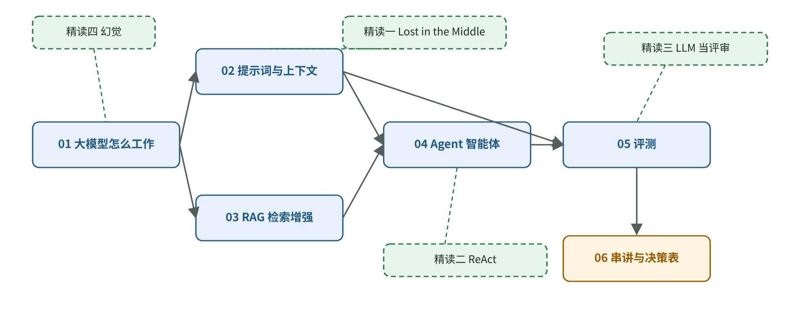

# AI 应用导读：从模型能力到系统判断

[知识库首页](../../README.md) · [本专题目录](README.md)

> **阅读目标**：建立一张从模型输入到产品评测的知识地图，先看懂完整过程，再决定深入哪一章。

本文目录

- [读完你能做到的事](#section-1)
- [知识地图](#section-2)
- [怎样读懂论文的论证过程](#section-3)
- [推荐的读法](#section-4)
- [本阶段的资料来源](#section-5)

这一阶段回答一个问题：**一个 AI 应用，从技术上是怎样工作的？** 读完之后，你应该能看懂团队的技术方案，能判断“这个需求该用提示词、RAG、Agent 还是微调”，能算出大致的成本，并且知道怎么用评测判断“变好了还是变坏了”。

## 读完你能做到的事

1. 用自己的话讲清大模型的工作方式：token、预测下一个词、温度、上下文窗口、为什么会编造。
2. 评审团队的提示词和上下文设计，指出“放多了”“放错位置了”“没法命中缓存”这类问题。
3. 判断一个知识问答需求该怎么做：直接放进上下文、RAG，还是微调；出错时知道先查哪一段。
4. 判断一个需求该用固定工作流还是 Agent，并为 Agent 设计权限、护栏和人工介入点。
5. 给 AI 功能建立评测：错误分析、二元判断、校准模型评审、区分 pass@k 和 pass^k。
6. 读懂四篇关键论文，并学会**它们的作者是怎样思考的**。

## 知识地图

阶段 1 的知识地图。箭头表示“先懂前面，后面才好懂”；虚线连着每章对应的精读论文。

| 编号 | 章节 | 一句话说明 | 对应精读 |
|---|---|---|---|
| 01 | 大模型怎么工作 | token、预测下一个词、三个训练阶段、上下文窗口、幻觉、成本 | 精读四 |
| 02 | 提示词与上下文工程 | 决定每次调用模型能看到什么；上下文不是越多越好 | 精读一 |
| 03 | RAG 检索增强 | 让模型基于你的资料回答；出错时分段排查 | 精读一 |
| 04 | Agent 智能体 | 工具调用、五种工作流模式、何时用 Agent、护栏 | 精读二 |
| 05 | 评测 | 错误分析、模型评审的校准、Agent 评测 | 精读三 |
| 06 | 串讲：一个 AI 功能的完整设计 | 把前五章串成一个真实案例，加一张决策表 | — |

## 怎样读懂论文的论证过程

只记住论文结论，很难判断它能否用于新的任务。这四篇精读沿着**问题、实验设计、证据与推理**展开，帮助读者理解结论是怎样成立的：

| 新增内容 | 在哪一层 | 帮你学到什么 |
|---|---|---|
| **起点**：作者注意到了什么矛盾或空白 | 第三层 | 好问题是从哪里来的 |
| **问题的转化链**：日常疑问 → 研究问题 → 可测量的量 | 第三层 | 怎样把模糊的担忧变成能验证的问题 |
| **预测表**：动手前有几种可能，各自应该看到什么 | 第三层 | 先写下预测，再看结果，避免事后随意解释 |
| **设计表**：每个设计选择在排除什么 | 第三层 | 怎样设计一个公平、干净的对比 |
| **每个实验回到预测表** | 第四层 | 证据怎样一条条裁决各种可能 |
| **论证地图**：主张、证据、隐含假设、最弱的一环 | 第六层 | 怎样判断一篇论文的结论有多可靠 |
| **意外与转折、没走的路** | 第六层 | 研究者遇到“不好看”的结果时怎么处理 |
| **可以带走的思考方法** | 第六层 | 能直接用在你自己工作中的思路 |

四篇论文的类型各不相同，正好覆盖了常见的几种“研究思路”：

| 精读 | 论文类型 | 最值得学的思考方法 |
|---|---|---|
| [精读一：Lost in the Middle](./P1_%E7%B2%BE%E8%AF%BB_Lost-in-the-Middle.md) | 诊断型实验 | 只动一个变量；给结果找参照线；造一个只能用一种解释的任务 |
| [精读二：ReAct](./P2_%E7%B2%BE%E8%AF%BB_ReAct.md) | 方法型实验 | 对照组从同一份材料里删出来；输了就做错误分析 |
| [精读三：LLM 当评审](./P3_%E7%B2%BE%E8%AF%BB_LLM%E5%BD%93%E8%AF%84%E5%AE%A1.md) | 测量工具验证 | 先验证测量工具再使用；为每种怀疑设计压力测试 |
| [精读四：幻觉从何而来](./P4_%E7%B2%BE%E8%AF%BB_%E5%B9%BB%E8%A7%89%E4%BB%8E%E4%BD%95%E8%80%8C%E6%9D%A5.md) | 理论论证 | 借用成熟领域的知识（归约）；追问“是什么在奖励这种行为” |

## 推荐的读法

**完整路线**（约 2–3 周，每周 4–6 小时）：按 01 → 02 → 精读一 → 03 → 04 → 精读二 → 05 → 精读三 → 精读四 → 06 的顺序。每读完一章，做章末自测。

**只有一周**：读 01、02、03、05 四章和 06 串讲，精读只看第一层和第六层。

**想先学“思考方法”**：直接读四篇精读的第三层和第六层，对照上面的表格，看四种不同类型的论文分别是怎样论证的。

## 本阶段的资料来源

本阶段的章节依据 Anthropic、OpenAI 的官方工程文章和文档，Hamel Husain、Chroma 等的实践文章与技术报告，以及四篇论文原文。原稿记录的来源核对日期为 2026-10-15；本次公开排版未重新逐一验证来源的最新状态，完整清单见[原文与来源](./sources.md)。原论文通过公开链接访问。

---

[下一篇](./01_%E5%A4%A7%E6%A8%A1%E5%9E%8B%E6%80%8E%E4%B9%88%E5%B7%A5%E4%BD%9C.md) · [专题目录](README.md) · [知识库首页](../../README.md)
