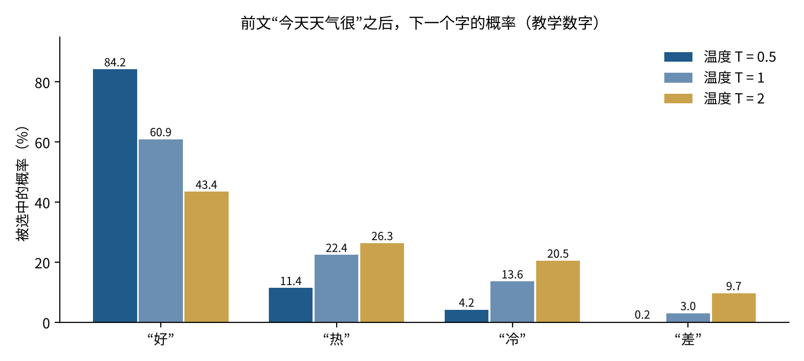
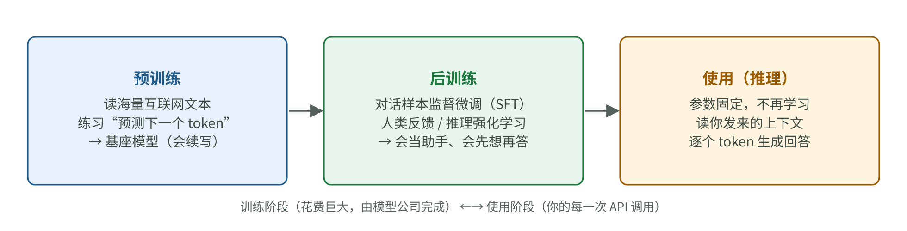
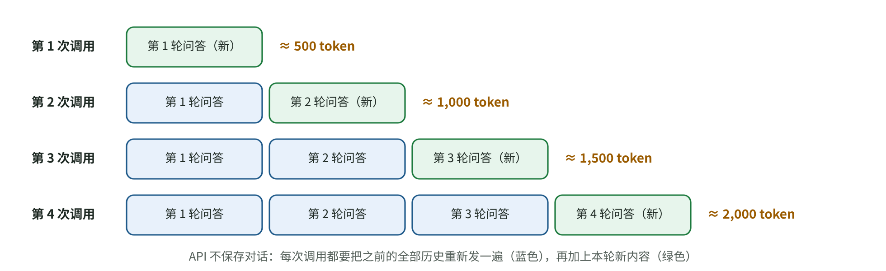

# 大模型为什么会答错？从文字接龙到上下文、成本与幻觉

[知识库首页](../../README.md) · [本专题目录](README.md)

> **阅读目标**：从一个词怎样被生成开始，理解模型为什么会猜错、上下文能帮什么忙，以及成本该怎样计算。

本文目录

- [一、一句话：它在做“接龙”](#section-1)
- [二、它是怎么学会的：三个阶段](#section-2)
- [三、上下文窗口：模型唯一的“工作记忆”](#section-3)
- [四、为什么会“一本正经地胡说”](#section-4)
- [五、成本与延迟：负责人要会算的账](#section-5)
- [六、能力是“参差不齐”的](#section-6)
- [七、本章要点](#section-7)
- [自测](#section-8)

做 AI 应用时，很多决定都绕不开大模型的工作原理：为什么同一个问题问两次答案不一样？为什么聊得越久越贵？为什么它会一本正经地编造？这一章不讲神经网络的数学细节，只讲**负责人做判断时需要的那一层原理**：模型在做什么、它是怎么学会的、它的“记忆”在哪里、钱花在哪里。

本章主要依据 Andrej Karpathy 的公开课 *Deep Dive into LLMs like ChatGPT*（2025-02，约三个半小时，面向大众），以及 OpenAI、Anthropic 的官方文档。想看更完整的版本，可以直接看这个视频。

## 一、一句话：它在做“接龙”

### 概念卡：token（词元）

**要解决的问题**：计算机只能处理数字，模型需要先把文字切成小块，每一块对应一个编号。

**白话定义**：token 是模型读写文字的最小单位。英文里一个常见单词通常是一个 token，长单词会被切成几块；中文里一个汉字大约对应一到两个 token，具体取决于模型用的“切分词表”。

**类比**：像把一句话拆成乐高积木，每块积木有编号。不成立的地方：积木的切法不是按“意思”切的，而是按统计上常一起出现的字符组合切的，所以有时会切得很奇怪。

**为什么你要关心**：**模型的价格、速度和上下文长度，全都按 token 计算。** 一份 1 万字的中文合同，大约是一万到两万个 token。

**在本阶段的作用**：后面讲成本（本章第五节）、上下文窗口（第三节、第 02 章）、检索的分块（第 03 章）都以 token 为单位。

### 模型唯一在做的事：预测下一个 token

把上面的概念放在一起，大模型的核心动作只有一个：**看着前面所有的 token，给“下一个 token 是什么”打分，然后选一个接上去，再重复。**

比如前文是“今天天气很”，模型会给词表里每个候选 token 一个分数（专业上叫 logit），再换算成概率。下面是一组**教学用的数字**（不是真实模型的输出）：

| 候选 | 分数 | 换算后的概率 |
|---|---|---|
| 好 | 2.0 | 60.9% |
| 热 | 1.0 | 22.4% |
| 冷 | 0.5 | 13.6% |
| 差 | −1.0 | 3.0% |

“换算”用的是一个叫 softmax 的公式：每个分数先取指数（e 的分数次方），再除以所有指数的总和，让所有概率加起来等于 100%。以“好”为例：e²≈7.389，四个指数的总和约 12.124，7.389÷12.124≈60.9%。

然后模型**按这个概率抽签**：大多数时候接“好”，也有两成多的机会接“热”。接上之后，“今天天气很好”成了新的前文，再预测下一个 token。一篇回答，就是这样一个 token 一个 token “接龙”出来的。

这解释了三个你一定遇到过的现象：

1. **同一个问题问两次，答案不一样**：因为每一步都在抽签。
2. **回答越长，越慢、越贵**：每多一个 token，就要多算一轮。
3. **模型没有“查数据库”这一步**：它说出的每个事实，都是“接龙”时概率最高的那个说法，而不是查证过的结果。这是第四节讲“幻觉”的根源。

### 温度（temperature）：抽签有多“随机”

API 里常见的 temperature 参数，控制的就是这次抽签。做法是：换算概率之前，先把每个分数除以温度 T。

图 1-1　同一组分数在三种温度下换算出的概率（教学数字）。温度低，第一名的优势被放大；温度高，各候选的概率被拉平。

| 温度 T | 好 | 热 | 冷 | 差 | 效果 |
|---|---|---|---|---|---|
| 0.5 | 84.2% | 11.4% | 4.2% | 0.2% | 几乎总选第一名，更稳定、更保守 |
| 1 | 60.9% | 22.4% | 13.6% | 3.0% | 原始分布 |
| 2 | 43.4% | 26.3% | 20.5% | 9.7% | 更分散，更有“创意”，也更容易出错 |

算一个：T=0.5 时，“好”的分数变成 2.0÷0.5=4，e⁴≈54.60；四个候选的指数总和约 64.84，54.60÷64.84≈84.2%。

**对负责人的意义**：要求稳定、可重复的任务（分类、抽取、评分），温度调低；需要多样性的任务（起标题、头脑风暴），温度可以高一些。具体模型是否开放温度参数、允许哪些取值，应查对应版本的官方文档；低温度也不能代替正确性评测。

## 二、它是怎么学会的：三个阶段

图 1-2　一个对话模型从训练到使用的三个阶段（教学示意图，依据 Karpathy 课程的结构绘制）。

### 阶段 1：预训练——读完互联网，学会“接龙”

模型先在海量的互联网文本上练习“预测下一个 token”，练习的次数是天文数字。结果是一个**基座模型**（base model）。它学会了语言的规律、大量的事实和推理模式，但它只会“续写文档”：你问它一个问题，它可能接着写出十个类似的问题，而不是回答。

Karpathy 把基座模型里的知识比作**“对读过的东西的模糊回忆”**：它读过很多次的东西记得很牢；只出现过一两次的冷门事实，记得很模糊。

### 阶段 2：后训练——学会当“助手”

接着用大量人工编写的“用户提问 → 理想回答”的对话样本继续训练（监督微调，SFT），模型学会了以助手的口吻回答问题、遵守格式、拒绝不当请求。之后再用**强化学习**进一步调整：

- **RLHF**（基于人类反馈的强化学习）：让人对多个回答排序，训练模型更像人们喜欢的回答。
- **面向推理的强化学习**：在答案可以自动核对的题目（数学、编程）上，奖励最终答对的解题过程。2024–2025 年的“推理模型”（OpenAI o1、DeepSeek-R1 等）就是这样训练出“先想再答”的能力的，具体训练目标与数据仍需对照各模型的技术报告。

### 阶段 3：使用（推理）——你每次调用 API 时发生的事

训练结束后，模型的参数就固定了。你调用 API 时，模型不会再学习任何东西：它只是读你发来的全部内容，然后一个 token 一个 token 地往下接。

**这一点非常重要**：用户在你的产品里说过的话、纠正过的错误，模型不会“记住”。下一次调用时，它能用到的信息只有两个来源——参数里的“模糊回忆”，和你这次发给它的内容。

## 三、上下文窗口：模型唯一的“工作记忆”

### 概念卡：上下文窗口（context window）

**白话定义**：一次调用里，模型能同时“看到”的全部 token 的上限，包括你发的系统提示、对话历史、检索到的资料、工具结果，以及它自己正在写的回答。

**类比**：参数是一个人多年积累的知识（模糊回忆），上下文窗口是他桌上摊开的资料（工作记忆）。桌上的资料他看得清清楚楚，但桌子有大小限制。类比不成立的地方：人会把桌上的东西记进脑子里，模型不会。

**在本阶段的作用**：第 02 章的上下文工程、第 03 章的 RAG，本质上都是在决定“往这张桌子上放什么”。

### 每一轮对话都要“从头再读一遍”

API 本身不保存对话。多轮聊天之所以看起来“有记忆”，是因为你的程序每次都把**完整的历史**重新发一遍。

图 1-3　多轮对话时，每次调用都要把之前的全部历史重新发送（教学示意图）。

算一笔账（教学数字）：假设每一轮（用户提问 + 助手回答）约 500 个 token，连续聊 10 轮。第 1 次调用发 500 个，第 2 次发 1000 个……第 10 次发 5000 个。10 次调用的输入合计：

500 + 1000 + 1500 + … + 5000 = 500 × (1+2+…+10) = 500 × 55 = **27,500 个 token**

对话只多了 10 倍，输入的 token 总量却是第一轮的 55 倍。这就是“聊得越久越贵、越慢”的原因，也是为什么你的产品需要设计历史消息的上限、摘要压缩等策略（开发学习第 06B 章那个 `MAX_HISTORY` 从 50 改成 200 的问题，就是这笔账）。

**提示缓存（prompt caching）可以缓解这笔账**：如果每次请求的开头部分（系统提示、固定资料、之前的历史）和上一次完全一样，服务商可以复用上次的计算结果，价格大幅打折。Anthropic 的官方文档写明，缓存命中部分按基础输入价的 **0.1 倍**计费；OpenAI 的文档写的是缓存输入最高可打到原价的 5% 左右（即“最高 95% 折扣”），具体以各模型价格表为准（两家文档均于 2026-10-15 查阅）。要用好缓存，提示词就要**把固定不变的内容放在前面，把每次都变的内容放在后面**。

## 四、为什么会“一本正经地胡说”

上面说过，模型说出的每个事实都是“接龙”的结果。那它为什么不在不确定时说“我不知道”？OpenAI 2025 年 9 月的论文 *Why Language Models Hallucinate* 给了一个很有说服力的解释：**现在的训练和评测方式奖励猜测，不奖励承认不知道。**

打个比方：选择题考试只按答对的题数算分时，空着不答一定是 0 分，瞎猜还有机会蒙对，所以理性的考生会全部猜一遍。论文认为，模型就是被优化成了这样的“好考生”。

OpenAI 在博客里给了一组 SimpleQA（一个事实问答测试）上的数字：

| 模型 | 弃答率 | 准确率 | 错误率 |
|---|---|---|---|
| gpt-5-thinking-mini | 52% | 22% | 26% |
| OpenAI o4-mini | 1% | 24% | 75% |

只看准确率，o4-mini 还略高；但它几乎从不说“不知道”，错误率是前者的近 3 倍。**只看准确率的排行榜，会把更爱瞎猜的模型排在前面。**

这篇论文的推理过程很值得学，本阶段有一篇完整的[精读四](./P4_%E7%B2%BE%E8%AF%BB_%E5%B9%BB%E8%A7%89%E4%BB%8E%E4%BD%95%E8%80%8C%E6%9D%A5.md)。

**对负责人的意义**：

1. 评测你的产品时，不要只看“答对率”，还要单独统计“答错率”和“合理拒答率”，并给“自信地答错”更重的扣分（第 05 章）。
2. 对冷门、精确的事实（人名、日期、条款号、价格），不要依赖模型的“回忆”，要么给它资料（第 03 章 RAG），要么让它调用工具查询（第 04 章 Agent）。
3. 在提示词和产品设计里，明确允许并鼓励模型说“我不确定”，并给用户一条找人工或查原文的路径。

## 五、成本与延迟：负责人要会算的账

把前面几节合起来，一次调用的成本和耗时大致由三件事决定：

| 因素 | 对成本的影响 | 对延迟的影响 | 你能怎么调 |
|---|---|---|---|
| 输入 token 数 | 按输入单价计费；缓存命中部分大幅打折 | 影响“首个字出来前”的等待 | 控制历史长度、只放需要的资料、固定内容放前面以命中缓存 |
| 输出 token 数 | 输出单价通常是输入的数倍 | 每个 token 都要逐个生成，是总耗时的主要来源 | 限制回答长度、要求结构化输出、推理模型控制思考预算 |
| 选哪个模型 | 大模型和小模型单价可差 10 倍以上 | 小模型通常更快 | 按任务难度分流：简单任务用小模型（第 04 章“路由”模式） |

一个可以随身带的估算公式（单价以各家官方价格页为准）：

> 每次调用费用 ≈ 未缓存输入 token × 输入单价 + 缓存命中 token × 缓存单价 + 输出 token × 输出单价

**手算一遍**（全部是教学数字）：某客服功能每次调用输入 6,000 token，其中 5,000 是固定的系统提示和知识（可以命中缓存），1,000 是本次对话；输出 400 token。假设输入单价每百万 token 3 美元、缓存按 0.1 倍计、输出每百万 token 15 美元：

- 未缓存输入：1,000 × 3 / 1,000,000 = 0.003 美元
- 缓存输入：5,000 × 0.3 / 1,000,000 = 0.0015 美元
- 输出：400 × 15 / 1,000,000 = 0.006 美元
- 合计约 **0.0105 美元/次**。如果没有缓存，输入部分是 6,000 × 3 / 1,000,000 = 0.018 美元，合计 0.024 美元，贵了一倍多。

每天 10 万次调用，差别就是每天约 1,350 美元。**这种账，负责人应该能在白板上算出来。**

## 六、能力是“参差不齐”的

Karpathy 用“参差不齐的智能”（jagged intelligence）形容大模型：它能解出很难的数学题，却可能数错一个单词里有几个字母。2026 年 2 月发布的《国际 AI 安全报告》也用了同样的说法：能力进步是“锯齿状”的，在难题上表现出色，在一些简单任务上却会失败。

这对产品设计的含义是：**不能用“它连这么难的都会”去推断“它一定会那个简单的”**。每一类任务都要单独评测（第 05 章）。

## 七、本章要点

1. 大模型只做一件事：根据前文预测下一个 token，按概率抽签接上。随机性、成本、速度、幻觉，都能从这一点推出来。
2. 它的知识有两个来源：参数里的“模糊回忆”和本次上下文里的“工作记忆”。精确、冷门、会变化的事实，要放进上下文，而不是依赖回忆。
3. API 没有记忆，多轮对话的输入量随轮数增长得很快。缓存、历史上限和摘要压缩是控制成本的基本手段。
4. 幻觉的一个重要原因是“只奖励答对”的训练和评测方式。评测时要单独统计答错率和合理拒答率。
5. 能力参差不齐，每一类任务都要单独评测。

## 自测

1. 同一个分类任务，模型有时把“退款”判成“投诉”。除了改提示词，你在参数上可以先试什么？为什么？

把温度调低（如果这个模型开放温度参数）。温度低时，概率最高的选项被放大，抽签结果更稳定。如果模型不开放温度参数，就要靠更清晰的类别定义、示例和评测来保证稳定性。

2. 手算：每轮 800 token，连续 5 轮，不做任何压缩，5 次调用的输入 token 合计是多少？

800 × (1+2+3+4+5) = 800 × 15 = 12,000 个 token。

3. 产品经理说：“模型在排行榜上准确率最高，所以它幻觉最少。”这句话错在哪里？

准确率只统计答对的比例，不区分“答错”和“不答”。一个从不拒答、爱猜的模型，准确率可能更高，错误率（幻觉）也高得多。OpenAI 给的 SimpleQA 例子里，o4-mini 准确率 24%、错误率 75%，gpt-5-thinking-mini 准确率 22%、错误率只有 26%。要同时看错误率和弃答率。

4. 为什么提示缓存要求“把固定内容放在前面”？

缓存复用的是“开头完全相同的那一段”的计算结果。如果每次都变的内容（用户问题、时间戳）放在最前面，后面的固定内容也就和上一次不“同头”了，缓存无法命中。

---

[上一篇](./00_%E9%98%B6%E6%AE%B5%E5%AF%BC%E8%AF%BB.md) · [下一篇](./02_%E6%8F%90%E7%A4%BA%E8%AF%8D%E4%B8%8E%E4%B8%8A%E4%B8%8B%E6%96%87%E5%B7%A5%E7%A8%8B.md) · [专题目录](README.md) · [知识库首页](../../README.md)
