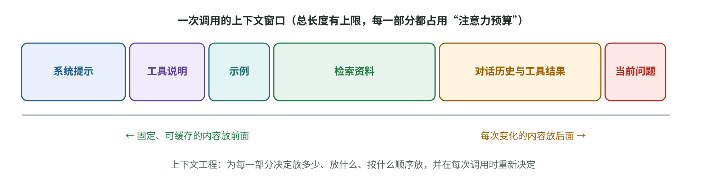
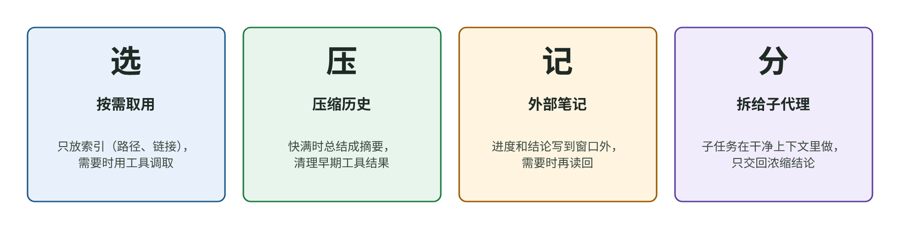

# 提示词越写越长，效果为什么反而变差？理解上下文工程

[知识库首页](../../README.md) · [本专题目录](README.md)

> **阅读目标**：把提示词放回完整的输入环境中，判断该放什么、删什么，以及长上下文为什么也会漏信息。

本文目录

- [一、上下文里都有什么](#section-1)
- [二、提示词的基本功](#section-2)
- [三、上下文越多越好吗？](#section-3)
- [四、管理上下文的四种手法](#section-4)
- [五、负责人怎么检查一份提示词和上下文设计](#section-5)
- [六、本章要点](#section-6)
- [自测](#section-7)

上一章说过，模型能用的信息只有两类：参数里的“模糊回忆”，和这一次上下文里的“工作记忆”。前者你改变不了，后者完全由你的产品决定。所以 AI 应用开发中最常做、也最影响效果的工作，就是**决定每一次调用往上下文里放什么、怎么放**。

2025 年起，行业里越来越多地用**上下文工程**（context engineering）这个词替代“提示词工程”。Anthropic 在 2025-09-29 的工程博客 *Effective context engineering for AI agents* 中给出的定义是：在模型推理过程中，策划并维护最优的一组信息（token）的策略，目标是找到“最小的一组高信号 token”，让你想要的结果最可能出现。

这一章先讲提示词的基本功，再讲为什么“上下文不是越多越好”，最后讲四种管理上下文的手法。

## 一、上下文里都有什么

图 2-1　一次调用里，上下文窗口通常由这几部分组成（教学示意图）。你的产品要为每一部分决定“放多少、放什么、按什么顺序放”。

| 组成部分 | 谁决定 | 常见问题 |
|---|---|---|
| 系统提示（system prompt） | 你的团队 | 越写越长、互相矛盾、写成了几十条 if-else |
| 工具说明 | 你的团队 | 工具太多、功能重叠，模型选错工具 |
| 示例 | 你的团队 | 罗列大量边缘情况，反而让模型抓不住重点 |
| 检索到的资料 | 检索系统（第 03 章） | 找错了、找多了、关键内容被淹没 |
| 对话历史与工具结果 | 用户和运行过程 | 越积越长，成本上升、注意力被稀释 |
| 当前问题 | 用户 | 表述模糊、缺少必要信息 |

提示词工程关注的是前三行“怎么写”；上下文工程管的是**整张表**，而且每一次调用都要重新决定。

## 二、提示词的基本功

### 写到“合适的高度”

Anthropic 的文章提出，系统提示要写在“合适的高度”（right altitude），避开两种失败：

- **太低**：把复杂、脆弱的逻辑写死在提示词里，例如“如果用户提到退款且金额大于 500 且是会员且……”。规则一多就互相打架，遇到没写到的情况就不知所措。
- **太高**：只有空泛的口号，例如“请专业、友好地回答”，默认模型知道你们公司的背景和标准。

**教学例子**：同一个客服场景的三种写法。

| 高度 | 写法 | 问题 |
|---|---|---|
| 太低 | “如果问题含‘退’字，回复模板 A；含‘换’字，回复模板 B；……”（共 40 条） | 用户说“这个能不能不要了”，没有一条命中 |
| 太高 | “你是一个专业的客服，请友好地帮助用户。” | 不知道退换货政策是什么，只能编 |
| 合适 | 说明角色和目标；给出退换货政策原文；说明判断原则（例如“超过 7 天但有质量问题时，转人工并说明原因”）；给 3 个有代表性的示例对话 | 规则少而清楚，遇到新情况能按原则推理 |

### 用示例，但要精选

给几个示例（few-shot）通常比写长篇规则有效。Anthropic 的建议是：与其罗列所有边缘情况，不如**精选少量多样、有代表性的示例**，原文把示例比作“胜过千言的图片”。

### 让模型“先想再答”

Google 在 2022 年的论文 *Chain-of-Thought Prompting Elicits Reasoning in Large Language Models*（Wei 等，NeurIPS 2022）发现：在示例里写出中间推理步骤，模型在数学应用题等任务上明显变好。用 8 个这样的示例，PaLM 540B 在 GSM8K 数学题上的成绩超过了当时的最佳水平（从论文图 2 读出，大约从 18% 升到 57%）。

这篇论文的思考过程有一个很值得学的地方：**作者没有只报告“有效”，而是检查了“对谁有效”**。他们在不同规模的模型上都做了实验，发现这个方法只在约 1000 亿参数以上的模型上才有正面作用；小模型会写出“看起来很流畅、其实不合逻辑”的推理，表现反而变差。所以论文把它称为“随模型规模涌现的能力”。

**今天怎么用**：2024 年之后的“推理模型”已经在训练中学会了先想再答（第 01 章第二节），不必再在提示词里写“请一步一步思考”；对非推理模型，让它先列出依据再给结论，仍然常常有用。不管哪种，**都要用评测验证，而不是默认有效**——这正是 Wei 等人的研究方法教给我们的。

### 输出格式要明确

如果模型的回答要被程序处理（填进表单、触发动作），就要明确规定格式，最好使用服务商提供的“结构化输出”功能（让模型按你给的 JSON 结构作答）。这能大幅减少“格式错了导致程序报错”的问题。

## 三、上下文越多越好吗？

直觉上，给模型的资料越多，它知道得越多，回答应该越好。现在主流模型的上下文窗口已经达到几十万到一百万 token，似乎“全塞进去”就行了。研究给出的答案是：**不是。**

### 证据一：中间的内容容易被忽略（2023）

斯坦福等机构的论文 *Lost in the Middle: How Language Models Use Long Contexts*（Liu 等，TACL 2024）做了一个很干净的实验：给模型 20 份文档，其中只有一份包含答案，然后**只改变这份文档的位置**，看准确率怎么变。结果是一条 U 形曲线：答案在开头或结尾时准确率最高，在中间时明显下降。

这篇论文的实验设计是“只动一个变量”的典范，本阶段有完整的[精读一](./P1_%E7%B2%BE%E8%AF%BB_Lost-in-the-Middle.md)，会讲清作者是怎样一步步排除其他解释的。

### 证据二：上下文越长，表现越不稳定（2025）

向量数据库公司 Chroma 在 2025-07-14 发布的技术报告 *Context Rot* 测试了 18 个当时的主流模型（包括 Claude、GPT、Gemini、Qwen 系列），发现：

- 输入越长，表现越差，而且这种变差不是均匀的：问题和答案的**措辞越不相似**，下降得越快。
- 上下文里只要有 1 个“看起来相关、其实不对”的干扰内容，表现就会下降；有 4 个时下降更多。
- 在对话记忆测试（LongMemEval）中，只给相关片段（平均约 300 token）比给完整对话（平均约 11.3 万 token）得分显著更高，所有模型家族都是这样。

报告的结论是：**相关信息“在不在”上下文里，并不是唯一要紧的事；它“怎么呈现”同样重要。**

### 两份研究不完全一致，怎么看？

细心读会发现一个差别：Lost in the Middle 发现位置影响很大，而 Context Rot 报告在它的“大海捞针”测试里，信息位置的影响并不显著。这不一定是矛盾：两份研究**用的模型差了两年，任务也不同**（前者是多文档问答，后者主要是在长文中找一句话）。

这就是读研究时要养成的习惯：**结论都带着条件**。对你的产品来说，可靠的做法不是背结论，而是用自己的数据测：把关键资料放在不同位置、混入不同数量的干扰内容，看效果怎么变。

### 为什么会这样

Anthropic 的文章给了一个直观解释：模型有一份“注意力预算”，每多一个 token 都要分走一点注意力。上下文必须被当成**边际收益递减的有限资源**。这也是“上下文腐烂”（context rot）这个说法的由来。

## 四、管理上下文的四种手法

图 2-2　上下文工程的四种常用手法（教学示意图，依据 Anthropic 2025-09 的工程博客整理）。

| 手法 | 做法 | 适合的场景 | 代价 |
|---|---|---|---|
| **选**：按需取用 | 不预先把所有资料塞进去，只放文件路径、链接等“索引”，需要时再用工具调取 | Agent 在大量文件、网页中工作 | 每次调取要多花时间；模型可能漏取 |
| **压**：压缩历史 | 上下文快满时，把之前的对话总结成一段摘要，用摘要开启新一轮；最轻量的做法是清掉早期的工具调用结果 | 长对话、长任务 | 摘要可能丢掉后面才发现重要的细节 |
| **记**：外部笔记 | 让模型把进度、待办、关键结论写进上下文之外的笔记文件，需要时再读回来 | 跨越很多步骤的任务 | 要设计笔记格式；笔记本身也可能出错 |
| **分**：拆给子代理 | 把一个子任务交给另一个“干净上下文”的模型，它可能用掉几万 token，只返回一两千 token 的结论 | 调研、代码搜索等可以并行的子任务 | 系统更复杂，成本更高 |

Anthropic 在文中举过一个例子：让 Claude 玩宝可梦游戏时，它在数千步中靠自己写的笔记保持准确的计数，还会自发记录地图和策略。你在 Codex 里看到的“上下文压缩”、AGENTS.md 文件、子代理，都是这几种手法的具体实现。

文章最后的建议很朴素：**做能奏效的最简单的事**（do the simplest thing that works）。

## 五、负责人怎么检查一份提示词和上下文设计

拿到团队的提示词或上下文方案时，可以逐条问：

1. **这次调用要完成的任务是什么？成功的标准是什么？** 说不清，就先别谈提示词。
2. **系统提示有没有写到合适的高度？** 有没有几十条互相打架的规则？有没有只剩口号？
3. **每一部分内容都有必要吗？** 删掉某一段，效果会变差吗？有没有测过？
4. **关键资料放在哪里？** 有没有被埋在一大段无关内容的中间？
5. **对话变长后怎么办？** 有没有历史上限、摘要压缩？成本按第 01 章的公式算过吗？
6. **固定内容在前、变化内容在后吗？** 能不能命中提示缓存？
7. **改了提示词之后，用什么证明变好了？** 答案应该是“跑了评测集”（第 05 章），而不是“试了几个例子感觉不错”。

## 六、本章要点

1. 上下文工程管的是“每一次调用，模型能看到的全部内容”：系统提示、工具、示例、资料、历史、当前问题。
2. 提示词要写在合适的高度：有清楚的原则和真实的资料，规则少而精，配精选示例。
3. 上下文不是越多越好：中间的内容容易被忽略，干扰内容会拉低表现，长度本身也会让表现不稳定。
4. 管理上下文的四种手法：按需选取、压缩、外部笔记、拆给子代理。先用最简单的。
5. 任何提示词改动，都要用评测证明。

## 自测

1. 团队把公司 300 页的产品手册全部放进每次调用的系统提示，理由是“模型支持 100 万 token”。你会提出哪些问题？

成本：每次调用都要付这些输入 token 的钱（能否命中缓存？）。效果：大量无关内容会稀释注意力，关键条款可能被淹没在中间；有没有和“只检索相关段落”（第 03 章）对比过效果？延迟：输入越长，首字出现越慢。最后要求用评测集对比两种方案。

2. 为什么说 Wei 等人的思维链论文，研究方法比结论更值得学？

他们没有只报告“方法有效”，而是在不同规模的模型上都做了实验，发现只有大模型才受益，小模型反而变差。这提醒我们：一个技巧是否有效，取决于条件（模型、任务）。在自己的产品里，任何技巧都要在自己的模型和数据上验证。

3. Lost in the Middle 和 Context Rot 关于“位置影响”的结论不一致，你怎么向团队解释？

两项研究用的模型相差两年，任务也不同（多文档问答与长文找句子）。结论都依赖实验条件，不能直接搬到我们的产品上。正确做法是用我们自己的数据，把关键资料放在不同位置测一遍。

---

[上一篇](./01_%E5%A4%A7%E6%A8%A1%E5%9E%8B%E6%80%8E%E4%B9%88%E5%B7%A5%E4%BD%9C.md) · [下一篇](./03_RAG%E6%A3%80%E7%B4%A2%E5%A2%9E%E5%BC%BA.md) · [专题目录](README.md) · [知识库首页](../../README.md)
