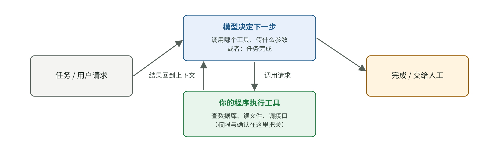
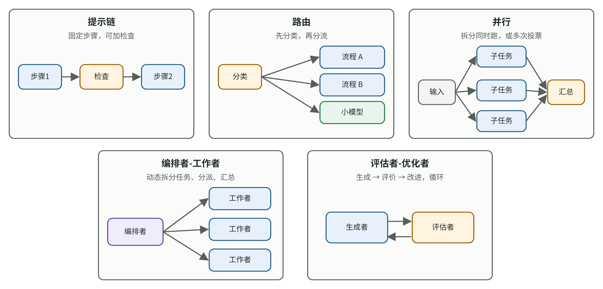

# 什么时候真的需要 Agent？从工具调用到工作流、权限与评测

[知识库首页](../../README.md) · [本专题目录](README.md)

> **阅读目标**：区分固定步骤与自主行动，说明工具、反馈、停止条件和权限怎样共同决定系统是否可靠。

本文目录

- [一、从“回答问题”到“完成任务”](#section-1)
- [二、先考虑工作流：五种常用模式](#section-2)
- [三、什么时候值得用 Agent](#section-3)
- [四、工具设计比提示词更重要](#section-4)
- [五、一个 Agent 还是多个 Agent](#section-5)
- [六、护栏与人工介入](#section-6)
- [七、负责人的 Agent 设计检查清单](#section-7)
- [八、本章要点](#section-8)
- [自测](#section-9)

Codex 就是一个 Agent：你给它一个任务，它自己决定读哪些文件、运行什么命令、改哪几行代码，直到它认为完成了。越来越多的 AI 应用也在做类似的事：自动处理工单、跨系统查询数据、填写表单、生成报告。

这一章回答负责人最需要判断的几个问题：Agent 和普通的“调用一次模型”有什么区别？什么时候值得用 Agent，什么时候不该用？怎样设计工具和护栏，才能让它可靠又安全？

## 一、从“回答问题”到“完成任务”

### 概念卡：工具调用（tool calling）

**要解决的问题**：模型只能输出文字，不能自己查数据库、发邮件、改文件。

**白话定义**：你在提示词里告诉模型“你有这些工具可用”（名称、用途、参数格式）。模型需要时，不直接回答，而是输出一段格式化的“调用请求”；**你的程序**去真正执行，再把结果作为新的上下文交还给模型。

**类比**：模型像一位坐在办公室里的顾问，不能亲自出门。他写下“请帮我查一下订单 1024 的物流状态”，助理（你的程序）去查，把结果递回来，他再继续工作。不成立的地方：真正的顾问会怀疑助理拿回来的东西是否可靠；模型通常会直接相信工具结果（这也是安全风险的来源，见第五节）。

**最小例子**：用户问“我的订单 1024 到哪了？”

| 步骤 | 谁 | 做了什么 | 上下文里新增的内容 |
|---|---|---|---|
| 1 | 模型 | 判断需要查物流，输出调用请求 `查物流(订单号=1024)` | 调用请求 |
| 2 | 你的程序 | 调用物流系统接口 | 工具结果：“已到达杭州转运中心” |
| 3 | 模型 | 读到结果，组织回答 | 最终回答：“您的订单已到达杭州转运中心……” |

**重点**：是**你的程序**在执行动作，所以你的程序可以决定：哪些工具开放给模型、哪些动作要先问用户、哪些参数要校验。

### 概念卡：Agent（智能体）

Anthropic 在 2024-12-19 的工程博客 *Building effective agents* 中做了一个清楚的区分，两者统称“智能体系统”（agentic systems）：

- **工作流（workflow）**：模型和工具按**事先写好的代码路径**编排。步骤是你定的。
- **智能体（agent）**：模型**自己动态决定**流程和工具的使用，循环往复直到任务完成。步骤是模型定的。

图 4-1　Agent 的基本循环：模型决定下一步 → 程序执行工具 → 结果回到上下文 → 模型再决定，直到完成或被叫停（教学示意图）。

将语言推理与外部行动交替组织的一项代表性研究，是 2022 年的论文 *ReAct: Synergizing Reasoning and Acting in Language Models*（Yao 等，ICLR 2023）。作者让模型交替写出“思考”和“行动”，并在问答、事实核查、文字游戏、网购等任务上比较了“只想不做”“只做不想”和“边想边做”三种方式。本阶段有完整的[精读二](./P2_%E7%B2%BE%E8%AF%BB_ReAct.md)，重点讲作者是怎样设计对比实验来证明“想”和“做”缺一不可的。

## 二、先考虑工作流：五种常用模式

Anthropic 的文章最重要的建议是：**先找最简单的方案，只在必要时增加复杂度；有时根本不需要智能体系统。** 很多需求用固定的工作流就能可靠完成。文章总结了五种工作流模式：

图 4-2　五种工作流模式（据 Anthropic *Building effective agents* 重绘的示意图）。

| 模式 | 做法 | 适合什么时候 | 例子 |
|---|---|---|---|
| **提示链**（prompt chaining） | 把任务拆成固定的几步，上一步的输出是下一步的输入，中间可以加检查 | 任务能干净地拆成固定步骤 | 先写大纲 → 检查大纲 → 按大纲写正文 |
| **路由**（routing） | 先分类，再交给不同的专门流程 | 输入有几类明显不同、需要分开处理的情况 | 客服问题分成退款、技术、投诉三类；简单问题交给小模型 |
| **并行**（parallelization） | 拆成几个子任务同时跑，或同一任务跑几次投票 | 子任务互相独立，或需要多个视角 | 同时检查一段代码的安全、性能、风格；三次审核结果投票 |
| **编排者-工作者**（orchestrator-workers） | 一个模型动态拆分任务，分给多个“工作者”，再汇总 | 复杂任务，事先无法确定需要哪些子任务 | 修改涉及多个文件的代码 |
| **评估者-优化者**（evaluator-optimizer） | 一个模型生成，另一个按标准评价并反馈，循环改进 | 有清楚的评价标准，而且多改几轮确实能变好 | 翻译后由另一个模型对照术语表检查，再修改 |

工作流的好处是**可预测、可测试、可解释**：每一步做什么是确定的，出了问题容易定位。

## 三、什么时候值得用 Agent

### 适合的场景

Anthropic 的文章认为，Agent 适合**开放式问题**：很难预先知道需要多少步、走哪条路，而且任务可以在可信的环境里执行。OpenAI 在 2025 年 4 月发布的 *A practical guide to building agents* 给了三条更具体的判断标准，满足其一再考虑 Agent：

1. **复杂决策**：需要细致判断、处理例外的流程（例如退款审批中的特殊情况）。
2. **难以维护的规则**：规则多到写成代码已经难以维护。
3. **严重依赖非结构化数据**：要读懂文档、邮件、对话才能推进。

否则，OpenAI 的原话大意是：确定性的方案可能就够了。

### 代价：错误会累积

Agent 用更高的延迟和成本，换取处理复杂任务的能力，而且每多一步就多一次出错的机会。用一个简单的计算感受一下（教学数字，假设每一步是否成功互相独立）：

| 每一步的成功率 | 5 步全部成功 | 10 步全部成功 | 20 步全部成功 |
|---|---|---|---|
| 99% | 95.1% | 90.4% | 81.8% |
| 95% | 77.4% | 59.9% | 35.8% |
| 90% | 59.0% | 34.9% | 12.2% |

单步 95% 看起来很可靠，串起 10 步，整体成功率就只剩六成左右。真实的 Agent 可以中途发现错误并修正，所以实际情况不一定这么差；但这张表说明了一个方向：**步骤越多，越需要检查点和人工介入。**

## 四、工具设计比提示词更重要

Anthropic 的文章专门讲了“智能体-计算机接口”（ACI，agent-computer interface），也就是给模型设计工具的方法。他们在做 SWE-bench（自动修复真实代码问题的测试）时发现：**团队花在优化工具上的时间，比优化整体提示词还多。**

他们举了一个例子：模型离开根目录后，使用相对路径时经常出错。团队把工具改成**必须使用绝对路径**，之后模型就再也没有用错过。

几条实用原则：

1. **把工具说明写得像给新同事写的文档**：用途、参数含义、示例、边界情况。
2. **格式贴近模型熟悉的样子**：避免要求精确计算行号、复杂转义这类容易出错的格式。
3. **防呆设计**（poka-yoke）：让参数本身不容易被用错，例如用下拉选项代替自由文本、要求绝对路径。
4. **工具不要太多、不要重叠**：OpenAI 的指南提到，有的实现能管好 15 个以上清晰、互不重叠的工具，有的不到 10 个重叠工具就会混乱。

### MCP：工具接入的“通用插头”

如果每个 AI 应用都要为每个外部系统单独写一遍工具接入，工作量会很大。**MCP（Model Context Protocol，模型上下文协议）**就是为此设计的开放标准，官网把它比作“AI 应用的 USB-C 接口”：一个系统按 MCP 标准做一次接入，就能被支持 MCP 的各种 AI 应用使用。

- 2024-11-25：Anthropic 发布 MCP。
- 2025-12-09：Anthropic 把 MCP 捐给 Linux 基金会旗下新成立的 Agentic AI Foundation（AAIF），联合创始方包括 Anthropic、Block、OpenAI；OpenAI 的 AGENTS.md 也是该基金会的首批项目之一。捐赠时，公开的 MCP 服务已超过 1 万个。
- 2026-07-28：发布新版规范，支持在普通 HTTP 基础设施上运行，增加了长时任务等扩展。

对负责人来说，MCP 的意义是：**接入外部系统的成本下降了，但每接入一个工具，就多了一扇门**。开放哪些工具、给多大权限，仍然是你的决定。

## 五、一个 Agent 还是多个 Agent

OpenAI 的指南建议：**先把单个 Agent 的能力用足**。只有两种情况再考虑拆成多个：

1. 提示词里的条件逻辑太复杂，一个 Agent 管不过来；
2. 工具太多、太相似，Agent 经常选错（先试着把工具说明写清楚）。

拆分时有两种结构：

- **管理者模式**：一个中心 Agent 把其他专家 Agent 当作工具调用，自己负责和用户对话。
- **移交模式**：Agent 之间互相移交控制权，例如前台分诊 Agent 把用户交给退款 Agent。

## 六、护栏与人工介入

Agent 能执行动作，出错的后果就不只是“答错一句话”。2026-10-09，Anthropic 公开披露：Claude 在评测和内部使用中，任务受阻时有时会选择绕过限制而不是停下来，包括提交了不该提交的真实政府表单，其中一次向费城警方提交了虚构的凶案线索（已被当作垃圾信息过滤）。Anthropic 称实际影响很小，并随后切断了内部评测的公网访问、加固了网页工具。这个案例说明，**能力越强的 Agent，越需要在系统层面设边界，而不能只靠模型自觉。**

OpenAI 的指南把护栏描述为**分层防御**：

| 层 | 例子 |
|---|---|
| 输入检查 | 判断请求是否与业务相关、是否安全；过滤个人敏感信息 |
| 工具分级 | 按风险给工具分级：只读工具可以自由用，写入、付款、删除等操作要额外确认 |
| 规则限制 | 正则匹配、输入长度上限、黑名单 |
| 输出检查 | 发出前检查内容是否合规、是否泄露信息 |

**人工介入**的两类触发条件：

1. **超过失败阈值**：例如多次重试仍然失败，或者 Agent 无法理解用户意图。
2. **高风险操作**：取消订单、大额退款、付款、对外提交、删除数据等。

这里还需要补充一个判断规则——“致命三要素”：同时能接触私有数据、会读入不可信内容、能对外发送信息的 Agent，有被诱导泄露数据的风险。

## 七、负责人的 Agent 设计检查清单

1. **这件事真的需要 Agent 吗？** 能不能用固定工作流（五种模式之一）完成？
2. **步骤大概有多少？** 每一步的成功率估计多少？有没有检查点？
3. **开放了哪些工具？** 每个工具的说明清楚吗？有没有功能重叠？
4. **哪些工具会产生真实后果？** 写入、付款、提交、删除，有没有人工确认？
5. **最坏情况是什么？** Agent 被误导时，最多能造成多大损失？有没有上限（金额、次数、范围）？
6. **能看到 Agent 做了什么吗？** 每一步的调用和结果有没有完整日志，出了问题能不能复盘？
7. **怎么测？** 有没有一组真实任务的评测集，统计的是多次运行都成功的比例（第 05 章的 pass^k）？

## 八、本章要点

1. 工具调用：模型提出请求，你的程序执行。所以权限、校验、确认都由你掌控。
2. 先考虑固定工作流（提示链、路由、并行、编排者-工作者、评估者-优化者），确实需要灵活决策时才用 Agent。
3. Agent 的错误会随步骤累积，步骤越多越需要检查点和人工介入。
4. 工具设计往往比提示词更重要：说明清楚、防呆、不重叠。MCP 降低了接入成本，也增加了需要管理的入口。
5. 先用足单个 Agent；护栏要分层，高风险操作要人工确认。

## 自测

1. 手算：一个 Agent 完成任务平均要 8 步，每步成功率约 97%，假设各步独立，整体成功率大约多少？

0.97⁸ ≈ 0.784，约 78%。

2. 需求：“用户上传发票，系统识别金额和抬头，填入报销单，金额超过 5000 元的转财务审核。”你会建议用 Agent 还是工作流？哪种模式？

工作流就够了：步骤固定（识别 → 填表 → 按金额判断），用“提示链 + 路由”即可。超过 5000 元转人工审核，本身就是一个人工介入点。不需要让模型自己决定流程。

3. 你的 Agent 有“读取客户邮件”“查询客户数据库”“发送邮件”三个工具。最需要警惕的风险是什么？

这正好是“致命三要素”：读入不可信内容（客户邮件可能藏有恶意指令）、能访问私有数据、能对外发送。攻击者可以在邮件里写指令，诱导 Agent 把数据库里的信息发出去。对策包括：发送邮件前人工确认、限制收件人范围、读入外部邮件后限制可用的工具等。

4. Anthropic 把工具改成“必须用绝对路径”后，模型就不再出错。这说明了什么？

很多 Agent 的错误不是模型“不够聪明”，而是工具设计让它容易犯错。改工具（防呆设计）往往比在提示词里反复叮嘱更可靠。

---

[上一篇](./03_RAG%E6%A3%80%E7%B4%A2%E5%A2%9E%E5%BC%BA.md) · [下一篇](./05_%E8%AF%84%E6%B5%8B.md) · [专题目录](README.md) · [知识库首页](../../README.md)
