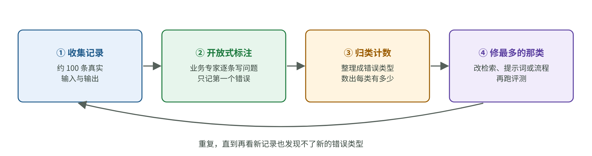

# AI 演示很惊艳，上线却不稳定：怎样设计一套有用的评测

[知识库首页](../../README.md) · [本专题目录](README.md)

> **阅读目标**：从失败样本出发定义成功，理解自动评分、人工校准和多次运行各自提供什么证据。

本文目录

- [一、为什么“试几个例子”不够](#section-1)
- [二、三个层级的评测](#section-2)
- [三、评测的起点：先看数据，做错误分析](#section-3)
- [四、打分：用“通过 / 不通过”，不用 1–5 分](#section-4)
- [五、让模型来当评审：好用，但要先校准](#section-5)
- [六、Agent 的评测：看结果，跑多次](#section-6)
- [七、负责人怎样把评测落地](#section-7)
- [八、本章要点](#section-8)
- [自测](#section-9)

前面每一章最后都落到同一句话：“要用评测验证。”这一章讲评测本身。

传统软件的测试是确定的：输入 2+2，输出必须是 4。AI 功能的输出每次可能不同，而且“好不好”常常没有唯一标准答案。很多团队因此只能靠“试几个例子，感觉不错”来判断，结果改好了一处，另一处悄悄变坏，自己却不知道。**评测（evals）就是让 AI 功能的质量变得可测量、可比较的一套做法。** 对负责人来说，它是决定“能不能上线”“这次改动有没有用”的依据。

## 一、为什么“试几个例子”不够

Hamel Husain 在 2024-03-29 的文章 *Your AI Product Needs Evals* 中讲了一个真实案例：房地产软件公司 Rechat 的 AI 助手 Lucy。团队靠调提示词取得了初期进展，然后陷入停滞：

- 改好一个问题，另一个问题又冒出来（按下葫芦浮起瓢）；
- 只能凭感觉判断改动好坏；
- 提示词越写越长，越来越难维护。

转折点是他们建立了系统的评测流程。Husain 的核心观点是：**评测的速度决定了迭代的速度。** 没有评测，每次改动都是在赌。

## 二、三个层级的评测

Husain 把评测分为三级，从便宜到昂贵：

| 层级 | 做法 | 什么时候跑 | 例子 |
|---|---|---|---|
| **第一级：单元测试式断言** | 用代码检查输出是否满足明确的规则 | 每次改代码、改提示词都跑 | 回答里不能出现内部系统名；JSON 格式必须正确；必须引用至少一个资料出处 |
| **第二级：人工评审 + 模型评审** | 记录真实的对话过程（trace），由人或另一个模型按标准打分 | 按固定节奏，例如每周或每次重要改动 | 抽 50 条对话，判断“回答是否解决了用户问题” |
| **第三级：A/B 测试** | 把新旧版本分给不同用户，比较真实业务指标 | 产品成熟后、重大改动时 | 新版本的问题解决率、转人工率是否更好 |

大部分团队应该先把第一级和第二级做起来。

## 三、评测的起点：先看数据，做错误分析

很多人一开始就问：“我们该用什么指标？”Husain 和 Shreya Shankar 在他们 2026 年 9 月更新的《AI Evals 常见问题》中反复强调，正确的起点不是选指标，而是**先看数据**——一条一条地读真实的输入和输出，找出它到底错在哪里。他们称**错误分析是评测中最重要的活动**。

图 5-1　错误分析的四个步骤（依据 Husain 与 Shankar 的 Evals FAQ 整理的示意图）。这个方法借鉴自社会科学的质性研究。

1. **收集一批有代表性的记录**：起步约 100 条，覆盖不同类型的用户和问题。没有真实用户时，可以先用合成数据。
2. **开放式标注**：由一位懂业务的人逐条阅读，自由地写下问题，**每条只记第一个出错的地方**。负责人自己至少要亲手标前 30 条。
3. **归纳成错误类型并计数**：把零散的笔记整理成几类，例如“没检索到正确条款”“语气过于随意”“编造了政策”，然后数每一类有多少条。
4. **重复**，直到再看新的记录也发现不了新的错误类型为止。

**教学例子**：一个合同问答助手的 100 条记录，归纳后得到：

| 错误类型 | 条数 | 对应的修法 |
|---|---|---|
| 没检索到相关条款 | 18 | 改检索（第 03 章） |
| 检索到了但回答引用错了条款 | 7 | 改提示词，要求逐条对照引用 |
| 对资料里没有的问题也给了肯定回答 | 6 | 鼓励拒答，评测中给“自信地答错”加重扣分（第 01 章） |
| 回答太长 | 3 | 限制输出格式 |
| 正确 | 66 | — |

有了这张表，**优先做什么就一目了然**：先修检索，而不是先调语气。这也是负责人分配团队精力最好的依据。

## 四、打分：用“通过 / 不通过”，不用 1–5 分

很多团队喜欢让评审员（人或模型）给 1–5 分。Husain 和 Shankar 明确建议用**二元判断（通过 / 不通过）**，理由是：

- 二元判断逼着你想清楚“什么算合格”；
- 1–5 分里，3 分和 4 分的区别很难说清，不同评审员之间很难一致，大家还容易都打中间分；
- 想追踪细微进步，可以把一个大标准拆成几个小的二元检查（例如“引用了出处”“没有编造数字”“语气专业”各算一项）。

## 五、让模型来当评审：好用，但要先校准

人工评审又慢又贵，所以常用另一个大模型来当评审（LLM-as-a-Judge）。这个做法有效，但模型评审员自己也有偏差。

2023 年的论文 *Judging LLM-as-a-Judge with MT-Bench and Chatbot Arena*（Zheng 等，NeurIPS 2023）系统地研究了这个问题。他们发现，用 GPT-4 当评审员时，只算明确分出胜负的判断，它和人类专家的一致率是 85%，专家之间是 81%；同时也发现了几种偏差，例如：

- **位置偏差**：比较两个回答时，倾向于偏爱放在前面（或后面）的那个；
- **长度偏差**：倾向于偏爱更长的回答；
- **自我偏好**：可能偏爱自己生成的回答（论文发现了一些迹象，但作者明确说数据不足以确定）。

这篇论文怎样设计实验来**测出**这些偏差（例如把两个回答交换位置再问一次），是本阶段[精读三](./P3_%E7%B2%BE%E8%AF%BB_LLM%E5%BD%93%E8%AF%84%E5%AE%A1.md)的重点。

### 校准评审员的做法

Husain 和 Shankar 建议**把模型评审员当成一个分类器来对待**：

1. 先请懂业务的人对一批样本（每种错误类型约 100–200 条）做通过/不通过的标注；
2. 让模型评审员对同一批样本打分；
3. 分别统计两个数：人说“不通过”的样本里，模型也判“不通过”的比例（能不能抓到问题）；人说“通过”的样本里，模型也判“通过”的比例（会不会误报）；
4. 两个数都够高，才能用它替代人工。

还有一个容易被忽略的现象：Shankar 等人在 2024 年的研究 *Who Validates the Validators?*（UIST 2024）中发现了**评分标准漂移**（criteria drift）：人们在看了一批输出之后，才逐渐想清楚自己的评分标准是什么，有些标准只有看到具体的输出才会冒出来。所以，**不要指望一开始就写出完美的评分标准**，校准是反复进行的过程。可沿来源页继续阅读该研究。

## 六、Agent 的评测：看结果，跑多次

Anthropic 在 2026-01-09 的工程博客 *Demystifying evals for AI agents* 中，给评测 Agent 整理了一套术语和方法。几个对负责人最有用的点：

**看最终状态，不看它说了什么**。Agent 说“已经帮您订好了”，不算数；要检查数据库里是否真的有这条预订。文中把这叫作看结果（outcome），而不是看过程中的说法。

**输出有随机性，同一个任务要跑多次**。由此有两个不同的指标：

| 指标 | 含义 | 适合 |
|---|---|---|
| pass@k | k 次尝试里**至少成功一次** | 成功一次就够的场景，例如生成几个方案让人挑 |
| pass^k | k 次尝试**全部成功** | 对一致性要求高的场景，例如面向客户的 Agent |

文中的例子：单次成功率 75% 的 Agent，连续 3 次都成功的概率是 0.75³ ≈ 42%。面向客户时，客户感受到的是 42%，而不是 75%。

**能力评测和回归评测要分开**：

- **能力评测**：测“它还不太会的事”，通过率一开始应该很低，用来衡量进步；
- **回归评测**：测“它已经会的事”，通过率应接近 100%，用来防止改坏；
- 能力评测的通过率做高了，就把这些题目“毕业”到回归评测里。

**起步不需要很多题**：20–50 个来自真实失败的简单任务就足以开始。上线前人工检查过的情况、用户反馈的失败，都应该转成测试题。

文中还有一个提醒评测本身也会出错的例子：某个模型在 CORE-Bench 上起初只得 42%，排查后发现评分器过于死板——答案是“96.12”，因为期望值写的是“96.124991…”就被判错；修正评分错误和任务歧义后，分数升到 95%。所以，**分数异常低或异常高时，先检查评测本身**。文章的结尾建议是：读记录（Read the transcripts!）。

## 七、负责人怎样把评测落地

1. **每个 AI 功能上线前，要有一份评测集**：至少几十条真实或接近真实的样例，写清楚什么算通过。
2. **把错误分析变成例行工作**：每次重大改动后，花 30 分钟人工看 20–50 条输出（Husain 和 Shankar 给出的最小可行做法）；上线后定期复审新数据。
3. **任何提示词、模型、检索的改动，都要跑评测**，看整体分数和各错误类型的变化，而不是只看改动针对的那个问题。
4. **换模型之前先跑评测**：面对“新模型更便宜、更快”的消息，有了评测集，你可以在一天内用自己的数据决定换不换。
5. **让懂业务的人参与评测标准的制定**，而不是全交给工程师。

## 八、本章要点

1. 评测让 AI 功能的质量可测量。没有评测，每次改动都在赌。
2. 三级评测：代码断言、人工 + 模型评审、A/B 测试。先做前两级。
3. 起点是错误分析：读真实记录、标注、归类计数，用计数决定优先修什么。
4. 用通过/不通过，不用 1–5 分。模型评审员要用人工标注校准，并注意位置、长度等偏差。
5. Agent 要看最终结果、跑多次；面向客户的场景看 pass^k。评测本身也会出错，要读记录。

## 自测

1. 手算：一个 Agent 单次成功率 90%。pass@3（3 次至少成功 1 次）和 pass^3（3 次全部成功）分别是多少？

pass^3 = 0.9³ = 72.9%。pass@3 = 1 − (1−0.9)³ = 1 − 0.001 = 99.9%。同一个 Agent，看哪个指标，结论差别很大。

2. 团队用一个大模型评审员给回答打 1–5 分，平均分从 3.8 升到 4.1，团队说“效果提升了”。你会追问什么？

评审员和人工判断的一致性校准过吗？3.8 到 4.1 的变化是否超过了评审员自身的随机波动？新版回答是不是变长了（长度偏差）？建议改成几个二元检查，并用人工标注过的样本验证评审员。

3. 为什么错误分析时“每条只记第一个出错的地方”？

后面的错误常常是第一个错误引起的（例如没检索到资料，导致回答编造）。只记第一个错误，能让计数反映真正的根源，避免重复计算，也能更快找到最值得修的环节。

4. 新模型的价格是现在用的模型的一半，你怎么决定换不换？

用现有的评测集跑一遍新模型，比较整体通过率和各错误类型的变化；同时统计延迟和实际成本。如果评测集覆盖了关键场景、且没有明显退化，再小流量上线观察（第三级评测）。

---

[上一篇](./04_Agent%E6%99%BA%E8%83%BD%E4%BD%93.md) · [下一篇](./06_%E4%B8%B2%E8%AE%B2%E4%B8%8E%E5%86%B3%E7%AD%96%E8%A1%A8.md) · [专题目录](README.md) · [知识库首页](../../README.md)
