# 资料明明在上下文里，模型为什么找不到？精读 Lost in the Middle

[知识库首页](../../README.md) · [本专题目录](README.md)

> **阅读目标**：跟着位置实验和对照设计，解释为什么“放得下资料”不等于“用得好资料”。

本文目录

- [第一层：5 分钟读懂](#section-1)
- [第二层：补概念](#section-2)
- [第三层：研究者是怎么想的](#section-3)
- [第四层：结果逐图读懂](#section-4)
- [第五层：深入——作者怎样排除其他解释](#section-5)
- [第六层：复盘这篇论文的推理](#section-6)
- [局限与证据边界](#section-7)
- [对 AI 应用负责人的意义](#section-8)
- [与其他知识的连接](#section-9)
- [术语表](#section-10)
- [自测](#section-11)

**原文**：Nelson F. Liu, Kevin Lin, John Hewitt, Ashwin Paranjape, Michele Bevilacqua, Fabio Petroni, Percy Liang. *Lost in the Middle: How Language Models Use Long Contexts*. Transactions of the ACL (TACL), 2024。作者来自斯坦福大学、加州大学伯克利分校、Samaya AI。本文依据 arXiv 2307.03172 第 3 版（2023-11-20），共 18 页，正文与附录 A–G 全部读过。本地 PDF：[原文/P1_Lost-in-the-Middle_TACL2024.pdf](https://arxiv.org/pdf/2307.03172v3)。文中“第 N 页”指这份 PDF 的页码。

**在本阶段的位置**：承接第 02 章“上下文越多越好吗”，是“上下文工程”的实验基础；第 03 章 RAG 里“检索多少段、怎么排序”的决定也以它为依据。

**怎么读**：只有 5 分钟，读第一层；想学透，按顺序读完六层。第三层和第六层专门讲作者的思考过程。

## 第一层：5 分钟读懂

**一句话**：把同一份关键资料放在上下文的不同位置，模型的准确率会明显不同——放在开头或结尾时最好，放在中间时最差，曲线像一个 U 字。

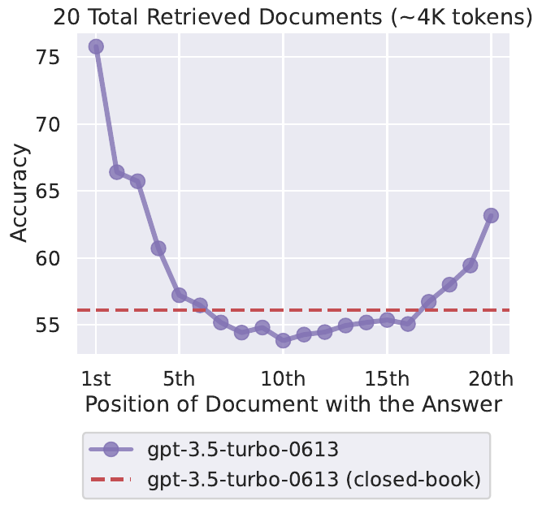

论文原图 1（第 1 页）。横轴是“含答案的那份文档排在第几位”（共 20 份），纵轴是答题准确率（%）。紫色实线是 GPT-3.5-Turbo，红色虚线是同一个模型**不给任何文档**时的准确率（56.1%）。**怎么读**：先看两端——第 1 位约 76%，第 20 位约 63%；再看中间——第 10 位附近跌到约 54%，**比不给文档还低**。

**三个最重要的发现**：

1. **位置决定成败**：GPT-3.5-Turbo 在 20 份文档的设置下，答案在第 1 位时准确率 75.8%，在第 10 位时只有 53.8%，相差 22 个百分点（附录表 6，第 18 页）。
2. **“上下文窗口更大”不等于“用得更好”**：同一个模型的 4K 版和 16K 版，在两者都能装下的输入上，表现几乎完全一样。
3. **多给资料，收益很快见顶**：在一个真实的检索问答实验里，从 20 份资料加到 50 份，准确率只提高了约 1–1.5 个百分点，输入却多了一倍多。

**对你最直接的三条启示**：

1. 检索出的资料要**重新排序**，把最相关的放在最前面。
2. **别贪多**：检索 50 段不一定比 20 段好，先用评测找到“够用”的数量。
3. 评价一个模型的长上下文能力，不能只看它“能装多少”，要看**关键信息放在不同位置时表现是否稳定**。

## 第二层：补概念

### 概念卡：多文档问答（multi-document QA）

**要解决的问题**：模拟 RAG 系统的真实情况——检索系统找回一堆资料，只有其中一两份真正包含答案。

**白话定义**：给模型一个问题和 k 份文档，**恰好只有一份**包含答案，其余 k−1 份是“干扰文档”。模型要找到那一份并据此回答。

**最小例子**（论文图 2，第 4 页）：问题“谁获得了第一个诺贝尔物理学奖？”三份文档里只有第 2 份写着“第一个诺贝尔物理学奖于 1901 年授予德国的威廉·伦琴”。

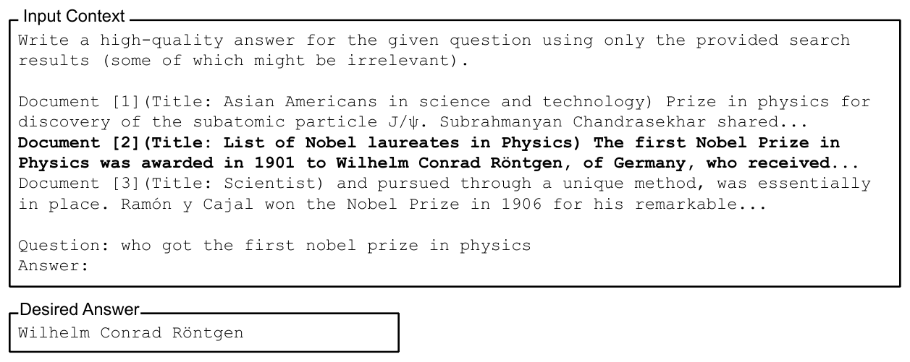

论文原图 2（第 4 页）。上框是发给模型的完整输入：一句指令、3 份文档（加粗的是含答案的那份）、问题。下框是期望答案。**怎么读**：注意干扰文档并不是随便找的——它们都和“诺贝尔奖”“物理”有关，看上去很像答案，但并不包含答案。

### 概念卡：闭卷与开卷参照线（closed-book / oracle）

论文用两条参照线来解读结果：

- **闭卷**（closed-book）：不给任何文档，模型只能靠参数里的“回忆”答题（第 01 章）。GPT-3.5-Turbo 是 56.1%。
- **只给正确文档**（oracle）：只给那一份含答案的文档，没有任何干扰。GPT-3.5-Turbo 是 88.3%。

有了这两条线，你就能判断：给了 20 份文档之后，模型的表现是更接近“只看正确文档”，还是更接近“什么都没看”。

### 概念卡：首因效应与近因效应（primacy / recency bias）

心理学里有个经典发现：让人记一串词，人们最容易记住**开头几个**（首因效应）和**最后几个**（近因效应），中间的最容易忘。这叫“系列位置效应”。论文在第 6.3 节特意提到了这个联系。

**这个类比在哪里不成立**：人记不住中间是因为记忆容量有限；而 Transformer 模型的注意力机制**在技术上可以同样地看到任何一个位置**。所以在模型上看到类似的现象，作者认为是“令人意外的”。

### 小术语

- **准确率**（accuracy）：模型的输出里**出现了任何一个标准答案**，就算答对（第 4 页）。
- **贪心解码**（greedy decoding）：每一步都选概率最高的那个词，不抽签（第 01 章温度为 0 的情况）。这样结果可以重复。
- **扩展上下文版本**：同一个模型的“加长版”，例如 GPT-3.5-Turbo（4K）和 GPT-3.5-Turbo（16K）、Claude-1.3（8K）和 Claude-1.3（100K）。
- **仅解码器 / 编码器-解码器**（decoder-only / encoder-decoder）：两种模型结构。今天的主流聊天模型都是仅解码器结构，读每个词时只能“回头看”前面的内容；编码器-解码器结构会先把整个输入前后都看一遍。这个区别在第五层会用到。

## 第三层：研究者是怎么想的

### 起点：窗口越来越大，但没人知道模型用得怎么样

2023 年，模型的上下文窗口正从 2K 扩到 32K 甚至 100K。大家默认“窗口越大，能用的信息越多”。但作者注意到：**当时评价长上下文模型，主要看的是它在长文本上的“困惑度”**（预测下一个词的整体准确程度），而不是它能不能在长输入里**准确找到并使用某一条信息**（第 2、10 页）。这两件事并不一样。

**一句话**：大家以为“装得下”就是“用得好”，作者想检验这个前提。

### 把模糊的问题变成可以测的问题

| 层次 | 内容 |
|---|---|
| 日常说法 | 模型能用好长上下文吗？ |
| 研究问题 | 相关信息放在输入的不同位置时，模型使用它的能力会不会变？输入变长时又会怎样？ |
| 可测量的量 | 同一批问题，**只改变含答案文档的位置**（第 1 位、第 5 位……第 20 位），或者**只改变干扰文档的数量**（10、20、30 份），测准确率 |

作者在引言里把判断标准写得非常明确（第 2 页）：**如果模型能稳健地使用长上下文，那么它的表现应该几乎不受相关信息位置的影响。** 这句话就是整篇论文的“检验标准”。

### 动手之前，有哪几种可能？

作者在正文里明说了第一种可能和检验标准；其余几种是我们根据论文引用的已有研究和后面的补充实验整理的（读者重建）。

| 如果……成立 | 应该看到 | 实际看到（第四、五层详述） |
|---|---|---|
| A. 模型能稳健使用整个上下文 | 准确率曲线**基本平坦** | ✗ 曲线明显弯曲 |
| B. 只有“近因偏好”（已有研究发现小模型更关注最近的词） | 曲线**单调上升**，越靠后越好 | ✗ 开头反而最好 |
| C. 只有“首因偏好”（指令微调数据里，任务说明通常在开头） | 曲线**单调下降**，越靠前越好 | ✗ 结尾也会回升 |
| D. 位置效应是实验设计造成的假象（例如干扰文档按相关度排序，暗示“前面的更重要”） | 打乱干扰文档顺序、换成随机干扰文档后，效应**消失** | ✗ 效应仍在 |
| E. 窗口更大的版本更会用上下文 | 16K、100K 版本的曲线**更平** | ✗ 几乎重合 |

五种可能全部被否定，剩下的结论就是：**这些模型同时具有首因和近因偏好，中间的信息最容易被忽略，而且这不是实验设计的假象，也不能靠加大窗口解决。**

### 每个设计选择都在排除什么

这篇论文的实验设计非常“干净”。读的时候，可以把每个设计都看成在回答“如果不这样做，会把什么混在一起？”

| 设计 | 让什么保持不变 | 如果不这样设计，会混淆什么 |
|---|---|---|
| **同一个问题、同一组文档，只调换顺序**（图 3） | 题目难度、文档内容 | 不同位置用的是不同的题，就分不清“位置的影响”和“题目难易的影响” |
| **只加减干扰文档来改变长度**（图 4） | 含答案的文档、问题 | 长度变化如果伴随内容变化，就分不清是“变长”还是“内容不同”造成的 |
| **干扰文档用检索系统找来的“最像答案但不含答案”的段落** | 贴近真实 RAG 场景 | 用随便找的文档太容易区分，测不出真实情况（附录 B 又专门用随机文档对比了一次） |
| **闭卷与开卷两条参照线** | — | 没有参照，就说不清 54% 算好还是算差 |
| **成对比较普通版与扩展版**（4K 与 16K、8K 与 100K） | 同一个模型、同样的训练方式 | 直接比不同模型，分不清是“窗口大小”还是“模型本身”的差别 |
| **再设计一个几乎没有语义的“键值查找”任务**（第三节） | 去掉语言理解的难度 | 分不清是“找不到”还是“找到了但理解不了” |
| **贪心解码** | 去掉随机性 | 抽签带来的波动会干扰位置效应的测量 |

注意最后一种思路：当一个结果可能有两种解释（“找不到”和“用不好”），作者就**再造一个只能用其中一种解释的任务**。这是本文最值得学的一招。

## 第四层：结果逐图读懂

### 实验 1：多文档问答——位置怎样影响准确率

**检验的是预测表中的 A、B、C、E。**

**设置**：从 NaturalQuestions-Open（谷歌搜索的真实问题，配维基百科答案）中选出 2,655 个问题（第 4 页）。每份文档是最多 100 个 token 的维基百科段落。输入共 10、20 或 30 份文档（约 2K、4K、6K token）。测了 6 个模型：开源的 MPT-30B-Instruct、LongChat-13B（16K），闭源的 GPT-3.5-Turbo 及其 16K 版、Claude-1.3 及其 100K 版。

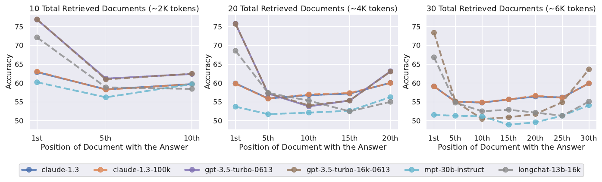

论文原图 5（第 5 页）。三张小图分别是 10、20、30 份文档。横轴是答案文档的位置，纵轴是准确率（%），每条线一个模型。**怎么读**：先看每条线的形状——几乎都是两头高、中间低；再对比三张图——文档越多，中间的“凹陷”越深越宽；最后注意紫色实线（GPT-3.5-Turbo）和棕色虚线（它的 16K 版）在左边两张图里几乎重合。

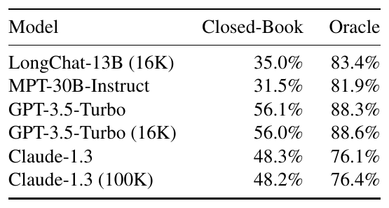

论文原表 1（第 5 页）。左列是闭卷准确率（不给文档），右列是只给正确文档时的准确率。**怎么读**：拿图 5 中间位置的数字和这两列比。

把 GPT-3.5-Turbo 在 20 份文档下的完整数字（附录表 6）放在参照线之间看：

| 答案位置 | 第 1 位 | 第 5 位 | 第 10 位 | 第 15 位 | 第 20 位 |
|---|---|---|---|---|---|
| 准确率 | 75.8% | 57.2% | 53.8% | 55.4% | 63.2% |
| 与闭卷（56.1%）相比 | +19.7 | +1.1 | **−2.3** | −0.7 | +7.1 |

算一下：最好与最差相差 75.8 − 53.8 = **22.0 个百分点**；答案在第 10 位时，比不给任何文档还低 2.3 个百分点。也就是说，**把正确答案放进上下文的中间，不但没帮上忙，还起了反作用**（干扰文档把模型带偏了）。而只给正确文档时是 88.3%，可见模型并不是读不懂答案，而是在一堆文档里没有用好它。

**结论**：曲线不是平的（否定 A），也不是单调的（否定 B 和 C），而是 U 形。扩展上下文版本与普通版几乎重合（否定 E）。

**表中的例外**：Claude-1.3 的曲线比 GPT-3.5 平得多（20 份文档时最好 60.1%、最差 55.9%，差约 4 个百分点）；MPT-30B-Instruct 整体准确率低，凹陷也浅。所以“U 形”的严重程度因模型而异。

### 实验 2：键值查找——是“找不到”还是“用不好”

**动机**：问答任务需要理解语言，模型表现差，可能是因为没找到，也可能是找到了却没理解。作者设计了一个**几乎不需要理解的任务**：给一串 JSON 格式的“键:值”对，键和值都是随机生成的长串（UUID），问某个键对应的值。只要找到完全相同的那串字符，抄出后面的值就行（图 6，第 6 页）。

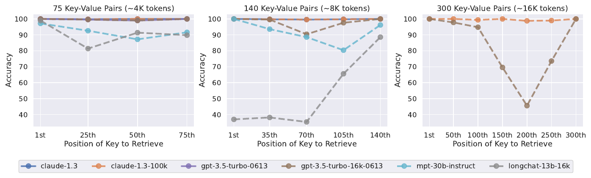

论文原图 7（第 7 页）。三张小图分别是 75、140、300 个键值对（约 4K、8K、16K token），横轴是目标键的位置，纵轴是准确率（%）。**怎么读**：Claude-1.3 的两条线贴着 100% 的顶部；但 GPT-3.5-Turbo（16K）在 300 对时，中间位置跌到约 45%，形成一个很深的 V。

**结论**：对部分模型来说，连“逐字找到一串字符”这种最基本的检索，在长输入的中间都会失败。所以问题至少有一部分出在“找”这一步，而不只是“理解”。同时，Claude-1.3 在这个任务上几乎满分，说明这并不是所有模型的必然局限。

### 实验 3：真实场景——多给资料值不值

**动机**：前面的实验都是“恰好一份含答案”的人工设置。真实 RAG 里，检索回来的前 k 份可能有好几份含答案，也可能一份都没有。

**设置**：用检索系统（Contriever）从维基百科取回前 k 份文档（k 从 5 到 50），直接放进提示词，测两个数：**检索召回率**（前 k 份里有没有含答案的文档，第 03 章的 recall@k）和**模型准确率**。

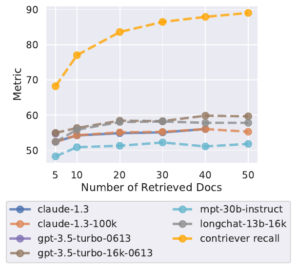

论文原图 11（第 10 页）。横轴是检索的文档数，橙色虚线是检索召回率，其他线是各模型的答题准确率（%）。**怎么读**：橙色线从约 68% 一路涨到近 90%，说明多检索确实能把答案“找进来”；但模型的线在 20 份左右就基本平了。两条线之间的差距，就是“找进来了却没用上”的部分。

**结论**：从 20 份加到 50 份，GPT-3.5-Turbo 只提高约 1.5%，Claude-1.3 约 1%（第 3、10 页），而输入长度（以及成本和延迟）多了一倍多。作者据此建议：**把相关文档重排到前面**，或者**适当少检索一些**。

## 第五层：深入——作者怎样排除其他解释

一个好的研究不会停在“发现了现象”，而是主动找“还有什么别的解释”，再一一排除。这篇论文在正文第四节和附录中做了下面这些检查。

### 排除“实验设计造成的假象”（预测表 D）

| 担心 | 作者的检查 | 结果 |
|---|---|---|
| 干扰文档按相关度从高到低排列，模型可能学过“搜索结果越靠前越重要” | 附录 C：随机打乱干扰文档，并在指令里写明“搜索结果是随机排序的” | 仍是 U 形（图 14） |
| 干扰文档太像答案，问题出在“分辨不出”而不是“位置” | 附录 B：改用随机的维基百科段落作干扰 | 准确率整体更高，但中间仍然下降（图 13） |
| 数据集本身有歧义（有些干扰文档其实也含合理答案） | 附录 A：只用无歧义的子集重做 | 结论相同（图 12） |
| 结论只适用于这几个模型 | 附录 D：在 500 题的子集上测 GPT-4 | 准确率更高，但仍是 U 形（图 15） |

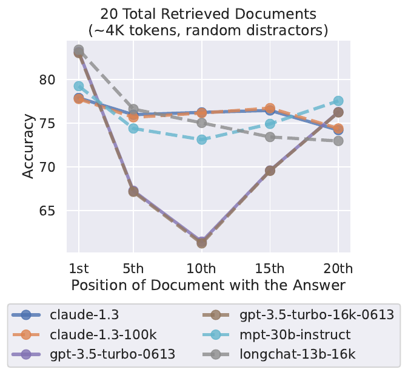

论文原图 13（第 15 页）。和图 5 中间那张一样的设置（20 份文档），只是干扰文档换成了随机段落。**怎么读**：纵轴的起点变高了（任务变容易了），但 GPT-3.5-Turbo 的两条线在第 10 位仍然深深下凹。

### 追问“为什么会这样”：三个初步探究

作者坦白这部分是“初步的探究”（第 7 页）。每一项都是一个假设，加一个能检验它的对比。

**假设 1：和模型结构有关。** 仅解码器模型读每个词时只能回头看。作者用两个编码器-解码器模型（Flan-T5-XXL、Flan-UL2）对比。

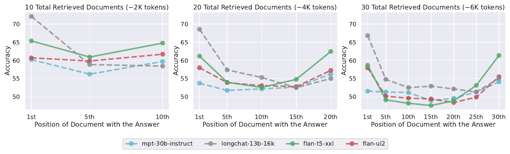

论文原图 8（第 8 页）。绿色和红色是编码器-解码器模型，蓝色和灰色是仅解码器模型。**怎么读**：左图（10 份文档，在 Flan-UL2 的训练长度以内）中 Flan-UL2 的线很平，最好与最差只差 1.9 个百分点；中图和右图（输入超过训练长度）它也出现了 U 形。

结论：编码器-解码器结构在**训练时见过的长度以内**比较稳健，超出后同样出问题。作者的解释（推测）是：双向编码器能“前后对照”地看每份文档，更容易判断哪份重要。

**假设 2：问题放在最后，模型读文档时还不知道要找什么。** 仅解码器模型读文档时，问题还没出现。作者把问题在文档**前后各放一次**（“带着问题读”，query-aware contextualization）。

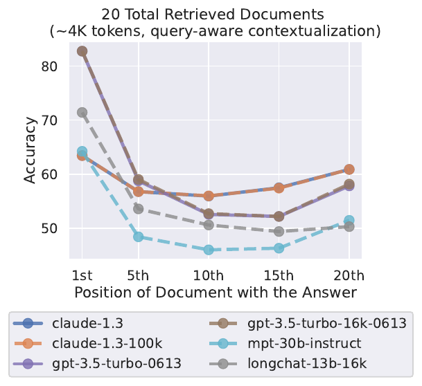

论文原图 9（第 8 页）。设置同图 5 中图，只是问题在文档前后各出现一次。**怎么读**：和图 5 中图对比——第 1 位升高了，其他位置反而略降，U 形基本没变。

结论出现了**转折**：这个办法让键值查找几乎全部满分（GPT-3.5-Turbo 16K 在 300 对时从最差 45.6% 升到 100%），但对多文档问答几乎没用。说明“精确查找”和“在多份文档中挑出有用的并理解”是两种不同的难度。

**假设 3：指令微调造成的。** 微调数据里任务说明通常放在开头，可能让模型更看重开头。作者对比 MPT-30B 的基础版（未做指令微调）和指令版。

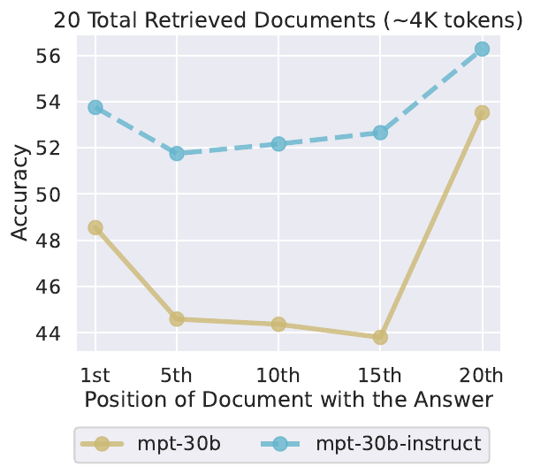

论文原图 10（第 9 页）。黄色是基础模型，蓝色是指令微调后的模型。**怎么读**：两条线都是 U 形；微调后整体升高，凹陷变浅（最好与最差的差距从近 10 个百分点降到约 4 个）。

结论：U 形**不是指令微调造成的**，基础模型本来就有。作者又在附录 E 用 Llama-2 的 7B、13B、70B 三种规模做了对比：

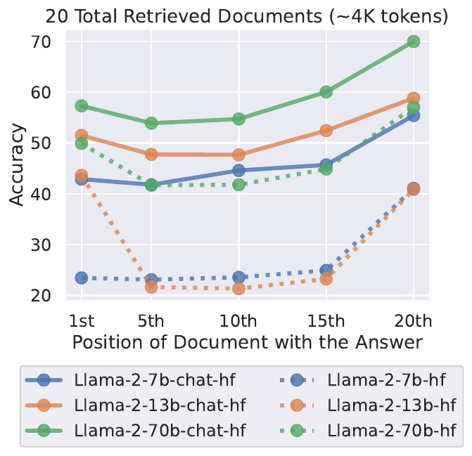

论文原图 16（第 16 页）。实线是对话微调版，点线是基础版；颜色代表 7B、13B、70B 三种规模。**怎么读**：蓝色（7B）只在最右端升高，只有“近因偏好”；橙色、绿色（13B、70B）两端都高，是 U 形。

这里又有一个意外：**“首因偏好”只出现在足够大的模型上**，7B 模型只有近因偏好。作者据此推测，早期研究只发现近因偏好，是因为它们研究的模型太小（不到 10 亿参数）。这是一个用新数据解释旧结论的好例子。

## 第六层：复盘这篇论文的推理

### 论证地图

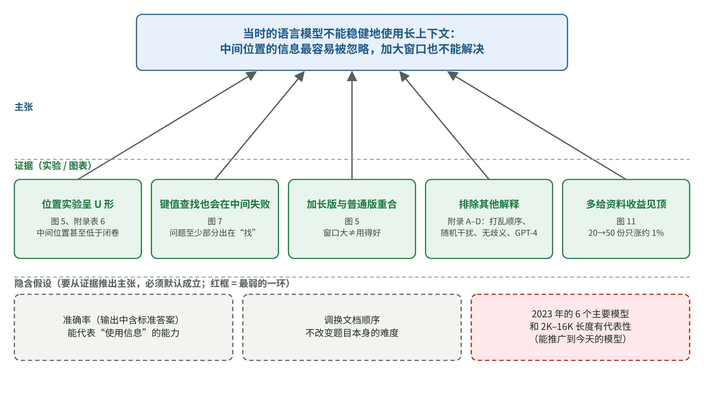

本文的论证地图（读者重建的教学示意图）。最上面是核心主张；中间是支撑它的证据；虚线框是要从证据推出主张时**默认成立的假设**；红框标出最弱的一环。

用一段话复述这条推理：

> 因为大家在评价长上下文模型时只看“装得下多少”，作者提出：模型能否稳健使用输入中任意位置的信息？如果能，准确率应该不随位置变化。作者构造了“只动位置”和“只动长度”的对照实验，发现准确率呈 U 形，中间位置甚至低于不给文档。为了排除“是实验设计造成的”，作者打乱顺序、换随机干扰、用无歧义子集、加测 GPT-4，结论都不变；为了区分“找不到”和“用不好”，作者设计了无语义的键值查找任务，发现部分模型连查找都会在中间失败。由此得出：当时的语言模型不能稳健地使用长上下文，评价长上下文模型时应测试不同位置下的表现。

**最弱的一环**：所有结论都来自 2023 年的 6 个主要模型和 2K–16K token 的输入长度。“今天的模型、更长的输入是否仍然如此”，这篇论文回答不了。第 02 章提到的 Chroma 2025 年报告就在新模型上发现，位置的影响在它的任务里不再显著，而其他长上下文问题依然存在。

### 意外与转折

1. **中间位置比闭卷还差**：作者在引言里就特别强调了这一点。它说明给模型资料不一定是“只赚不赔”。
2. **问题前置**对精确查找几乎是“特效药”，对问答却没用。作者没有回避这个不一致，而是如实报告，并据此区分了两种能力。
3. **基础模型也是 U 形**，推翻了“指令微调造成首因偏好”的猜想。
4. **首因偏好只在大模型出现**，顺带解释了早期研究为什么没看到。

### 作者没有走的路（读者推断）

- **打开模型看内部**：分析注意力到底分配到了哪里。这能直接回答“为什么”，但需要访问模型内部，对 GPT-3.5、Claude 这类闭源模型做不到。作者选择只看输入和输出，换来了可以覆盖闭源模型。
- **提出并训练一个改进方法**：论文只做“诊断”，没有做“治疗”。好处是结论更干净，代价是读者得自己想办法（作者在第五节给了重排和截断两个方向）。
- **测更多真实任务**：例如长文档摘要、多轮对话。成本是主要限制——作者提到，在完整实验上测 GPT-4 要花 6000 美元以上（第 5 页脚注）。

### 可以带走的思考方法

1. **只动一个变量**：怀疑某个因素有影响时，构造“其他都一样，只有它不同”的对照。**在你的工作中**：想知道“资料放在提示词前面还是后面更好”，就用同一批问题、同一批资料，只改顺序，跑两遍评测。
2. **给结果找参照线**：一个数字单独看没有意义，要和“最差情况”（闭卷）、“最好情况”（只给正确资料）放在一起看。**在你的工作中**：评估 RAG 时，同时测“不检索”和“直接给正确资料”两种情况，你就知道检索和排序分别损失了多少。
3. **两种解释打架时，造一个只能用其中一种解释的任务**：本文的键值查找就是这样。**在你的工作中**：分不清是“检索没找到”还是“模型没用好”，就先单独测检索的召回率（第 03 章），再单独测“只给正确资料时模型答得对不对”。

## 局限与证据边界

1. **模型较旧** → 影响“结论能否推广到今天的模型”。文中的模型都是 2023 年的；新模型在长上下文训练上下了很大功夫。读者应把它当作“需要在自己的模型上验证的风险”，而不是确定的事实。
2. **任务较窄** → 影响“结论能否推广到其他任务”。主要是“恰好一份文档含答案”的问答和键值查找；摘要、多跳推理、多轮对话没有测。
3. **长度较短** → 影响“超长上下文”的判断。最长约 16K token，远小于今天常见的 100 万 token。
4. **原因部分是推测** → 第四节的三个探究，作者自己称为“初步的”；对编码器-解码器为什么更稳健的解释，是作者的假设而非证明。
5. **准确率的算法较宽松** → 只要输出里出现标准答案就算对，可能把“答案夹在一堆错误内容里”的情况也算作正确。这对位置效应的比较影响不大，因为所有位置用的是同一标准。

阅读范围：正文与附录 A–G 全部读过，关键数字核对了附录表 5–7；没有运行作者公开的代码和数据。

## 对 AI 应用负责人的意义

1. **RAG 系统一定要有重排序**，把最相关的资料放到最前（或最后）。
2. **检索数量要用评测来定**，而不是越多越好。可以按本文图 11 的做法，同时画“召回率”和“答题准确率”两条线，找到准确率不再上升的那个点。
3. **长提示词里，最重要的指令和资料不要埋在中间**。
4. **选模型时做一次“位置测试”**：把关键信息放在开头、中间、结尾，看你的候选模型表现是否稳定。不同模型差别很大（本文中 Claude-1.3 就比 GPT-3.5 平稳得多）。

## 与其他知识的连接

- **第 02 章 Context Rot（Chroma，2025）**：两年后在 18 个新模型上测试，发现输入变长时表现仍不稳定，但在它的“大海捞针”任务里位置影响不显著。两份研究合在一起看，说明“长上下文不可靠”这个大方向仍然成立，具体形态随模型和任务变化。
- **第 03 章 RAG**：本文的“重排序”“少检索”建议，在今天的 RAG 系统里已经是标准做法；Anthropic 的 Contextual Retrieval 也把重排序作为提升的一环。
- **第 05 章评测**：本文提出的“新评测方案”——评价长上下文能力时要报告最好与最差位置的差距——就是一种评测设计思想。

## 术语表

| 中文 | 英文 | 白话解释 | 首次出现 |
|---|---|---|---|
| 上下文窗口 | context window | 模型一次能看到的 token 上限 | 第一层 |
| 多文档问答 | multi-document QA | 给一堆文档，其中一份含答案，让模型回答 | 第二层 |
| 干扰文档 | distractor | 看上去相关、其实不含答案的文档 | 第二层 |
| 闭卷 | closed-book | 不给任何资料，只靠模型自己的知识 | 第二层 |
| 开卷（只给正确文档） | oracle | 只给含答案的那份文档 | 第二层 |
| 首因效应 / 近因效应 | primacy / recency bias | 更容易记住或使用开头 / 结尾的内容 | 第二层 |
| 系列位置效应 | serial-position effect | 心理学中“记得开头和结尾、忘了中间”的现象 | 第二层 |
| 贪心解码 | greedy decoding | 每步都选概率最高的词，不抽签 | 第二层 |
| 仅解码器 / 编码器-解码器 | decoder-only / encoder-decoder | 两种模型结构，前者只能回头看，后者先通读全部输入 | 第二层 |
| 键值查找 | key-value retrieval | 给一堆“键:值”对，找出指定键的值 | 第四层 |
| 召回率 | recall | 检索结果里有没有含答案的文档 | 第四层 |
| 带着问题读 | query-aware contextualization | 把问题放在资料前后各一次 | 第五层 |
| 指令微调 | instruction fine-tuning | 用“指令—回答”数据训练模型当助手 | 第五层 |

## 自测

1.（复述）用三句话说清这篇论文发现了什么、怎么发现的。

发现：模型使用上下文中的信息时，开头和结尾的最好，中间的最差，呈 U 形；扩大窗口不能解决。方法：同一批问题和文档，只改变含答案文档的位置或干扰文档的数量，测准确率，并和“不给文档”“只给正确文档”两条参照线比较。补充：用打乱顺序、随机干扰、无歧义子集、GPT-4 等检查排除了其他解释。

2.（手算）根据附录表 6，GPT-3.5-Turbo 在 20 份文档下，答案在第 15 位时的准确率是 55.4%。它比闭卷高还是低？比只给正确文档低多少？

闭卷是 56.1%，55.4% 比闭卷低 0.7 个百分点；只给正确文档是 88.3%，低了 32.9 个百分点。

3.（迁移）你的客服系统每次检索 30 段资料放进提示词。根据本文，你会建议团队做哪两个实验？

一是“数量实验”：分别检索 5、10、20、30 段，同时记录召回率和答题准确率，找到准确率不再提升的点。二是“位置/排序实验”：加入重排序，把最相关的放在最前，对比不重排时的准确率。两者都要用同一批测试问题。

4.（思路）如果实验结果是“曲线单调上升，越靠后越好”，作者的结论应该怎样改写？

那就只说明模型有近因偏好（预测表中的 B），而不是 U 形。结论会变成“模型更擅长使用靠近问题的信息”，实际建议也会变成“把最相关的资料放在最后、紧挨着问题”。这说明预测表的价值：不同的结果对应不同的结论和做法，事先写清楚，才不会事后随意解释。

5.（思路）要验证“今天的模型是否还有这个问题”，你会怎样设计一个最小实验？

沿用本文的方法：选 50–100 个你业务里的真实问题，每题准备 1 份含答案的资料和 19 份相关但不含答案的资料，把含答案的资料分别放在第 1、5、10、15、20 位，用你的候选模型各跑一遍，比较准确率；同时测“不给资料”和“只给正确资料”两种情况作参照。

---

[上一篇](./06_%E4%B8%B2%E8%AE%B2%E4%B8%8E%E5%86%B3%E7%AD%96%E8%A1%A8.md) · [下一篇](./P2_%E7%B2%BE%E8%AF%BB_ReAct.md) · [专题目录](README.md) · [知识库首页](../../README.md)
