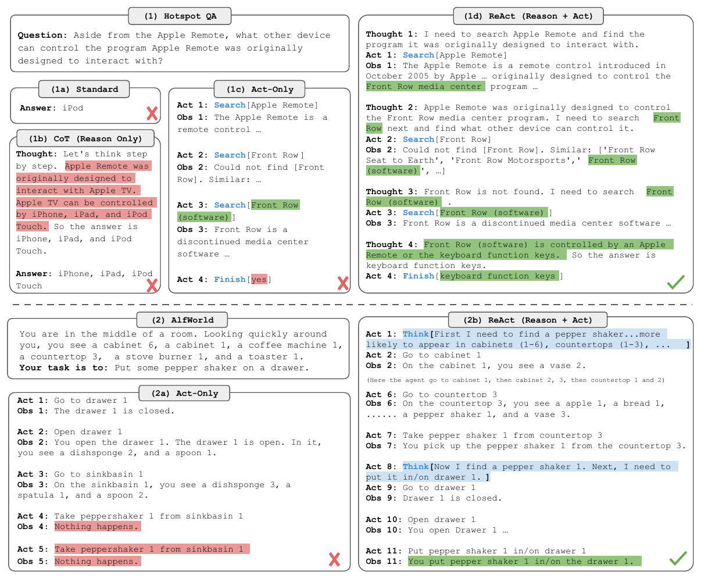
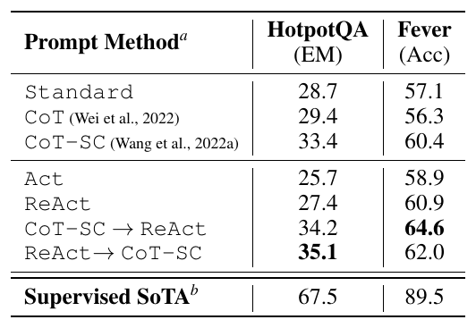
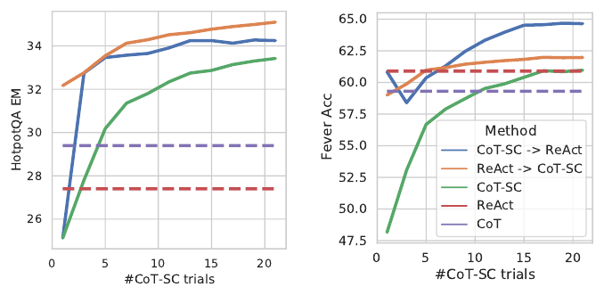
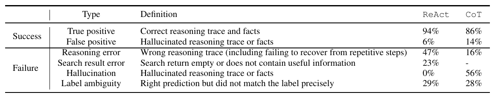
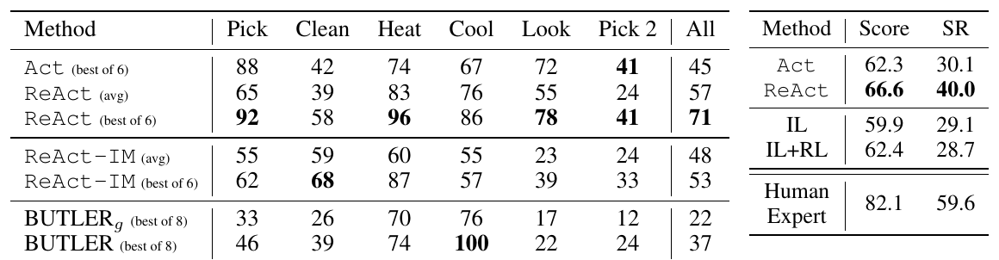
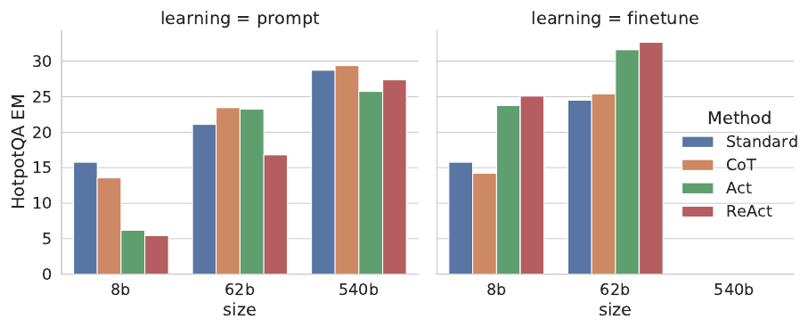
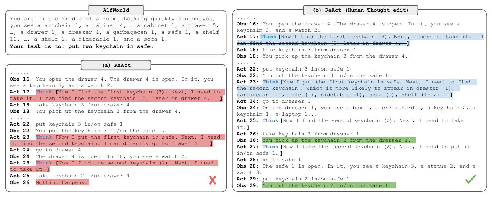
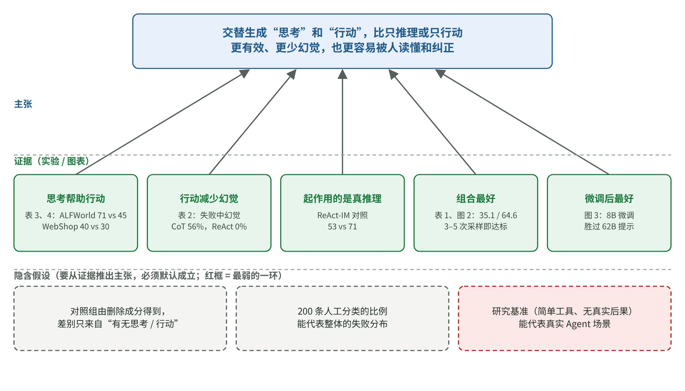

# ReAct 论文精读：模型怎样把推理、行动和外部证据接起来

[知识库首页](../../README.md) · [本专题目录](README.md)

> **阅读目标**：沿着原始任务轨迹观察推理与行动怎样衔接，再看成功率之外被掩盖的失败。

本文目录

- [第一层：5 分钟读懂](#section-1)
- [第二层：补概念](#section-2)
- [第三层：研究者是怎么想的](#section-3)
- [第四层：结果逐图读懂](#section-4)
- [第五层：深入——意外、对照与补充证据](#section-5)
- [第六层：复盘这篇论文的推理](#section-6)
- [局限与证据边界](#section-7)
- [对 AI 应用负责人的意义](#section-8)
- [与其他知识的连接](#section-9)
- [术语表](#section-10)
- [自测](#section-11)

**原文**：Shunyu Yao, Jeffrey Zhao, Dian Yu, Nan Du, Izhak Shafran, Karthik Narasimhan, Yuan Cao. *ReAct: Synergizing Reasoning and Acting in Language Models*. ICLR 2023。作者来自普林斯顿大学和谷歌研究院（Brain 团队）。本文依据 arXiv 2210.03629 第 3 版（2023-03-10），共 33 页；正文和附录 A、B 全部读过，附录 C–E 的提示词与示例轨迹浏览过。本地 PDF：[原文/P2_ReAct_ICLR2023.pdf](https://arxiv.org/pdf/2210.03629v3)。

**在本阶段的位置**：第 04 章 Agent 的源头论文。今天几乎所有 Agent（包括 Codex）的“思考 → 调用工具 → 看结果 → 再思考”循环，都可以追溯到这篇论文。

**怎么读**：只有 5 分钟，读第一层。第三层讲作者怎样设计出一组“公平”的对照实验，这是全文最值得学的部分。

## 第一层：5 分钟读懂

**一句话**：让模型交替写出“思考”和“行动”——想清楚下一步要做什么，做了之后看到结果，再根据结果继续想——比“只想不做”或“只做不想”都更好。

论文原图 1（第 2 页）。上半部分是一道问答题的四种做法：(1a) 直接回答，(1b) 只想不做（思维链），(1c) 只做不想（只搜索），(1d) 边想边做（ReAct）。下半部分是一个文字版家务游戏的两种做法：(2a) 只做不想，(2b) 边想边做。**怎么读**：红色高亮是错误或幻觉，绿色是有用的信息，红叉和绿勾是最终对错。注意 (1b) 一路“推理”得很流畅却编造了事实；(1c) 搜到了关键信息却没能用它得出答案；只有 (1d) 答对。

**三个最重要的发现**：

1. **思考帮助行动**：在需要很多步操作的任务上，加了“思考”的版本大幅领先。文字家务游戏 ALFWorld 中，最好成绩 71% 对 45%；网购任务 WebShop 中，成功率 40% 对 30%。
2. **行动帮助思考**：在需要查事实的任务上，能查资料的版本幻觉少得多。人工分析 200 条记录发现，“只想不做”的失败案例中有 56% 是幻觉，ReAct 是 0%。
3. **两者各有短板，组合最好**：ReAct 偶尔会陷入重复或被无用的搜索结果带偏；把它和“只想不做”的方法按规则切换着用，效果最好。

**对你最直接的三条启示**：

1. Agent 的每一步都应该先“说出理由”再行动，这让它更可靠，也让你能**读懂它为什么这样做**、出错时能定位。
2. 需要准确事实时，给模型查资料的工具，比让它“凭记忆推理”可靠得多。
3. Agent 会陷入循环、会被糟糕的工具结果带偏——这两种失败模式今天依然常见，要在设计时预防（步数上限、更好的工具）。

## 第二层：补概念

### 概念卡：思维链（chain of thought，CoT）

第 02 章讲过：在示例里写出中间推理步骤，大模型就会模仿着先推理再回答。ReAct 论文称它为“只想不做”（Reason Only）。作者指出它的问题：它是一个**静态的黑箱**——推理完全依靠模型内部的知识，不和外部世界接触，所以容易**编造事实**，而且前面一步错了，后面会一路错下去（第 2 页）。

### 概念卡：行动与观察（action / observation）

**白话定义**：模型输出一个能被执行的指令（行动），环境执行后返回一段结果（观察）。这和第 04 章的“工具调用”是一回事。

本文问答任务里，作者给模型的工具只有三个（第 4 页）：

| 行动 | 做什么 |
|---|---|
| `search[实体]` | 返回该维基百科词条的前 5 句；找不到时，返回 5 个相似词条名 |
| `lookup[字符串]` | 在当前页面里找下一处包含该字符串的句子（相当于浏览器的 Ctrl+F） |
| `finish[答案]` | 提交答案，结束任务 |

作者特意说明，这个工具**比当时最好的检索系统弱得多**（只能按精确词条名查）。这是一个刻意的设计：工具越笨，模型越需要靠推理来决定“下一步该查什么”。

### 概念卡：少样本提示（few-shot prompting）

不训练模型，只在提示词里放几个完整的示例（这里是人工写好的“思考—行动—观察”轨迹），让模型照着做。本文的主要实验都是这样做的：问答任务用 6 个示例，事实核查用 3 个，家务游戏每类任务用 2 个，网购用 1 个。

### 小术语

- **HotpotQA**：多跳问答，答案需要综合两篇以上维基百科文章。例如“除了 Apple Remote，还有什么设备能控制 Apple Remote 最初设计要配合的那个程序？”
- **FEVER**：事实核查，判断一句话是“有证据支持”“被证据反驳”还是“证据不足”。
- **ALFWorld**：纯文字的家务模拟游戏，例如“把一个胡椒瓶放进抽屉”，可能要走 50 步以上。
- **WebShop**：模拟购物网站，有 118 万件真实商品，按用户要求找到并购买合适的商品。
- **EM（Exact Match，完全匹配率）**：答案和标准答案逐字一致才算对。100 题对了 27 题，EM 就是 27。
- **CoT-SC（自洽性）**：同一道题用思维链做 21 次（带一点随机性），取出现最多的答案。
- **PaLM-540B**：谷歌当时的大模型，5400 亿参数，本文主实验所用。

## 第三层：研究者是怎么想的

### 起点：两条路各走各的，各有各的毛病

作者注意到，2022 年时“让模型推理”和“让模型行动”是两个分开的研究方向（第 2 页）：

- **只推理**（思维链）：推理能力强，但与世界隔绝，会编事实，错误会沿着推理链传播。
- **只行动**（把模型当成行动策略，例如 WebGPT、SayCan）：能和环境交互，但不会对高层目标做抽象推理，也没有“工作记忆”来跟踪进度。

作者的灵感来自人：做饭时，我们会在动作之间自言自语——“菜都切好了，该烧水了”“没有盐，用酱油代替吧”“面团怎么做？查一下”（第 1 页）。**推理指导行动，行动又为推理提供新信息。**

**一句话**：大家要么让模型想、要么让模型做，作者想知道“边想边做”能不能带来系统性的好处。

### 把想法变成可以测的问题

| 层次 | 内容 |
|---|---|
| 日常说法 | 让模型边想边做，会不会更好？ |
| 研究问题 | 和只推理、只行动相比，交替生成推理和行动能否在不同类型的任务上稳定地更好？好在哪里，又有什么新问题？ |
| 可测量的量 | 四类任务（多跳问答、事实核查、文字游戏、网购）上的 EM、准确率、成功率；再加上对失败案例的人工分类 |

### 核心想法：把“思考”当成一种不影响世界的行动

论文第 2 节给了一个简洁的形式化描述。不用怕符号，我们一个个拆开。

**原文的设定**（第 3 页）：在第 t 步，智能体看到观察 ot，按照策略 π(at | ct) 选一个行动 at，其中 ct = (o1, a1, …, ot−1, at−1, ot) 是到目前为止的全部经历。

| 符号 | 读作 | 白话 |
|---|---|---|
| ot | 第 t 步的观察 | 工具或环境返回的结果，例如搜索到的句子 |
| at | 第 t 步的行动 | 模型发出的指令，例如 `search[Front Row]` |
| ct | 上下文 | 从开始到现在的全部观察和行动，也就是第 01 章说的“上下文窗口里的内容” |
| π(at \| ct) | 策略 | “在已知全部经历的条件下，下一步做什么”的规则；这里就是大模型本身 |
| A | 行动空间 | 所有能执行的行动（search、lookup、finish……） |
| L | 语言空间 | 所有能写出来的文字 |

**问题在哪里**：从“一长串经历”直接跳到“正确的下一步”，常常太难。图 1(1c) 里，模型搜到了关键信息，却没能把它和问题联系起来，最后答错。

**ReAct 的改动**只有一处：把行动空间扩大为 Â = A ∪ L，也就是“能执行的行动”**加上**“任意一段文字”。当模型选择输出一段文字（称为**思考**）时：

- 它**不改变外部世界**，所以没有新的观察；
- 但它**会被加进上下文**：ct+1 = (ct, 思考)，让下一步的决定有了更好的依据。

**一句话复述**：思考是一种“只写在草稿纸上、不对外执行”的行动，它的作用是整理现有信息，让下一个真正的行动选得更准。

作者列出了思考的几种用途（第 3 页）：拆解目标、制订计划、补充常识（“胡椒瓶更可能在柜子或台面上”）、从观察中提取要点、跟踪进度、处理意外并调整计划。

### 动手之前，有哪几种可能？

| 如果……成立 | 应该看到 | 实际看到（第四层详述） |
|---|---|---|
| A. 思考是多余的，会行动就够了 | ReAct ≈ 只行动 | ✗ ReAct 在四个任务上都优于只行动 |
| B. 行动是多余的，模型内部知识就够了 | ReAct ≈ 只推理 | 部分成立：事实核查上 ReAct 更好；**多跳问答上只推理反而略好**（意外，见第五层） |
| C. 起作用的只是“多了一些描述环境的文字”，不是真正的推理 | 只写“环境反馈式”思考的版本，效果和 ReAct 一样 | ✗ ALFWorld 上 71% 对 53% |
| D. 内部知识和外部信息各有所长 | 把 ReAct 和只推理组合起来，比任何单独一种都好 | ✓ 两个问答任务上组合方法都最好 |

### 最值得学的设计：所有对照组都从同一批示例“删出来”

比较不同提示方法时，一个常见的陷阱是：**每种方法用的示例不一样**，结果的差别可能只是因为某组示例写得更好。作者是这样避免的（第 5、7 页）：

1. 先人工写好 ReAct 格式的示例轨迹（思考 + 行动 + 观察）。
2. **删掉所有思考** → 得到“只行动”（Act）的示例；
3. **删掉所有行动和观察** → 得到“只推理”（CoT）的示例；
4. **全部删掉、只留问题和答案** → 得到“直接回答”（Standard）的示例。

这样，四种方法看到的是**同样的题目、同样的解题路线**，唯一的区别就是“有没有思考”“有没有行动”。作者在 ALFWorld 部分还专门写道：示例是从训练集随机抽的，“对 ReAct 和 Act 都不偏袒”，是一个公平、受控的比较。

| 设计 | 让什么保持不变 | 如果不这样做，会混淆什么 |
|---|---|---|
| 对照组从同一批 ReAct 示例中删除成分得到 | 示例题目、解题路线、示例数量 | 方法本身的差别和“示例写得好坏”的差别 |
| 故意用很弱的维基百科工具 | — | 工具太强时，看不出推理对“决定查什么”的作用 |
| ALFWorld 每类任务用 2 个示例的 6 种排列组合各跑一遍 | 结论不依赖于某一组恰好好用的示例 | 偶然挑中好示例造成的假象 |
| 人工给 200 条记录分类 | — | 只看总分，不知道“为什么赢”“为什么输” |
| 都用贪心解码（每步取概率最高的输出） | 去掉随机性 | 抽签带来的波动 |

## 第四层：结果逐图读懂

### 实验 1：问答与事实核查（检验预测 A、B、D）

论文原表 1（第 5 页）。上半是三种不行动的方法，下半是 ReAct 及其组合，最下面是当时专门训练的最好方法（Supervised SoTA）作参照。**怎么读**：先比 Act 和 ReAct（25.7→27.4，58.9→60.9），看思考的作用；再比 CoT 和 ReAct（29.4 对 27.4，56.3 对 60.9），看行动的作用；最后看加粗的组合方法。

**读数**：

- **ReAct 优于只行动**（两项都是）：思考帮助模型把搜到的信息组织成答案（预测 A 被否定）。
- **ReAct 对只推理**：事实核查上 60.9 对 56.3，ReAct 更好；多跳问答上 27.4 对 29.4，**ReAct 略差**。这是一个需要解释的意外。
- **组合最好**：HotpotQA 上“ReAct 失败时退回 CoT-SC”得 35.1；FEVER 上“CoT-SC 没把握时改用 ReAct”得 64.6（预测 D 成立）。

**组合的切换规则**（第 5 页）很像我们设计 Agent 时的“兜底策略”：

- **ReAct → CoT-SC**：如果 ReAct 在规定步数内（HotpotQA 7 步、FEVER 5 步）没给出答案，就改用多次推理投票。作者统计过，答对的轨迹中用满 7 步或 5 步的只有约 1%，所以这个上限基本不会误伤。
- **CoT-SC → ReAct**：如果 21 次推理里，得票最多的答案不到一半（说明模型自己也没把握），就改用 ReAct 去查。

论文原图 2（第 5 页）。横轴是 CoT-SC 采样的次数，纵轴左图是 HotpotQA 的 EM、右图是 FEVER 的准确率。虚线是不随采样次数变化的 ReAct 和 CoT。**怎么读**：蓝、橙两条组合方法的线在采样 3–5 次时，就达到了绿线（纯 CoT-SC）采样 21 次的水平——组合方法用更少的计算达到同样的效果。

### 为什么问答上 ReAct 会输：错误分析

作者没有停在“略输 2 分”，而是**从 ReAct 和 CoT 中各随机抽 50 条答对、50 条答错的记录，共 200 条，逐条人工分类**（第 6 页）。这正是第 05 章讲的“错误分析”方法。

论文原表 2（第 6 页）。上两行是答对的记录里“真对”和“蒙对（推理或事实是编的）”的比例；下面四行是答错记录里各类错误的比例。**怎么读**：横向比较 ReAct 和 CoT 两列，看每种错误谁多谁少。

| 发现 | 数字 | 含义 |
|---|---|---|
| CoT 的头号失败原因是幻觉 | 失败中 56% 是幻觉，ReAct 是 0% | 能查资料，就不必编 |
| CoT “蒙对”的比例更高 | 答对的里有 14% 推理或事实是编的，ReAct 6% | 只看答对率会高估 CoT 的可靠性 |
| ReAct 的头号失败原因是推理错误 | 47%（CoT 16%），其中常见的是**重复同样的思考和行动、跳不出循环** | “想一步做一步”的结构限制了推理的灵活性 |
| ReAct 的第二失败原因是搜索结果没用 | 23% | 一次无用的搜索会把后面的推理带偏 |
| 两者都有标注本身的问题 | 29% 和 28% 的“错误”其实是答对了但和标准答案措辞不同 | 评测本身也有误差（第 05 章“先检查评测本身”） |

这张表把“ReAct 略输”变成了一个清楚的权衡：**ReAct 更可靠（几乎不编造），CoT 更灵活（推理结构更自由）**。这正是作者提出组合方法的理由。

### 实验 2：文字家务游戏与网购（检验预测 A、C）

论文原表 3（左，第 8 页）：ALFWorld 六类任务和总体（All）的成功率（%）。论文原表 4（右）：WebShop 的平均得分和成功率（SR）。**怎么读**：表 3 先看最右列 All：ReAct 最好的一组 71，Act 最好的一组 45，专门训练的模仿学习方法 BUTLER 37；再看 ReAct-IM（只写环境反馈式思考）53。表 4 看 SR 列：ReAct 40.0，Act 30.1，模仿学习加强化学习 28.7，人类专家 59.6。

**读数**：

- ALFWorld：ReAct **表现最差的一组示例（48%）也超过了 Act 和 BUTLER 最好的一组**。在 6 组受控对比中，ReAct 相对 Act 的提升从 33% 到 90%，平均 62%（第 8 页）。注意 BUTLER 是用每类任务 10 万条专家轨迹训练出来的，ReAct 只用了 2 个示例。
- WebShop：只用 1 个示例的 ReAct，成功率比之前最好的方法高出约 10 个百分点；但离人类专家仍很远。
- **预测 C 被否定**：作者设计了一个对照 ReAct-IM，模仿此前的“内心独白”方法，思考只描述环境状态和还剩什么没做。它得 53%，ReAct 得 71%。差别在于 ReAct 的思考会**拆解目标、判断下一个子目标、用常识推断东西可能在哪里**——这些才是真正起作用的“推理”。

### 实验 3：换成微调会怎样

论文原图 3（第 7 页）。左图是只用提示（不训练），右图是用 3,000 条轨迹微调；横轴是模型大小（80 亿、620 亿、5400 亿参数），纵轴是 HotpotQA 的 EM。**怎么读**：左图小模型上红色（ReAct）最矮；右图微调后红色变成最高。

**意外**：在小模型上只用提示时，ReAct 是四种方法里最差的——小模型很难从几个示例里同时学会推理和行动。但**用 3,000 条 ReAct 自己生成的正确轨迹微调后**，ReAct 变成最好的：微调后的 80 亿参数模型超过了所有 620 亿参数模型的提示结果。作者的解释是：微调“直接回答”或“只推理”，教的是**记住**（可能是编造的）事实；微调 ReAct 和 Act，教的是**如何查找信息**，这是更能迁移的技能。

## 第五层：深入——意外、对照与补充证据

### 补充证据

- **换一个模型也成立**：附录 A.1 用 GPT-3（text-davinci-002）重做，HotpotQA 30.8、ALFWorld 78.4，都高于 PaLM-540B 的 29.4、70.9（第 14 页）。说明方法不依赖某一个模型。
- **能拿到最新信息**：附录 A.2 举了一个例子，HotpotQA 的标准答案已经过时（酒店房间数变了），只有 ReAct 通过实际查询给出了更新后的合理答案。这也提醒我们：“答错”有时是数据集的问题。
- **人可以改它的思考来纠偏**：附录 A.3 展示了在 ALFWorld 中，人只修改两句思考，就让原本失败的 ReAct 成功完成任务。

论文原图 5（第 15 页）。左边 (a) 是 ReAct 原本的轨迹：它以为第二个钥匙链还在抽屉 4，回去找扑了空（红色）。右边 (b) 是人修改了第 17 步和第 23 步的思考（蓝色）后，它改去梳妆台找到了钥匙链并成功（绿色）。**怎么读**：人没有替它执行任何动作，只是改了“草稿纸”上的两句话。

这一点对今天的产品设计很有启发：**思考是可读、可改的**，所以人可以用很低的成本介入 Agent 的工作（第 04 章的人工介入）。

### 作者对“为什么有效”的解释，哪些是证据，哪些是推测

| 说法 | 证据强度 |
|---|---|
| 行动减少了幻觉 | 有直接证据（表 2 的人工分类） |
| 思考帮助拆解目标、跟踪状态 | 有对照证据（ReAct 对 Act、ReAct 对 ReAct-IM）加上定性观察 |
| ReAct 的重复循环可能是贪心解码造成的，换更好的解码方式可能缓解 | 作者的推测（第 6 页脚注），没有实验 |
| 用更多人工标注数据微调能进一步提升 | 作者的推测，只有 3,000 条自生成数据的初步实验 |

## 第六层：复盘这篇论文的推理

### 论证地图

本文的论证地图（读者重建的教学示意图）。

用一段话复述：

> 推理和行动一直被分开研究：只推理会编造、会错上加错；只行动缺少对目标的抽象推理。受人“边想边做”的启发，作者把“思考”定义为一种只写进上下文、不影响环境的行动。为了公平比较，他们从同一批示例中删掉思考或行动来构造对照组。结果是：在多步操作任务上，加思考大幅提升成功率，而且真正起作用的是拆解目标和常识推理，不是单纯描述环境；在查事实的任务上，能行动使幻觉几乎消失，但结构约束带来了循环和被坏搜索结果带偏的新问题；把两种方式按“有没有把握”切换使用，效果最好。

**最弱的一环**：主实验依赖一个当时不公开的模型（PaLM-540B）和四个研究用基准任务。作者用 GPT-3 补了一组实验，但任务仍是研究基准，和真实业务中“工具很多、环境混乱、行动有真实后果”的情况差别很大。

### 意外与转折

1. **多跳问答上 ReAct 输给了只推理**：作者没有回避，而是用 200 条人工分类找到原因，并由此提出了组合方法。**一个“不好看”的结果，变成了论文的第二个贡献。**
2. **小模型上 ReAct 提示效果最差，微调后却最好**：说明“方法好不好”还取决于“怎么教给模型”。
3. **最弱的工具反而是好的设计**：限制工具能力，才让推理的作用显现出来。

### 作者没有走的路（读者推断）

- **训练一个专门的 Agent 模型**：论文主要用提示，只做了少量微调。好处是方法简单、人人可复现思路；代价是性能上限受限于提示能装下的示例。今天的模型（第 01 章讲的推理模型）已经把“边想边做”训练进了模型本身。
- **在真实、有风险的环境里测试**：作者在伦理声明中说明，他们故意把行动限制在维基百科和不能真正下单的模拟商店里（第 10 页）。这是负责任的选择，但也意味着论文没有回答“在真实系统里会出什么事”。
- **系统研究工具设计**：论文固定了工具，只研究推理。第 04 章 Anthropic 的经验恰好补上了另一半：工具设计往往比提示词更重要。

### 可以带走的思考方法

1. **对照组要从同一份材料里删出来**：比较两种做法时，确保除了要比较的那一点，其他完全一样。**在你的工作中**：比较“提示词加了推理步骤”和“没加”时，用同一批示例，只删掉推理部分。
2. **输了就做错误分析**：总分输了 2 分，不要急着放弃或调参，先抽样分类看输在哪里。**在你的工作中**：新方案总分没提高时，按第 05 章的方法看 50 条失败记录，常常会发现它在某一类问题上大幅更好、在另一类上更差，然后就能组合使用。
3. **故意削弱一个条件，让要研究的因素显现出来**：本文故意用很弱的搜索工具。**在你的工作中**：想测试“模型会不会主动核实信息”，就不要给它一个总能直接给出答案的工具。

## 局限与证据边界

1. **模型与时间** → 影响“今天是否依然如此”。主实验用的是 2022 年的 PaLM-540B，提示式方法；今天的推理模型已内置“先想后做”，具体数字不再适用，但“思考与行动互相促进”的结论在之后的 Agent 实践中被广泛采纳。
2. **任务是研究基准** → 影响“能否推广到你的业务”。四个任务的工具都很简单，行动没有真实后果。真实 Agent 面对的工具更多、环境更乱，风险更高（第 04 章的护栏）。
3. **人工分析的样本量** → 影响“错误类型比例的精确度”。表 2 基于 200 条记录，比例是大致的，适合看方向，不宜当精确数字引用。
4. **比较的公平性依赖示例** → 作者用“删除成分”的方法控制了示例，但示例本身是作者写的；不同人写的示例可能得到不同的数字。作者在 ALFWorld 上用 6 种示例组合缓解了这个问题。

阅读范围：正文与附录 A、B 全部读过，附录 C（提示词）、D、E（示例轨迹）浏览过；没有运行作者公开的代码。

## 对 AI 应用负责人的意义

1. **要求 Agent 在每次行动前写出理由**，并把理由记录进日志。这既提升效果，也让你能复盘和纠错。
2. **为“循环”和“坏结果”做预案**：设置步数上限；工具返回空结果或无用结果时，给出明确提示；超过上限时切换到兜底方案或交给人。
3. **按“有没有把握”切换策略**：模型对答案没把握时去查资料，有把握时直接回答——这是本文组合方法的思想，也是控制成本的实用办法。
4. **评测时同时看“答对的里有多少是蒙对的”**：只看准确率，会高估只靠记忆推理的方法。

## 与其他知识的连接

- **第 02 章思维链**：ReAct 是在思维链的基础上加入了行动。
- **第 04 章 Agent**：今天的工具调用、Agent 循环、Anthropic 的五种工作流模式，都是这个思想的工程化发展。
- **第 05 章评测**：本文的表 2 是一个典型的错误分析；附录 A.2 的“标准答案过时”提醒我们评测本身也会出错。
- **精读四（幻觉）**：本文显示，让模型能查资料是减少幻觉的有效办法；精读四从另一个角度解释了幻觉为什么会产生。

## 术语表

| 中文 | 英文 | 白话解释 | 首次出现 |
|---|---|---|---|
| 边想边做 | ReAct（Reason + Act） | 交替写出思考和行动 | 第一层 |
| 思维链 | chain of thought, CoT | 先写推理步骤再回答 | 第二层 |
| 行动 / 观察 | action / observation | 模型发出的指令 / 环境返回的结果 | 第二层 |
| 少样本提示 | few-shot prompting | 在提示词里放几个完整示例 | 第二层 |
| 多跳问答 | multi-hop QA | 需要综合多份资料才能回答的问题 | 第二层 |
| 完全匹配率 | exact match, EM | 和标准答案逐字一致才算对 | 第二层 |
| 自洽性 | self-consistency, CoT-SC | 多次推理取多数答案 | 第二层 |
| 策略 | policy, π | 根据当前经历决定下一步行动的规则 | 第三层 |
| 行动空间 | action space | 所有可执行行动的集合 | 第三层 |
| 消融 / 删除成分对照 | ablation | 去掉某个成分，看效果变化 | 第三层 |
| 模仿学习 / 强化学习 | imitation / reinforcement learning | 照着专家示范学 / 通过奖励和惩罚学 | 第四层 |
| 微调 | fine-tuning | 用新数据继续训练模型 | 第四层 |
| 人在回路 | human-in-the-loop | 人在过程中检查和纠正 | 第五层 |

## 自测

1.（复述）ReAct 中的“思考”和普通的“行动”有什么区别？为什么思考有用？

思考不会改变外部环境，也不会带来新的观察，但它会被写进上下文。它的作用是拆解目标、整理已有信息、跟踪进度、处理意外，让下一个真正的行动选得更准。

2.（手算）ALFWorld 中，ReAct 最好成绩 71%，Act 最好成绩 45%。ReAct 比 Act 高多少个百分点？相对提升多少？

高 71 − 45 = 26 个百分点；相对提升 26 ÷ 45 ≈ 58%。注意论文说的“平均相对提升 62%”是 6 组受控对比各自的相对提升的平均值，和这里用两个“最好成绩”算出的数不是一回事。

3.（思路）作者为什么要从 ReAct 示例中“删除成分”来构造对照组，而不是为每种方法另写示例？

为了保证各方法之间唯一的区别就是“有没有思考”“有没有行动”。如果另写示例，结果的差别可能来自示例的质量，而不是方法本身。

4.（思路）多跳问答上 ReAct 输给了 CoT。如果作者没做错误分析，直接报告“ReAct 在问答上不如 CoT”，会错过什么？

会错过两点：CoT 的高分里混着不少“蒙对”和幻觉，可靠性其实更低；ReAct 输在推理灵活性和坏搜索结果上，这两类问题和 CoT 的问题正好互补。正是这个分析引出了效果最好的组合方法。

5.（迁移）你的客服 Agent 偶尔会反复调用同一个查询工具、陷入循环。根据本文，你会建议哪些对策？

设置最大步数，超出后切换到兜底方案（例如直接回答“我需要转人工确认”）；在工具返回空结果时给出明确的提示，引导它换一种查询方式；在日志里记录每步的思考，用错误分析找出触发循环的典型情况，再针对性地改进提示词或工具。

---

[上一篇](./P1_%E7%B2%BE%E8%AF%BB_Lost-in-the-Middle.md) · [下一篇](./P3_%E7%B2%BE%E8%AF%BB_LLM%E5%BD%93%E8%AF%84%E5%AE%A1.md) · [专题目录](README.md) · [知识库首页](../../README.md)
