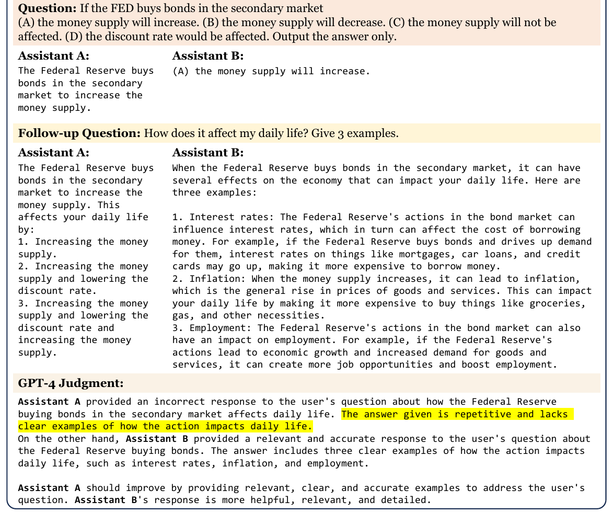
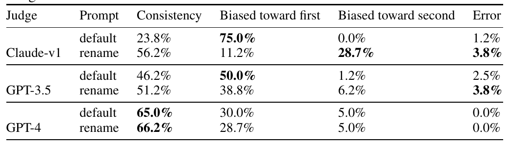
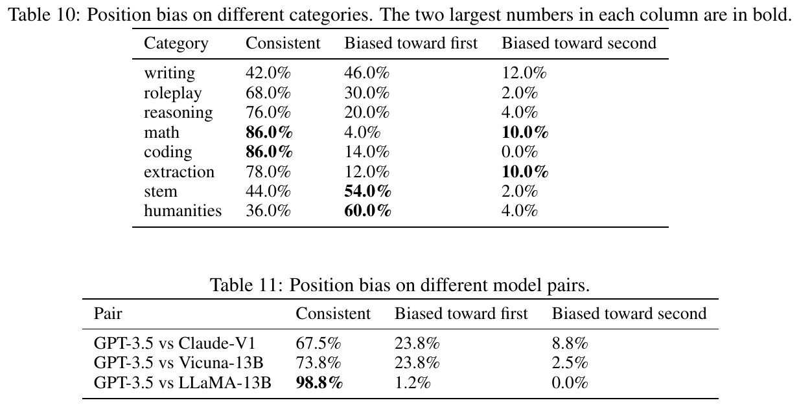
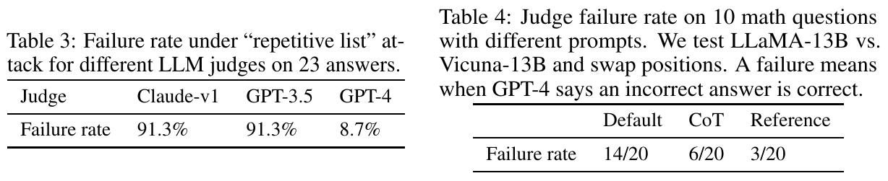
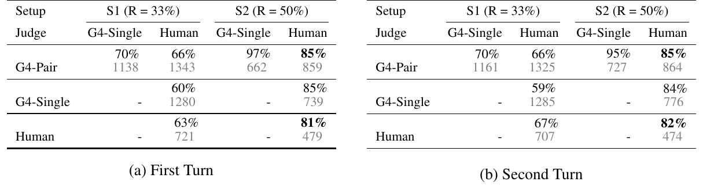
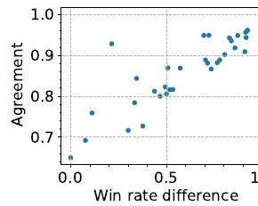
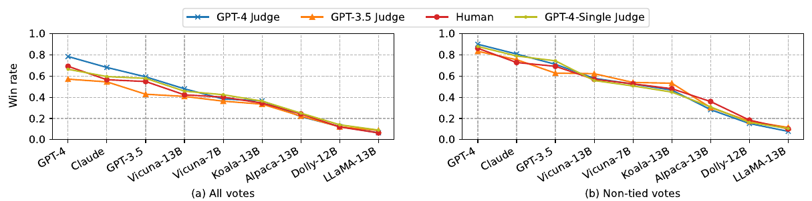
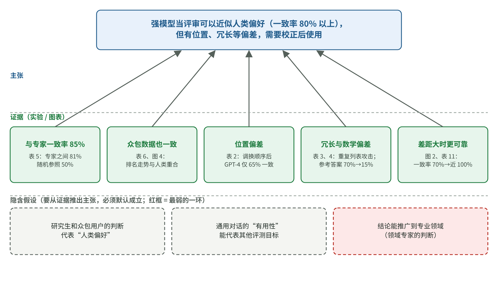

# 让大模型给大模型打分靠谱吗？从 MT-Bench 看懂评审偏差

[知识库首页](../../README.md) · [本专题目录](README.md)

> **阅读目标**：先检查评分工具自身的偏差，再讨论模型打分能在哪些条件下替代部分人工工作。

本文目录

- [第一层：5 分钟读懂](#section-1)
- [第二层：补概念](#section-2)
- [第三层：研究者是怎么想的](#section-3)
- [第四层：结果逐图读懂](#section-4)
- [第五层：深入——补救办法的代价](#section-5)
- [第六层：复盘这篇论文的推理](#section-6)
- [局限与证据边界](#section-7)
- [对 AI 应用负责人的意义](#section-8)
- [与其他知识的连接](#section-9)
- [术语表](#section-10)
- [自测](#section-11)

**原文**：Lianmin Zheng, Wei-Lin Chiang, Ying Sheng, Siyuan Zhuang, Zhanghao Wu, Yonghao Zhuang, Zi Lin, Zhuohan Li, Dacheng Li, Eric P. Xing, Hao Zhang, Joseph E. Gonzalez, Ion Stoica. *Judging LLM-as-a-Judge with MT-Bench and Chatbot Arena*. NeurIPS 2023（数据集与基准赛道）。作者主要来自加州大学伯克利分校，以及加州大学圣地亚哥分校、卡内基梅隆大学、斯坦福大学、MBZUAI。本文依据 arXiv 2306.05685 第 4 版（2023-12-24），共 29 页；正文与附录 D 全部读过，附录 A–C、E、F 浏览过。本地 PDF：[原文/P3_Judging-LLM-as-a-Judge_NeurIPS2023.pdf](https://arxiv.org/pdf/2306.05685v4)。

**在本阶段的位置**：第 05 章评测的核心依据。今天几乎每个团队都在用“让大模型给输出打分”，这篇论文第一次系统地回答了：它和人的判断有多一致，会犯哪些系统性错误，怎样减轻。顺带一提，这篇论文里的 Chatbot Arena 后来发展成了行业里最知名的模型排行榜之一（后来改名 LMArena，现在叫 Arena）。

**怎么读**：只有 5 分钟，读第一层。第三层讲作者怎样“先验证测量工具，再使用它”，第四层讲他们为每一种怀疑的偏差设计专门的测试——这两部分是全文最值得学的。

## 第一层：5 分钟读懂

**一句话**：用 GPT-4 这样的强模型当评审，它的判断和人类专家的一致程度，可以达到“人和人之间”的一致程度（80% 以上）；但它有位置偏差、偏爱长回答、容易被题目给出的错误答案带偏，需要用简单的办法加以校正。

**三个最重要的发现**：

1. **一致率够高**：只看双方都给出明确胜负的情况，GPT-4 与人类专家的一致率是 85%，人类专家之间是 81%（表 5）。
2. **偏差是真实存在的**：把两个回答调换顺序，GPT-4 只有 65% 的情况给出一致的判断；把一个回答里的列表“换个说法重复一遍”（不加任何新信息），较弱的评审模型有 91% 的情况认为变长后的更好。
3. **偏差可以减轻**：调换顺序评两次、两次一致才算赢；数学题先让评审自己做一遍再评分。后者把判错率从 70% 降到 15%。

**对你最直接的三条启示**：

1. 用模型当评审之前，**先拿一批人工标注过的样本检验它**，就像这篇论文做的那样。
2. 做“两个回答比哪个好”的评测时，**一定要调换顺序评两次**。
3. 涉及对错的评分（数学、事实、代码），**给评审一个参考答案**，不要让它“看着待评答案去判断”。

## 第二层：补概念

### 概念卡：用大模型当评审（LLM-as-a-Judge）

**要解决的问题**：开放式问题（写一篇游记、解释一个经济概念）没有唯一标准答案，没法用程序自动判对错；请人来评又慢又贵。

**白话定义**：把问题和待评的回答发给一个强大的模型，让它判断哪个更好，或者打一个分数，并写出理由。

论文提出三种用法（第 4 页）：

| 用法 | 做法 | 优点 | 缺点 |
|---|---|---|---|
| 成对比较 | 给两个回答，判断哪个更好或平局 | 相对比较更稳定 | 被比较的模型越多，需要比较的组合数增长得越快 |
| 单个打分 | 给一个回答，打 1–10 分 | 容易扩展 | 分数容易波动，细微差别看不出 |
| 参照评分 | 给出参考答案，再评分 | 适合有标准答案的题目 | 需要准备参考答案 |

### 概念卡：一致率（agreement）

**白话定义**：随机抽一道题，再从两类评审里各随机抽一位（例如一位人类专家和 GPT-4），两者判断相同的概率（第 7 页）。

**最小例子**：如果两个评审都是**闭着眼乱选**“A 好”或“B 好”，一致的概率是 50%（两人选同一个的机会一半）。如果还允许选“平局”，三选一乱选，一致的概率是 1/3 ≈ 33%。这就是论文表格里写的 “R = 50%” 和 “R = 33%”——**随机参照线**。85% 的意义要和 50% 比着看。

论文报告两种口径：

- **S1**：所有投票都算，包括平局；调换顺序后判断不一致的也算作平局。随机参照线 33%。
- **S2**：只算双方都给出明确胜负的投票。随机参照线 50%。

### 概念卡：两个新的评测集

为了检验评审，作者先要有**人类的判断作为标准**，于是建了两个数据集：

- **MT-bench**：80 道两轮对话的问题，分 8 类（写作、角色扮演、信息提取、推理、数学、编程、理工知识、人文社科知识），每类 10 道，都是作者手工设计、能拉开模型差距的难题（第 3 页）。例如第一轮“写一篇夏威夷游记”，第二轮“改写上一段，每句话以字母 A 开头”。
- **Chatbot Arena**：一个众包平台。用户同时和两个匿名模型聊天，选出更好的那个，投票后才揭晓是哪两个模型。运行一个月收集了约 3 万票（第 4 页）。

### 小术语

- **MMLU**：一个包含大量学科选择题的传统基准，测模型的知识。
- **RLHF**：基于人类反馈的强化学习（第 01 章），让模型更符合人的偏好。
- **胜率**（win rate）：一个模型在和其他模型的对比中胜出的比例。

## 第三层：研究者是怎么想的

### 起点：用户觉得好用的模型，考试分数却看不出来

作者注意到一个矛盾（第 1–2 页）：经过对话训练（指令微调和 RLHF）的聊天模型，用户明显更喜欢；可在 MMLU 这类传统基准上，它们和未经对话训练的基础模型**分数差不多**。

论文原图 1（第 2 页）。助手 A 是未经对话训练的 LLaMA-13B，助手 B 是在它基础上用对话数据微调的 Vicuna-13B。第一个问题来自 MMLU 选择题，两者都答对了；追问“对我的日常生活有什么影响？举 3 个例子”时，A 只会重复同一句话，B 给出了三个清楚的例子。最下面是 GPT-4 的评语。**怎么读**：选择题测不出两者的差别，但任何一个人都能看出 B 更好用。

**一句话**：传统基准测的是“知道什么”，用户在意的是“好不好用”，两者之间有一道缝。需要一种能衡量“人类偏好”、又能大规模自动运行的评测方法。

### 把问题变成可以测的问题

| 层次 | 内容 |
|---|---|
| 日常说法 | 能不能让大模型代替人来评价聊天机器人？ |
| 研究问题 | 强模型当评审时，它的判断和人类偏好有多一致？它有哪些系统性偏差？能否减轻？ |
| 可测量的量 | 评审与人类专家、众包用户之间的一致率；针对每种偏差设计的专项测试中的失败率 |

### 关键思路：先验证测量工具，再用它

这篇论文的逻辑顺序值得记住：

1. **先造“标准答案”**：请 58 位专家级标注者（主要是研究生）对 MT-bench 投了约 3,000 票；从 Arena 的 3 万票里随机取 3,000 票（第 7 页）。
2. **再拿评审去对**：用同样的题目让模型评审投票，计算和人类的一致率。
3. **专门找它的毛病**：为每一种怀疑的偏差设计一个测试。
4. **提出补救办法并验证**。
5. **最后才用它**：用验证过的 GPT-4 评审给一批模型打分（表 8）。

这和第 05 章的建议完全一样：**模型评审员就是一个测量工具，使用前要先用人工标注校准。**

### 动手之前，有哪几种可能？

| 如果……成立 | 应该看到 | 实际看到 |
|---|---|---|
| A. 强模型评审和人一样可靠 | 与人类的一致率接近人与人之间的一致率 | ✓ S2 口径 85% 对 81% |
| B. 评审会被表面特征（位置、长度）左右 | 调换顺序、加长内容时判断改变 | ✓ 都存在，较弱的模型尤其严重 |
| C. 评审能正确判断它自己会做的题 | 数学题上很少判错 | ✗ 会被待评答案中的错误带偏 |
| D. 评审偏爱自己生成的答案 | 评审给自己的胜率高于人类给的 | 无法确定（作者如实承认） |

### 每个测试在排除什么

| 怀疑的偏差 | 测试设计 | 为什么这样设计 |
|---|---|---|
| **位置偏差**：偏爱放在前面（或后面）的回答 | 用 GPT-3.5 对同一题生成两个相似的回答，**调换顺序各评一次**，看判断是否一致 | 两个回答质量相近，任何不一致都只能来自位置 |
| 区分“偏爱位置”还是“偏爱名字” | 把提示中的“助手 A / 助手 B”换个名字（rename）再测 | 如果换名字后偏好也跟着变，说明偏的是名字 |
| **冗长偏差**：偏爱更长的回答 | “重复列表”攻击：把回答里的列表换个说法再加一遍，**不增加任何新信息**，看评审是否认为加长版更好 | 内容完全相同，只有长度不同 |
| 测试本身是否靠谱（校准） | 给评审两个**完全相同**的回答 | 评审都判平局，说明它不是乱判，后面的失败确实来自长度 |
| **数学评判能力** | 10 道数学题，调换顺序共 20 次判断，看评审是否把错误答案判为正确 | 这些题 GPT-4 单独做是会做的 |

## 第四层：结果逐图读懂

### 结果 1：位置偏差

论文原表 2（第 5 页）。每一行是一个评审模型和一种提示写法（default 默认、rename 换名字）。“一致”是调换顺序后判断不变的比例；“偏向第一个/第二个”是因为位置而改变判断的比例；“错误”是输出格式不对。**怎么读**：先看“一致”列，越高越好；再看“偏向第一个”，越低越好。

| 评审 | 一致 | 偏向第一个 |
|---|---|---|
| Claude-v1 | 23.8% | 75.0% |
| GPT-3.5 | 46.2% | 50.0% |
| GPT-4 | 65.0% | 30.0% |

**读数**：所有评审都有明显的位置偏差，大多偏向第一个；只有 GPT-4 超过 60% 的情况能保持一致。Claude-v1 换名字后，一致率从 23.8% 升到 56.2%，偏好转向了“第二个”——说明它偏的部分是“助手 A”这个**名字**（第 5 页）。

**这个测试很严格**：两个回答质量本来就很接近，有时连人都分不出。附录 D.1 的补充数据说明了位置偏差在什么时候更严重：

论文原表 10、表 11（第 25 页），评审都是 GPT-4。表 10 按问题类别，表 11 按被比较的两个模型。**怎么读**：表 10 中写作（42%）、人文（36%）这类开放问题一致率最低，数学和编程最高（86%）；表 11 中两个模型实力越接近，一致率越低，GPT-3.5 对 LLaMA-13B 这种差距悬殊的组合，一致率高达 98.8%。

注意作者的提醒：数学和编程题上评审“更有把握”，但第 3 节显示它在这类题上**常常判错**。“一致”不等于“正确”。

### 结果 2：冗长偏差与数学评判

论文原表 3（左）和表 4（右），第 5 页。表 3 是“重复列表”攻击下各评审的失败率（23 个回答）；表 4 是 GPT-4 在 10 道数学题、调换顺序共 20 次判断中，把错误答案判为正确的次数，三列分别是默认提示、先思考再评、给参考答案。**怎么读**：表 3 看 GPT-4 和另外两个评审的差距；表 4 从左到右看失败次数的下降。

- **冗长偏差**：Claude-v1 和 GPT-3.5 都有 91.3% 的情况被“换说法重复一遍”的加长版骗过，GPT-4 只有 8.7%。作为校准，所有评审对两个完全相同的回答都判平局（第 5 页）。
- **数学评判**：GPT-4 自己会做的题，在评分时也会被待评答案里的错误带偏（附录图 13 有一个小学数学的例子）。“先思考再评”只能部分解决——它在自己做题时常常犯和待评答案**一模一样**的错误；改成“先单独做出参考答案，再把参考答案放进评分提示”，失败从 14/20 降到 3/20，即从 70% 降到 15%。

**为什么“先思考”不够、“给参考答案”才行**：先思考时，待评答案就摆在旁边，模型的推理会被它带着走；单独先做一遍，等于让评审在**没看到待评答案的情况下**得出自己的判断，再拿来对照。这是一个“隔离干扰”的设计。

### 结果 3：和人类的一致率

论文原表 5（第 8 页）。(a) 第一轮、(b) 第二轮对话。每个格子上面的数字是一致率，下面的灰色小字是投票数。左半边是 S1 口径（含平局，随机参照 33%），右半边是 S2 口径（只算明确胜负，随机参照 50%）。G4-Pair 是 GPT-4 成对比较，G4-Single 是 GPT-4 单个打分后换算成比较结果。**怎么读**：看 S2 口径下“G4-Pair 对 Human”的 85%，再看最下一行“Human 对 Human”的 81%。

| 比较对象（第一轮，S2） | 一致率 | 随机参照 |
|---|---|---|
| GPT-4（成对）与人类 | 85% | 50% |
| GPT-4（单个打分）与人类 | 85% | 50% |
| 人类与人类 | 81% | 50% |

**读数**：GPT-4 和人类的一致程度，**不低于人类之间**。在 S1 口径下数字低一些（66% 对 63%），但相对关系一样。在 Arena 的众包数据上，GPT-4 与人类的 S2 一致率是 87%（表 6）。

还有一个有意思的补充（第 7 页）：当一位专家的判断和 GPT-4 不同时，作者把 GPT-4 的理由给专家看。**75% 的情况下专家认为 GPT-4 的理由合理，34% 的情况下专家愿意改变自己的选择。**

论文原图 2（第 8 页）。每个点是一对模型。横轴是两个模型的胜率差（差距越大越靠右），纵轴是 GPT-4 与人类在这对模型上的一致率。**怎么读**：点从左下往右上走——两个模型差距小时，一致率约 70%；差距大时接近 100%。

**结论**：GPT-4 评审在“谁明显更好”时非常可靠，在“两者差不多”时就不那么可靠了——而人类在这种情况下也更容易意见分歧。

论文原图 4（第 8 页）。横轴是 9 个模型，按强弱排列；纵轴是平均胜率；不同颜色的线是不同的评审（红色是人类）。(a) 含平局，(b) 不含平局。**怎么读**：几条线的走势几乎重合，说明模型评审给出的排名和人类基本一致。

### 自我偏好：一个“无法确定”的结论

作者统计了各评审给不同模型的胜率，发现 GPT-4 给自己的胜率比人类给的高约 10%，Claude-v1 高约 25%；但它们也会偏爱别的模型，GPT-3.5 则不偏爱自己。作者的结论是：**数据有限、差异不大，无法确定是否存在自我偏好**；而且要做严格的对照实验很难，因为没法在不改变质量的前提下把一个回答改写成另一个模型的风格（第 5 页）。

如实写出“我们无法确定”，本身就是好的研究习惯。第 05 章介绍偏差时，我们也据此把“自我偏好”写成“可能存在”。

## 第五层：深入——补救办法的代价

| 办法 | 效果 | 代价或不确定之处 |
|---|---|---|
| **调换顺序评两次**，两次一致才算赢，否则算平局（作者在后续实验中采用） | 消除位置带来的不一致 | 调用次数翻倍；会产生更多平局 |
| **随机分配顺序** | 大量评测时，偏差会相互抵消 | 单次结果仍可能偏；只适合看总体 |
| **给评审几个示例**（few-shot） | GPT-4 的一致率从 65.0% 升到 77.5% | 提示变长，调用成本约为 4 倍；一致性高不代表准确率高，可能引入新偏差；和人类的一致率并没有提高（附录 D.2） |
| **先单独做出参考答案** | 数学判错从 70% 降到 15% | 每道题多一次调用 |
| **多轮对话放在同一个提示里评** | 避免评审找错“上一轮回答” | 提示更长 |

几个提示写法的对比（附录表 9）还显示：同一种改法对不同模型效果相反。例如让评审给两个回答各打一个分数，GPT-3.5 的一致率提高了，GPT-4 和 Claude-v1 却下降了。**评审提示怎么写，需要在你自己的评审模型上测，不能照搬。**

## 第六层：复盘这篇论文的推理

### 论证地图

本文的论证地图（读者重建的教学示意图）。

用一段话复述：

> 传统基准测不出用户真正在意的“好用”，而人工评价又慢又贵。作者想知道强模型能否代替人来评价。他们先建立了两套人类判断数据作为标准，再测模型评审与人类的一致率：GPT-4 与人类专家的一致率达到 85%，高于专家之间的 81%。同时，他们为每种怀疑的偏差设计专项测试：调换顺序揭示了位置偏差，换说法重复揭示了冗长偏差，数学题揭示了被待评答案带偏的问题；对自我偏好则如实承认无法确定。在用调换顺序、参考答案等方法校正后，作者认为强模型评审是一种可以大规模使用、并且能给出理由的人类偏好近似方法。

**最弱的一环**：“与人类一致”的“人类”主要是研究生和平台上的众包用户，评价的是 2023 年的模型在通用对话上的“有用性”。在专业领域（法律、医疗、你的业务），需要的是**领域专家**的判断，评审和他们的一致率要重新测。

### 意外与转折

1. **人类会被评审说服**：专家在 34% 的分歧中愿意改用 GPT-4 的判断。这既说明评审的理由有价值，也提醒我们：**人工标注时如果先看到模型的判断，人的判断可能被带偏**。
2. **“先思考”不如“先单独做题”**：直觉上让评审先推理就够了，结果它会沿着待评答案的错误推理下去。
3. **给示例提高了一致性，却没有提高和人类的一致率**：说明“稳定”和“正确”是两回事。

### 作者没有走的路（读者推断）

- **评估安全性和诚实性**：作者在局限中承认，本文只评“有用性”，没有评“无害”和“诚实”（第 9 页）。
- **把“有用”拆成多个维度**：准确、相关、有创意都合成了一个分数。第 05 章提到的“拆成多个二元检查”正好补上这一点。
- **训练专门的评审模型**：作者在附录 F 做了初步尝试（微调 Vicuna-13B 当评审），但没有深入。

### 可以带走的思考方法

1. **先验证测量工具，再相信它的读数**：任何自动评分，都要先和人工判断对一遍。**在你的工作中**：上线模型评审前，请业务专家标注 100–200 条，算出评审和专家的一致率。
2. **为每一种怀疑设计一个“只改一处”的压力测试**：调换顺序、只加长不加内容、给两份相同的回答作校准。**在你的工作中**：怀疑评审偏爱长回答，就把同一个回答加一段无关的话，看分数会不会涨。
3. **报告“在什么情况下可靠”，而不只是一个平均数**：本文按模型差距、问题类别拆开看一致率。**在你的工作中**：评审在哪类问题上和专家分歧最大，就在哪类问题上保留人工复核。
4. **承认无法确定的事**：自我偏好一节是很好的示范。

## 局限与证据边界

1. **只评“有用性”** → 影响“能否用来评安全、合规类指标”。作者自己指出没有覆盖安全和诚实。
2. **人类标注者的代表性** → 影响“与专业领域专家是否同样一致”。标注者多为研究生和众包用户。
3. **评审模型和被评模型都是 2023 年的** → 影响具体数字。今天的模型更强，偏差的程度可能不同，但这套测试方法依然适用。
4. **专项测试的样本量较小** → 冗长测试 23 个回答、数学测试 10 道题，适合说明“存在这类问题”，不宜把百分比当作精确值。
5. **一致率口径** → S1 和 S2 两种口径差别很大（66% 和 85%），引用时要说明口径。

阅读范围：正文与附录 D 全部读过，附录 A–C、E、F 浏览过；没有运行作者公开的代码和数据。

## 对 AI 应用负责人的意义

1. **模型评审可以用，但要先校准**：用你的业务专家标注的样本测一致率，并且分别统计“能不能抓到问题”和“会不会误报”（第 05 章）。
2. **成对比较时调换顺序评两次**；单个打分时，尽量拆成几个二元判断。
3. **有对错的题目，给参考答案**。
4. **两个方案差别很小时，不要只信模型评审**：本文显示这正是评审最不可靠的时候，应该加大样本量或请人复核。
5. **警惕“看起来更长、更详细”的回答拿高分**：在评审标准里明确写出“不要因为长度给分”，并用加长测试验证。

## 与其他知识的连接

- **第 05 章评测**：本文是“模型评审要先校准”的实证依据；Husain 和 Shankar 建议的“把评审当分类器看”是同一思路的工程化。
- **精读四（幻觉）**：两篇论文都在讲“评分方式会塑造行为”。本文是评分方式的偏差让评测失真；精读四是评分方式让模型学会了瞎猜。
- **延伸阅读**：[Who Validates the Validators?](https://arxiv.org/abs/2404.12272) 进一步研究人怎样为评审制定标准。

## 术语表

| 中文 | 英文 | 白话解释 | 首次出现 |
|---|---|---|---|
| 模型当评审 | LLM-as-a-Judge | 让大模型给其他模型的输出评分 | 第二层 |
| 成对比较 | pairwise comparison | 给两个回答，判断哪个更好 | 第二层 |
| 单个打分 | single answer grading | 给一个回答打分 | 第二层 |
| 参照评分 | reference-guided grading | 给出参考答案再评分 | 第二层 |
| 一致率 | agreement | 两个评审判断相同的概率 | 第二层 |
| 随机参照线 | random baseline | 乱选时的一致率（50% 或 33%） | 第二层 |
| 胜率 | win rate | 在对比中胜出的比例 | 第二层 |
| 位置偏差 | position bias | 偏爱某个位置的回答 | 第三层 |
| 冗长偏差 | verbosity bias | 偏爱更长的回答 | 第三层 |
| 自我偏好 | self-enhancement bias | 偏爱自己生成的回答 | 第四层 |
| 众包 | crowdsourcing | 请大量普通用户参与标注或投票 | 第二层 |
| 少样本评审 | few-shot judge | 在评审提示里放几个评判示例 | 第五层 |

## 自测

1.（复述）作者用什么证据说明“GPT-4 评审可以近似人类判断”？

在 MT-bench 上，只算明确胜负的投票时，GPT-4 与人类专家的一致率是 85%，而专家之间是 81%（随机乱选是 50%）；在 Arena 众包数据上也有类似结果。而且各评审给出的模型排名走势和人类几乎一致。

2.（手算）一个评审模型在调换顺序的测试中，一致率 60%，偏向第一个 32%，偏向第二个 6%，格式错误 2%。如果用“两次一致才算赢、否则算平局”的规则，大约有多少比例的比较会变成平局（不算格式错误）？

不一致的部分（偏向第一个 + 偏向第二个）= 32% + 6% = 38%，这些都会被判为平局。代价是平局变多，好处是消除了位置带来的错误胜负。

3.（思路）为什么作者在测冗长偏差时，还要给评审两个“完全相同”的回答？

这是校准：如果评审对完全相同的回答也会随意判出胜负，那么加长测试中的“失败”可能只是评审在乱判。评审对相同回答都判平局，说明它的判断是认真的，加长测试中的失败才能归因于长度。

4.（思路）“先思考再评”没能解决数学判错，“先单独做出参考答案”却有效。这说明了什么？

关键在于“隔离干扰”：先思考时待评答案就在旁边，模型的推理会被它带偏；单独做题时看不到待评答案，得出的参考答案才是独立的判断。设计评测时，要让评审在形成自己的判断前，尽量不受待评内容的影响。

5.（迁移）你要用模型评审比较两个版本的客服提示词，评测结果是新版胜率 52%。你会怎么解读？下一步做什么？

52% 接近 50%，说明两个版本差别很小，而本文显示差距小时评审最不可靠（一致率约 70%），位置偏差也最明显。下一步：确认是否调换了顺序评两次；增加样本量；抽取一部分请业务专家复核；按问题类别拆开看，也许新版在某类问题上明显更好、在另一类上更差。

---

[上一篇](./P2_%E7%B2%BE%E8%AF%BB_ReAct.md) · [下一篇](./P4_%E7%B2%BE%E8%AF%BB_%E5%B9%BB%E8%A7%89%E4%BB%8E%E4%BD%95%E8%80%8C%E6%9D%A5.md) · [专题目录](README.md) · [知识库首页](../../README.md)
