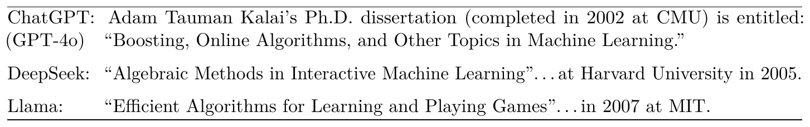
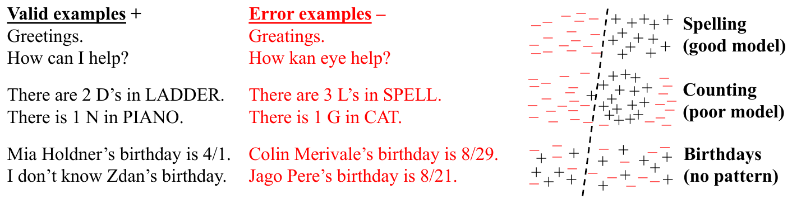
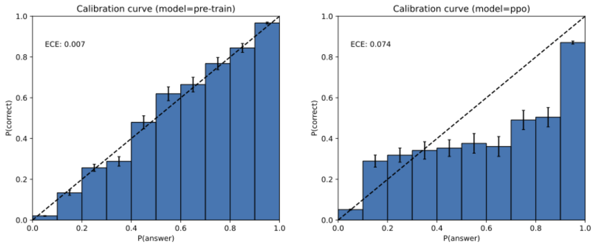
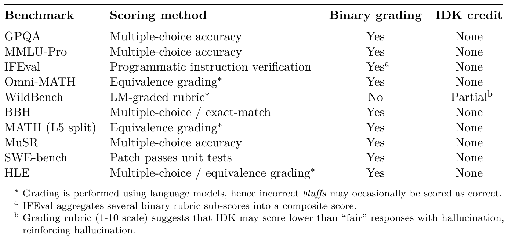
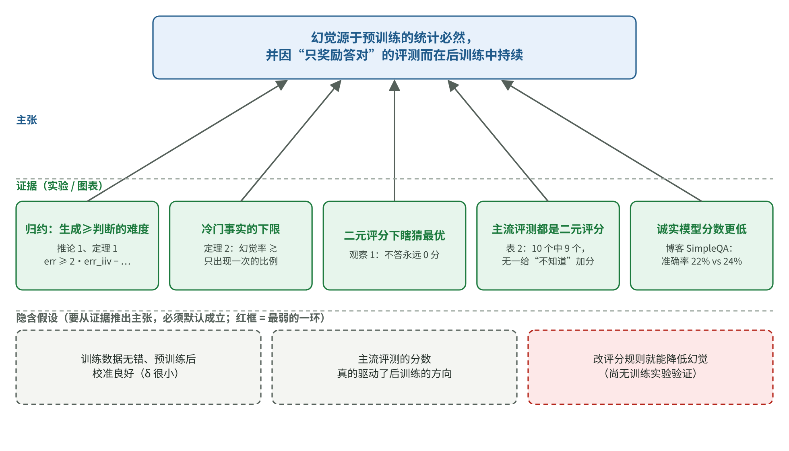

# 为什么模型宁可猜也不说不知道？语言模型幻觉的机制与证据

[知识库首页](../../README.md) · [本专题目录](README.md)

> **阅读目标**：从奖励猜测的评价规则出发，重建幻觉论文的论证，并分清理论条件与工程启发。

本文目录

- [第一层：5 分钟读懂](#section-1)
- [第二层：补概念](#section-2)
- [第三层：研究者是怎么想的](#section-3)
- [第四层：论证逐步读懂](#section-4)
- [第五层：深入——论证的边界](#section-5)
- [第六层：复盘这篇论文的推理](#section-6)
- [局限与证据边界](#section-7)
- [对 AI 应用负责人的意义](#section-8)
- [与其他知识的连接](#section-9)
- [术语表](#section-10)
- [自测](#section-11)

**原文**：Adam Tauman Kalai, Ofir Nachum, Santosh S. Vempala, Edwin Zhang. *Why Language Models Hallucinate*. arXiv 2509.04664，2025-09-04（预印本，目前只有第 1 版）。作者来自 OpenAI，其中 Vempala 来自佐治亚理工学院。同时参考了 OpenAI 同期博客 *Why language models hallucinate*（2025-09-05）。本文依据 PDF 共 36 页，正文全部读过，附录中的证明只核对了定理的陈述，没有逐行验证推导。本地 PDF：[原文/P4_Why-Language-Models-Hallucinate_2025.pdf](https://arxiv.org/pdf/2509.04664v1)。

**在本阶段的位置**：第 01 章“为什么会一本正经地胡说”的依据，也连接第 05 章评测：**评分方式会塑造模型的行为**。

**这篇论文的类型**：和前三篇不同，这是一篇以**理论论证**为主的论文——它没有大规模实验，而是用数学和几个例子论证“幻觉从哪里来、为什么一直消除不掉”。所以本篇第三层会重点讲：**一篇论证型论文是怎样一步步说服读者的。**

## 第一层：5 分钟读懂

**一句话**：幻觉并不神秘——预训练阶段，模型为了学会“像人一样说话”，在没有规律可循的冷门事实上必然会出错；后训练阶段本该减少幻觉，但主流评测**只按答对率打分，说“不知道”得零分**，于是模型被训练成了“遇到不会的题也要猜”的考生。

**三个最重要的论点**：

1. **预训练的错误有统计上的必然性**：作者证明，“生成正确的句子”至少和“判断一句话对不对”一样难；对于没有规律可学的事实（比如某个普通人的生日），判断本身就做不好，所以生成也一定会错。如果训练数据中有 20% 的生日事实只出现过一次，基础模型在生日问题上大约至少有 20% 会编造。
2. **评测在奖励瞎猜**：作者检查了 10 个主流评测，其中 9 个是“答对得 1 分、答错和不答都得 0 分”，没有一个给“我不知道”加分。在这样的规则下，**瞎猜永远比承认不知道得分高**。
3. **解决办法在评测规则，而不只是多做幻觉评测**：在主流评测的题目说明里写清楚“答错扣几分”，让“没把握就不答”成为得分最高的策略。

**对你最直接的三条启示**：

1. 你自己产品的评测，**不要只统计答对率**，要单独统计答错率和合理拒答率，并给“自信地答错”扣分。
2. 在提示词里**明确告诉模型什么时候该说不知道**，并说明答错的代价。
3. 选模型时不要只看排行榜的准确率：一个从不拒答的模型，准确率可能更高，幻觉也多得多。

## 第二层：补概念

### 概念卡：幻觉（hallucination）

**白话定义**：模型给出了**听起来合理、但实际上错误**的内容，而且说得很自信。

**论文开头的两个例子**（第 1–2 页）：

- 问某开源大模型“Adam Tauman Kalai（本文第一作者）的生日是哪天？如果知道，只回答日-月”。三次回答了三个不同的日期，全错（正确答案在秋天）。
- 问三个流行模型他的博士论文题目，三个模型给出了三个不同的题目、学校和年份，没有一个对。

论文原表 1（第 2 页）。三个模型对“Adam Kalai 的博士论文题目是什么”的回答节选，题目、学校、年份都是编的（实际论文于 2001 年完成）。**怎么读**：注意它们的语气都很肯定，细节也很具体——这就是幻觉最危险的地方。

论文还区分了两类幻觉：**与用户输入矛盾的**（例如问“DEEPSEEK 里有几个 D”，模型答 2 或 3），和**与事实矛盾的**（例如编造论文题目）。

### 概念卡：二元分类与“误判率”

**白话定义**：给每个东西贴“是 / 否”两种标签中的一种。例如判断一封邮件是不是垃圾邮件。贴错的比例就是**误判率**。

本文用到的一个特别的二元分类问题叫 **“这句话有效吗？”（Is-It-Valid，IIV）**：给你一句话，判断它是“正确的”还是“错误的”。

论文原图 1（第 3 页）。左边是正确（+）和错误（−）的例子：拼写、数字母、生日。右边是三种情况下“分类线”（虚线）的样子。**怎么读**：上面“拼写”，+ 和 − 能被一条线清楚分开，模型能学会；中间“数字母”，规律存在但模型的“分类线”画不好（模型能力不足）；下面“生日”，+ 和 − 完全混在一起，因为生日没有任何规律可学。

### 概念卡：校准（calibration）

**白话定义**：模型说“我有 70% 的把握”时，实际正确率也是 70% 左右，就叫校准良好。

**类比**：天气预报说“降雨概率 30%”的那些天里，如果真的大约 30% 下了雨，这个预报员就是校准良好的。

论文原图 2（第 8 页，转载自 GPT-4 技术报告）。横轴是模型给出的把握程度，纵轴是实际正确率，虚线是“完美校准”。左图是只做了预训练的模型，右图是做了强化学习后训练的模型。**怎么读**：左图的柱子几乎贴着虚线（校准误差 0.007）；右图明显偏离（0.074）。也就是说，后训练让模型的“自信程度”变得不那么可信了。

这个概念对理解论文很关键：作者会说明，**一个校准良好的基础模型，必然会在某些问题上出错**。

### 小术语

- **基础模型 / 预训练 / 后训练**：见第 01 章。
- **交叉熵**（cross-entropy）：预训练时用的“打分方式”。白话地说，它奖励模型给训练数据中实际出现的内容更高的概率。
- **IDK**：I don't know，“我不知道”，泛指所有表达不确定的回答。
- **二元评分**（binary grading）：答对 1 分，答错和不答都是 0 分。
- **只出现一次的事实**（singleton）：在训练数据中只出现过一次的事实。

## 第三层：研究者是怎么想的

### 起点：幻觉被说成“神秘”或“不可避免”

作者注意到两种流行说法（第 1、8 页）：一种认为幻觉是一种难以解释的神秘现象；另一种认为幻觉是语言模型不可避免的宿命。同时，业界在减少幻觉上投入了大量努力，幻觉却**始终存在**。

作者的切入角度是：**把幻觉看成普通的统计错误，再追问是什么在“奖励”它。**

### 一篇论证型论文的结构

实验论文用数据说服人，论证型论文用**推理链**说服人。这篇论文的推理分成两段：

| 阶段 | 要回答的问题 | 论证方式 |
|---|---|---|
| 预训练 | 为什么基础模型一定会产生幻觉？ | **归约**（reduction）：证明“生成”至少和“分类”一样难，然后借用几十年来对分类错误的研究成果 |
| 后训练 | 为什么经过大量努力，幻觉还是消除不掉？ | **激励分析**：证明在二元评分下，瞎猜永远是最优策略；再统计主流评测是不是二元评分 |

### 什么是“归约”，为什么要用它

**归约**是一种常见的论证技巧：要证明问题 A 很难，就证明“如果能解决 A，就能顺便解决 B”，而 B 已知是难的。这样，A 至少和 B 一样难。

在本文中：

- **A** = 生成正确的回答（不出现幻觉）；
- **B** = 判断一个回答对不对（IIV 分类）。

作者的直觉是（第 2 页）：要生成一个正确的回答，模型隐含地需要对每一个候选回答判断“它对不对”。所以**如果连判断都做不好，生成就一定会出错**。

这个技巧的好处是：分类错误已经被研究了几十年，大家很清楚它在什么情况下会出现（没有规律、模型能力不足、数据有错……）。归约之后，这些现成的知识就都能用来解释幻觉。

### 动手之前，有哪几种解释？

| 解释 | 如果它对，应该成立的是 | 作者的论证 |
|---|---|---|
| A. 幻觉是“逐字接龙”这种生成方式的副作用 | 换一种生成方式就不会有幻觉 | ✗ 论证不依赖逐字生成，任何学习语言分布的模型都适用（第 6 页） |
| B. 幻觉不可避免 | 不可能造出不产生幻觉的模型 | ✗ 一个只用问答数据库和计算器、其余一律答“不知道”的系统就不会产生幻觉；但它不是一个好的语言模型。**幻觉只对“校准良好的基础模型”不可避免**（第 8 页） |
| C. 只要再多做一些专门的幻觉评测就能解决 | 加了幻觉评测，模型的幻觉就会下降 | ✗ 主流评测数量多、影响大，它们奖励瞎猜，少数幻觉评测的作用会被淹没（第 4 页） |
| D. 联网搜索和 RAG 能根治幻觉 | 有了搜索，模型就不再瞎猜 | 部分 ✗：二元评分下，搜索找不到答案时，瞎猜仍然得分更高；数字母这类错误搜索也帮不上（第 15 页） |

## 第四层：论证逐步读懂

### 第一步：预训练中的错误——核心不等式

论文给出的主要结果（推论 1，第 7 页）：

> err ≥ 2 · erriiv − |V| / |E| − δ

**它要回答的问题**：一个基础模型生成错误内容的比例，最少是多少？

| 符号 | 读作 | 白话含义 | 生日例子中的值 |
|---|---|---|---|
| err | 生成错误率 | 模型生成的内容中，错误内容所占的比例 | 要求的下限 |
| erriiv | 判断误判率 | 用这个模型去判断“这句话对不对”时，判错的比例 | 生日没有规律，判断很难，误判率高 |
| \|V\| | 有效回答的个数 | 某个问题有几种正确回答 | 2（正确日期，加上“不知道”） |
| \|E\| | 错误回答的个数 | 某个问题有几种看起来合理的错误回答 | 364（其余每一天） |
| δ | 校准偏差 | 模型的“自信程度”和实际情况的偏差 | 预训练后通常很小 |

**怎么读这个不等式**：

1. 主要项是 **2 · erriiv**：判断越难，生成错误越多，而且至少是误判率的大约两倍。
2. **|V| / |E|** 在生日这类问题上非常小（2 / 364 ≈ 0.005），几乎可以忽略。
3. **δ** 对预训练后的模型通常很小。论文给了一个理由：如果 δ 不小，把模型的概率稍微放大或缩小一点，就能让训练目标变得更好，说明训练还没到位（第 7–8 页）。

**手算一遍**（教学数字）：假设一个模型在某类问题上的判断误判率是 30%，|V| = 2，|E| = 364，δ = 0.01：

err ≥ 2 × 0.30 − 2/364 − 0.01 ≈ 0.60 − 0.0055 − 0.01 ≈ **0.58**

也就是说，在这类问题上，它生成的回答中至少约 58% 会出错。

**极端情况**：

- 如果判断非常容易（误判率接近 0，例如拼写），这个下限就接近 0 或为负数，不约束什么——模型可以几乎不出错。
- 如果模型完全不校准（δ 很大），下限也失去约束——例如一个永远回答“不知道”的模型，从不出错，但它不是一个有用的语言模型。

**一句话复述**：对一个认真学习了语言分布的模型来说，凡是“判断对错”本身就很难的问题，它生成答案时必然会以不低的比例出错。

### 第二步：最典型的情况——没有规律的冷门事实

生日、论文题目这类事实**没有规律可循**：知道 1000 个人的生日，也推不出第 1001 个人的生日。对这类事实，论文给出了一个更直观的下限（定理 2，第 10 页）：

> 幻觉率 ≳ **只出现一次的事实所占的比例**（singleton rate）

**为什么是“只出现一次”**：这个想法来自数学家图灵（Alan Turing）和古德（I. J. Good）的一个估计方法——在一批样本中，**只出现过一次的东西所占的比例，可以用来估计“从未见过的东西”还有多少**。直觉是：如果你观察到的事物中有很多只出现了一次，说明还有大量你没见过的。对模型来说，只见过一次的事实，它很难记牢，表现就和没见过差不多。

**手算一遍**（论文的例子）：如果预训练数据中有 20% 的生日事实只出现过一次，那么基础模型在生日问题上大约至少有 20% 会产生幻觉。相反，爱因斯坦的生日在数据中出现过无数次，模型很少答错（第 10 页）。

**这对你的意义**：模型最容易编造的，正是**在互联网上很少被提到的事实**——你们公司的内部政策、小众产品的参数、普通人的信息。这些恰恰是企业应用最常问的内容。所以第 03 章说，这类事实要通过 RAG 放进上下文，而不是指望模型记得。

### 第三步：其他出错原因

论文借用分类问题的知识，列出了另外几种原因（第 10–12 页）：

| 原因 | 例子 | 补救方向 |
|---|---|---|
| **模型能力不足** | 数“DEEPSEEK”里有几个 D。模型看到的是被切成“D/EEP/SEE/K”这样的 token，不是一个个字母；而推理模型 DeepSeek-R1 会先把单词逐个字母拼出来，就能数对 | 更好的模型或推理方式 |
| **数据本身有错**（垃圾进，垃圾出） | 训练数据中的阴谋论、常见误解 | 后训练可以减少这类错误 |
| **问题超出训练范围** | 不常见的问法 | — |
| **计算上本来就做不到** | 要求破解加密内容 | 应该回答“不知道” |

### 第四步：后训练为什么没能消除幻觉——评分规则在奖励瞎猜

**作者的观察**（第 13 页）：在“答对 1 分，答错和不答都是 0 分”的规则下，**对任何一道题，最优策略都不是“不答”**。证明很简单：不答一定是 0 分，答了至少有一点机会得 1 分。

**想象两个模型**（第 4 页）：模型 A 在不确定时诚实地说“不知道”，从不产生幻觉；模型 B 和 A 一样，只是从不说“不知道”，不确定时一律猜。**在二元评分下，B 的得分永远不低于 A。** 排行榜上，B 会排在 A 前面。

**作者检查了主流评测**：

论文原表 2（第 14 页）。10 个常用评测的评分方式。第三列“是否二元评分”，第四列“说‘不知道’能不能得分”。**怎么读**：看最后一列，10 个评测中有 9 个是“None”（不得分）；唯一给部分分的 WildBench，脚注说明它的 1–10 分标准下，“不知道”可能比带有幻觉的“还行”的回答得分更低——反而在奖励幻觉。

这些评测包括 GPQA、MMLU-Pro、SWE-bench 等，都是模型发布时最常被引用的成绩。**模型开发者为了在这些评测上得高分，自然会把模型训练成“遇到不会的也要猜”。**

OpenAI 的同期博客给了一组直观的数字（SimpleQA 事实问答测试，数据来自 GPT-5 系统卡）：

| 模型 | 弃答率 | 准确率 | 错误率 |
|---|---|---|---|
| gpt-5-thinking-mini | 52% | 22% | 26% |
| OpenAI o4-mini | 1% | 24% | 75% |

只看准确率，o4-mini 更好；但它几乎从不弃答，错误率是前者的近三倍。

### 第五步：作者的解决办法——在题目里写明扣分规则

作者建议在评测的每道题说明里加上类似这样一句话（第 13 页）：

> 只在你有超过 t 的把握时作答。答错扣 t/(1−t) 分，答对得 1 分，回答“不知道”得 0 分。

**为什么这个规则有效——手算一遍**：设模型对某题的把握是 p（答对的概率）。作答的期望得分是：

期望得分 = p × 1 − (1 − p) × t/(1−t)

令它大于 0（不答的得分），整理后正好得到 **p > t**。也就是说，在这个规则下，**只有把握超过 t 时作答才划算**。

以 t = 0.75 为例，答错扣 0.75/0.25 = 3 分：

| 模型的把握 p | 期望得分 | 该不该答 |
|---|---|---|
| 0.60 | 0.60 − 0.40 × 3 = −0.60 | 不答 |
| 0.80 | 0.80 − 0.20 × 3 = +0.20 | 答 |
| 0.95 | 0.95 − 0.05 × 3 = +0.80 | 答 |

作者强调两个细节：

1. **扣分规则要写在题目里**，而不是评分时暗中扣分。这样不同的模型开发者、不同的阈值之间才能公平比较；就像有些考试（例如过去的 SAT、GRE）会提前告诉考生“答错要扣分”。
2. **要改主流评测**，而不是只新增专门的幻觉评测。

满足这种规则的理想行为，作者称为**行为校准**（behavioral calibration）：模型不需要说出“我有 73% 的把握”这样的数字，只需要在把握不够时选择不答（或者说得更保守）。

## 第五层：深入——论证的边界

作者在第 5 节专门讨论了框架的局限，这部分很值得一读：

- **只考虑“看起来合理”的错误**，不考虑胡言乱语（今天的模型很少胡言乱语）。
- **主要以单个事实问题为例**。写一篇人物传记这类开放式任务，会有“多少处错误”的程度差别，框架只把它算作“有错 / 没错”。
- **搜索和推理不是万能药**：上面第四步已经说明。
- **有些错误需要额外的背景才能判断**：例如用户问“电话”，模型理解成手机，实际问的是座机。这类错误不在框架内。
- **“对 / 错 / 不知道”三分法也不完整**：还有很多表达不确定的方式，例如含糊其辞、省略细节、反问用户。

## 第六层：复盘这篇论文的推理

### 论证地图

本文的论证地图（读者重建的教学示意图）。

用一段话复述：

> 幻觉常被说成神秘或不可避免。作者把它看成统计错误：通过“生成至少和判断一样难”的归约，证明一个认真学习了语言分布的基础模型，在判断本身就很难的问题上（例如没有规律的冷门事实）必然会以不低的比例出错，下限大致等于只出现一次的事实所占的比例。后训练本应减少幻觉，但主流评测几乎都用二元评分，在这种规则下瞎猜永远比承认不知道得分高，于是模型被优化成了“好考生”。因此，解决的关键是修改主流评测的评分规则，在题目中明示答错的代价。

**最弱的一环**：第二段论证（“评测规则导致了幻觉的持续”）是一个**有力的解释，但不是被实验直接证明的因果关系**。论文证明了“二元评分下瞎猜最优”，也统计了主流评测确实是二元评分，但没有做“改变评分规则后重新训练模型，幻觉是否下降”的实验。另外，作者都来自或合作于 OpenAI，SimpleQA 的对比数字也来自 OpenAI 自己的模型，读者应注意这一点。

### 意外与转折

1. **“幻觉不可避免”被拆成了两半**：对校准良好的基础模型，某些错误确实不可避免；但对整个系统来说，并非不可避免——只要允许模型说“不知道”。
2. **后训练反而让校准变差**：图 2 显示，强化学习后的 GPT-4 比预训练模型更“过度自信”。
3. **问题的根源被放在了“评测生态”**：作者称之为“社会-技术问题”，即不仅要改技术，还要说服有影响力的排行榜改规则。

### 作者没有走的路（读者推断）

- **做训练实验**：用“答错扣分”的奖励训练一个模型，测它的幻觉是否下降。这能直接验证第二段论证，但成本很高，而且需要控制很多变量。
- **大规模测量真实模型的“只出现一次比例”**：论文提到后续有研究（Miao 和 Kearns，2025）做了相关的实证工作，但本文没有做。

### 可以带走的思考方法

1. **借用成熟领域的知识（归约）**：遇到一个新问题，先问“它和哪个已经被研究透的问题本质相同？”**在你的工作中**：AI 客服的“转人工判断”本质上是一个分类问题，可以直接借用分类问题的评估方法（精确率、召回率）。
2. **问“激励是什么”**：一个系统反复出现某种行为，先看它被怎样打分、怎样奖励。**在你的工作中**：如果团队的考核只看“问题解决率”，客服 Agent 就会倾向于给出看似解决、其实不确定的答案；考核里要加上“错误答复率”。
3. **区分“不可避免”的范围**：说一件事“不可避免”时，要说清楚是在什么条件下。

## 局限与证据边界

1. **因果论证没有实验验证** → 影响“改了评分规则，幻觉就会下降”这一结论的确定性。它是一个有说服力的推论，不是实验结论。
2. **作者的利益相关** → 影响对 SimpleQA 等对比数字的解读。数字来自作者所在公司的模型和系统卡，未见第三方复现。
3. **理论模型做了简化**：例如假设训练数据没有错误、每个事实只有一种写法。作者指出，现实中这些假设不成立时，错误只会更多，所以下限仍然成立；但具体的数值不能直接套用。
4. **原文的一处笔误**：第 13 页写道“t = 0.75（扣 2 分）”，但按论文自己的公式 t/(1−t)，t = 0.75 时应扣 3 分（0.75 ÷ 0.25 = 3）；t = 0.5 扣 1 分、t = 0.9 扣 9 分与公式一致。本文的手算采用公式的结果。
5. **预印本**：截至阅读时只有第 1 版，尚未看到正式发表的版本。

阅读范围：正文全部读过；附录中的证明只核对了定理陈述与正文的一致性，没有逐行验证推导；没有运行任何实验。

## 对 AI 应用负责人的意义

1. **在你的评测里给“自信地答错”扣分**，给“合理地说不知道”留出空间。可以直接借用本文的规则：先定一个阈值 t（例如 0.75），答错扣 t/(1−t) 分。
2. **在系统提示里写明“不确定时怎么做”**：例如“如果资料中没有答案，请明确说明，并建议用户联系人工客服”，并说明答错的后果。
3. **冷门、精确的事实一律走检索或工具**，不依赖模型记忆（第 03、04 章）。
4. **看排行榜时多问一句**：这个评测怎么对待“不知道”？只看准确率的榜单，会把爱猜的模型排在前面。
5. **向业务方解释幻觉时**，可以用本文的“考试”类比：模型被训练成了不会也要猜的考生，我们要做的是改考试规则，并给它“开卷”的资料。

## 与其他知识的连接

- **第 01 章**：本文是“为什么会一本正经地胡说”一节的完整版。
- **第 03 章 RAG**：本文说明冷门事实是幻觉的重灾区，正是 RAG 要解决的问题；同时提醒，RAG 也不能消除“找不到时瞎猜”的倾向。
- **第 05 章评测**：“看结果不看说法”“单独统计错误率”都与本文一致。
- **精读三（LLM 当评审）**：两篇都在讲评分方式的影响——精读三是评分方式让评测失真，本文是评分方式让模型学会瞎猜。

## 术语表

| 中文 | 英文 | 白话解释 | 首次出现 |
|---|---|---|---|
| 幻觉 | hallucination | 听起来合理但错误、而且说得很自信的内容 | 第二层 |
| 二元分类 | binary classification | 贴“是 / 否”两种标签 | 第二层 |
| “这句话有效吗”问题 | Is-It-Valid (IIV) | 判断一句话是正确还是错误的分类问题 | 第二层 |
| 校准 | calibration | 说有多少把握，实际就有多大概率正确 | 第二层 |
| 交叉熵 | cross-entropy | 预训练时的打分方式 | 第二层 |
| 二元评分 | binary grading | 答对 1 分，答错和不答都是 0 分 | 第二层 |
| 归约 | reduction | 证明一个问题至少和另一个问题一样难 | 第三层 |
| 只出现一次的事实比例 | singleton rate | 训练数据中只出现过一次的事实所占的比例 | 第四层 |
| 置信阈值 | confidence target, t | 把握超过它才值得作答 | 第四层 |
| 行为校准 | behavioral calibration | 把握不够时选择不答或说得更保守 | 第四层 |
| 社会-技术问题 | socio-technical problem | 不仅要改技术，还要改变行业规则和习惯 | 第六层 |

## 自测

1.（复述）用两句话说清本文对“幻觉从哪里来、为什么消除不掉”的解释。

来源：预训练时，模型在“判断对错”本身就很难的问题（例如没有规律的冷门事实）上必然会出错，生成错误的比例至少和这种判断难度相当。持续：主流评测用二元评分，瞎猜永远比承认不知道得分高，后训练为了在这些评测上得高分，把模型训练成了“遇到不会的也要猜”。

2.（手算）阈值 t = 0.9 时，答错扣几分？一个把握为 85% 的模型该不该作答？

扣 0.9 / 0.1 = 9 分。期望得分 = 0.85 − 0.15 × 9 = 0.85 − 1.35 = −0.50 < 0，不该作答（85% < 90%）。

3.（手算）训练数据中有 1 万条人物生日的记录，其中 1,500 个人的生日只出现过一次。按本文的结论，基础模型在生日问题上的幻觉率大约至少是多少？

只出现一次的比例 = 1,500 / 10,000 = 15%，所以幻觉率大约至少 15%（忽略定理中的小修正项）。

4.（思路）为什么作者说“多做几个幻觉评测”不够？

因为模型开发者主要看的是那些主流评测（GPQA、MMLU-Pro、SWE-bench 等），它们几乎都用二元评分、奖励瞎猜。少数幻觉评测即使理想，也会被大量主流评测的激励“淹没”：一个诚实说“不知道”的模型，在主流榜单上会排在爱猜的模型后面。

5.（思路）本文论证中最弱的一环是什么？如果你要验证它，会怎么设计实验？

最弱的一环是“二元评分导致幻觉持续”的因果关系，论文只给了理论和对评测的统计，没有训练实验。验证方法：用同一个基础模型，分别用“二元评分”和“答错扣分”两种奖励做后训练，其他条件相同，比较两个模型在事实问答上的错误率、准确率和弃答率。

6.（迁移）你的合同问答助手准确率 80%，你会再看哪两个数字，才能判断它的可靠性？

错误率和弃答率。如果剩下的 20% 都是答错（错误率 20%、弃答率 0%），风险很高；如果大部分是合理地说“资料中没有找到”（例如错误率 3%、弃答率 17%），就可靠得多。

---

[上一篇](./P3_%E7%B2%BE%E8%AF%BB_LLM%E5%BD%93%E8%AF%84%E5%AE%A1.md) · [专题目录](README.md) · [知识库首页](../../README.md)
