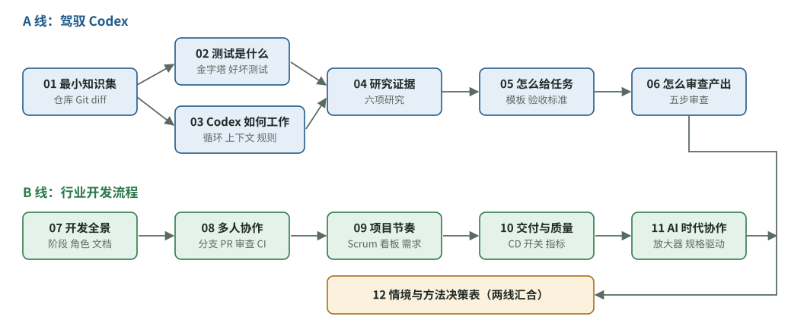

# 阅读起点：一个非技术负责人，要补哪些开发知识

[知识库首页](../../README.md) · [本专题目录](README.md)

> **阅读目标**：建立从需求、改动审查到交付的学习路线，让不直接写代码的人也能判断工作的质量。

本文目录

- [读完你能做到的事](#section-1)
- [知识地图](#section-2)
- [论文精读篇](#section-3)
- [推荐的读法](#section-4)
- [这套资料的证据怎么读](#section-5)

这套资料面向使用 AI 编程助手的开发者、产品负责人和项目管理者。它关注三个常见问题：**怎样判断改动是否符合需求，怎样识别有用的测试，以及多人协作时怎样避免互相覆盖。** 不要求读者先掌握完整的软件工程知识，必要概念会沿着工作过程展开。

解决这些问题，需要建立两类**判断力**：

1. **审查判断力**：能看懂 Codex 交回来的东西，知道哪里可能跑偏、哪些测试是多余的。
2. **流程判断力**：知道一个团队通常怎样把需求变成上线的软件，每一步为什么存在，什么情况该用什么做法。

判断力来自两种材料：一是**行业经过多年验证的做法**（Google、Martin Fowler、Scrum Guide、DORA 研究等一手资料）；二是**最近关于 AI 编程代理的研究**（2025–2026 年的论文和实验）。这套资料把两者合在一起，并按“先补台阶、再讲为什么、最后给可用的方法”的顺序来讲。

## 读完你能做到的事

1. 看懂 Codex 的改动摘要：改了哪些文件、增删多少行、动没动测试，并判断有没有超出任务范围。
2. 说清楚单元测试、集成测试、端到端测试的区别，识别“过度测试”和“假测试”。
3. 写出让 Codex 不容易跑偏的任务说明：有目标、上下文、约束、完成标准，并写明“不做什么”。
4. 用研究证据解释 Codex 为什么会跑偏（行动偏差、规则文件引发的额外测试、为了通过测试而“作弊”）。
5. 给团队定一套合适的协作规则：分支、合并请求、代码审查、持续集成、完成标准。
6. 遇到具体情况时，能对照决策表选出合适的方法。

## 知识地图

下面是这套资料的知识点和它们之间的依赖关系。箭头表示“先懂左边，右边才好懂”。

图 0-1　知识地图：箭头表示“先懂前面，后面才好懂”。A 线解决“怎么用好 Codex”，B 线解决“团队怎么协作开发”，最后在第 12 章汇合。

| 编号 | 章节 | 一句话说明 | 主要来源 |
|---|---|---|---|
| 01 | 最小知识集 | 不写代码也必须懂的概念：仓库、提交、分支、diff、依赖、环境 | Pro Git |
| 02 | 测试是什么 | 测试的种类、比例，什么是好测试、什么是多余和有害的测试 | Fowler/Vocke、Google 测试章节与测试博客 |
| 03 | Codex 如何工作 | 代理循环、上下文、AGENTS.md、沙箱与审批、计划模式 | OpenAI Codex 官方文档 |
| 04 | 研究证据 | 6 项研究告诉我们 AI 编程代理在哪里不可靠 | SWE-bench、METR、AGENTS.md 评测、FixedBench、ImpossibleBench |
| 05 | 怎么给任务 | 任务说明模板、验收标准、范围边界、何时先要计划 | OpenAI/Anthropic 最佳实践、BDD |
| 06 | 怎么审查产出 | 不会写代码也能做的审查清单，跑偏与过度测试的信号 | Google 代码审查规范、Kent Beck |
| 06B | 实战：审查一个 PR | 用一个真实的 Python 改动，演示在 Codex 应用、GitHub、VS Code 里一步步审查，含 3 道练习 | Google 审查指南、GitHub / VS Code / Codex 官方文档 |
| 07 | 开发全景 | 从需求到上线的全过程、角色、文档、环境、版本号 | Conway、Nygard ADR、SemVer |
| 08 | 多人协作 | 分支策略、合并请求、代码审查、持续集成 | GitHub Flow、DORA、Fowler、Google |
| 09 | 项目节奏 | Scrum 与看板、用户故事、验收标准、完成定义 | Scrum Guide 2020、Dan North |
| 10 | 交付与质量 | 持续交付、功能开关、DORA 指标、技术债、复盘 | DORA、Fowler、Google SRE |
| 11 | AI 时代的团队协作 | AI 是放大器；规格驱动；团队怎样分工审查 AI 代码 | DORA 2025、GitHub Spec Kit、Willison、Beck |
| 12 | 情境与方法决策表 | 什么情况用什么方法，以及负责人每周检查清单 | 汇总前面各章 |

## 论文精读篇

第 04 章是六项研究的总览。其中四项与你的问题关系最直接，另有**由浅入深的完整精读**，每篇分五层：5 分钟读懂 → 补概念 → 研究设计 → 逐图读结果 → 作者如何排除其他解释，最后是局限、实用建议和自测。论文中的关键图表都放了原图并逐张讲解。

| 精读 | 回答的问题 |
|---|---|
| [精读一：METR 随机对照实验](./P1_%E7%B2%BE%E8%AF%BB_METR%E5%AE%9E%E9%AA%8C.md) | AI 到底让开发者快了还是慢了？时间花到哪里去了？什么任务 AI 帮得上忙？ |
| [精读二：AGENTS.md 评测](./P2_%E7%B2%BE%E8%AF%BB_AGENTS%E8%AF%84%E6%B5%8B.md) | 项目说明文件有没有用？为什么会导致过度测试？该写什么？ |
| [精读三：FixedBench](./P3_%E7%B2%BE%E8%AF%BB_FixedBench.md) | 为什么代理会做不需要的修改？一句话怎么改善？ |
| [精读四：ImpossibleBench](./P4_%E7%B2%BE%E8%AF%BB_ImpossibleBench.md) | 代理会不会为了通过测试而作弊？哪些防护有效？ |

建议先读完第 04 章总览，再按需要读精读；也可以学完 A 线后集中读四篇精读。

## 推荐的读法

**如果你这周就要用 Codex 干活**：先读 01 → 05 → 06 → 06B。06 告诉你看什么，06B 带你实际看一遍。这几章能马上改善你给任务和看结果的方式。然后回头读 02、03、04 理解“为什么”。

**如果你要先给团队定规矩**：先读 07 → 08 → 11 → 12，再补 09、10。

**完整路线**（推荐）：按编号读。每章末尾有自测题，答不出来时回到对应小节重读。最后用 12 章的决策表做一次“如果我遇到……我会……”的练习。

每章的结构大体相同：先补这一章要用到的概念，再用具体例子讲机制，然后讲为什么这样做、什么时候不适用，最后是自测题。

## 这套资料的证据怎么读

- **一手来源优先**：官方文档、论文、标准原文。每章正文中的关键说法后面注明了来源，完整清单见[原文与来源](./sources.md)。
- **研究结论带条件**：论文结论都有实验条件（哪些模型、什么任务、多少样本）。第 04 章专门讲怎样读这些条件；其他章引用时只写一句关键条件。
- **工具会变**：Codex 的功能名称和默认设置更新很快。本资料中的 Codex 文档内容核对于 2026-10-07。如果界面与文中不同，以最新官方文档为准，但背后的原理（为什么要写完成标准、为什么要小步提交）不会过时。
- **教学例子**：文中的“小例子”“比如”是为了讲清楚而编的，会说明它和真实情况的差别。

---

[下一篇](./01_%E6%9C%80%E5%B0%8F%E7%9F%A5%E8%AF%86%E9%9B%86.md) · [专题目录](README.md) · [知识库首页](../../README.md)
