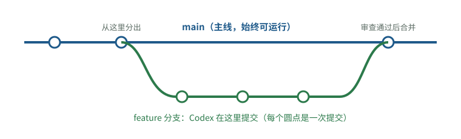

# 最小知识集：不写代码，也必须看得懂的十个概念

[知识库首页](../../README.md) · [本专题目录](README.md)

> **阅读目标**：通过一次代码变更理解仓库、提交、分支、依赖和环境，知道每种工具解决哪一步问题。

<details>
<summary>本文目录</summary>

- [先建立一个整体画面](#section-1)
- [1. 仓库（Repository，简称 repo）](#section-2)
- [2. 提交（Commit）](#section-3)
- [3. 差异（Diff）——审查 Codex 的核心工具](#section-4)
- [4. 分支（Branch）](#section-5)
- [5. 合并与冲突（Merge / Conflict）](#section-6)
- [6. 远程仓库、推送与拉取（Remote / Push / Pull）](#section-7)
- [7. 合并请求（Pull Request，PR；GitLab 叫 Merge Request，MR）](#section-8)
- [8. 依赖（Dependency）与锁文件](#section-9)
- [9. 环境、配置与密钥](#section-10)
- [10. 命令行与“检查工具”](#section-11)
- [出事时怎么撤回](#section-12)
- [自测](#section-13)

</details>

你和 Codex 对话时，它会说“我在 feature 分支上提交了 3 个 commit，diff 里改了 5 个文件，所有测试通过”。如果这句话里有一半词你只是大概知道，你就没法判断它做得对不对。这一章补的就是这些词。

学习目标：读完后，你能看懂 Codex 的工作汇报，知道改动的“账本”在哪里、怎么查，以及在出事时怎么撤回。

<a id="section-1"></a>
## 先建立一个整体画面

把一个软件项目想成一个**有完整修改记录的共享文件夹**：

```text
项目仓库（repository）
├── 代码文件（.py / .ts / .js ...）   ← 程序本身
├── 测试文件（tests/ 或 *_test.py）  ← 检查程序的程序
├── 配置文件（package.json、.env ...）← 依赖清单、运行参数
├── 说明文件（README.md、AGENTS.md）  ← 给人和给 AI 看的说明
└── .git/（隐藏）                     ← 全部历史记录：谁、何时、改了什么
```


Codex 做的每件事，最终都体现为**这个文件夹里文件的变化**。所以你只要学会看“变化”，就能审查它，哪怕你看不懂每一行代码。

<a id="section-2"></a>
## 1. 仓库（Repository，简称 repo）

**它解决什么问题**：多人、多次修改同一批文件时，需要知道每个版本是什么样、谁改了什么，并且随时能回到过去。

**白话定义**：仓库就是“项目文件夹 + 它的全部修改历史”。

**类比**：像带完整修订记录的共享文档。**不同之处**：文档的修订记录是自动连续保存的；仓库的记录要人（或 Codex）主动“存档”，存档的单位叫提交。

**在你工作中的作用**：Codex 永远在某个仓库里工作。没有仓库（或不用 Git）就让 Codex 改代码，相当于没有撤销键。OpenAI 的最佳实践也把“在没有 git worktree 的情况下运行多个任务”列为常见陷阱。

<a id="section-3"></a>
## 2. 提交（Commit）

**它解决什么问题**：要把一次有意义的修改打包存档，以后能单独查看、撤回。

**白话定义**：一次提交 = 一组文件改动 + 一段说明（提交信息）+ 作者和时间。每个提交有一个唯一编号（一串像 `a1b2c3d` 的字符）。

**最小例子**：

```text
commit a1b2c3d
作者: codex   时间: 2026-10-07 10:12
    修复登录超时后无法重新登录的问题
    - auth/session.py：刷新令牌前检查过期时间
    - tests/test_session.py：新增超时场景测试
```


**怎么判断提交好不好**：一个提交只做一件事，说明写清楚“改了什么、为什么”。如果 Codex 把“修 bug + 顺手重构 + 升级依赖”混在一个提交里，出问题时就无法只撤回其中一部分。Google 的代码审查规范专门要求：重构和修 bug 放在不同的改动里。

<a id="section-4"></a>
## 3. 差异（Diff）——审查 Codex 的核心工具

**它解决什么问题**：你不需要读完整个项目，只需要看“这次到底改了什么”。

**白话定义**：diff 是两个版本之间的逐行对比。删掉的行前面是 `-`（通常显示为红色），新增的行前面是 `+`（通常显示为绿色）。

**最小例子**：

```diff
--- a/config.py
+++ b/config.py
@@ -10,3 +10,3 @@
 TIMEOUT = 30
-MAX_RETRY = 3
+MAX_RETRY = 10
 DEBUG = False
```


这表示：`config.py` 第 11 行，重试次数从 3 改成了 10。**即使你不懂编程，你也可以问：任务里有要求改重试次数吗？**

**diff 统计（diffstat）**更适合非技术负责人先看：

```text
 auth/session.py         |  12 ++++---
 tests/test_session.py   | 140 ++++++++++++++++++++++++
 utils/helpers.py        |  85 +++++++++------
 package.json            |   2 +-
 4 files changed, 220 insertions(+), 19 deletions(-)
```


只看这几行就能提出三个好问题：

1. 任务是修登录问题，为什么动了 `utils/helpers.py`？（**范围**）
2. 修复代码 12 行，测试 140 行，比例是否合理？（**测试量**，第 02、06 章细讲）
3. `package.json` 改了，是不是新增或升级了依赖？（**依赖**）

在命令行里，`git diff --stat` 显示这个统计，`git diff` 显示全部逐行差异。Codex 应用和 IDE 里也有 diff 面板。

<a id="section-5"></a>
## 4. 分支（Branch）

**它解决什么问题**：多人或多个任务同时改代码，彼此不能互相干扰；没做完的东西不能影响正在用的版本。

**白话定义**：分支是从主线复制出来的一条独立修改线。主线通常叫 `main`。在分支上改完、检查通过后，再“合并”回主线。

**类比**：在文档副本上修改，改好了再把修改合进正式稿。**不同之处**：Git 合并时会逐行比较，两边改了同一处才会“冲突”，其他部分自动合并。



图 1-1　分支示意：从 main 分出一条 feature 分支，Codex 在分支上做多次提交，审查通过后再合并回 main。main 在整个过程中都不受影响。

**在你工作中的作用**：让 Codex 在单独分支上做每个任务。主线永远保持“能运行”的状态。第 08 章会讲团队该用什么分支规则。

<a id="section-6"></a>
## 5. 合并与冲突（Merge / Conflict）

**合并**：把分支上的改动并入主线。**冲突**：两条分支改了同一个文件的同一处，Git 不知道该保留哪个，需要人来决定。

分支存活时间越长，和主线差得越多，冲突越多、越难解决。这就是为什么行业研究反复建议**小改动、频繁合并**（第 08 章）。

<a id="section-7"></a>
## 6. 远程仓库、推送与拉取（Remote / Push / Pull）

仓库在你电脑上有一份（本地），在 GitHub、GitLab 等服务上有一份（远程）。**推送（push）**是把本地提交上传；**拉取（pull）**是把别人的提交下载下来。团队协作的“共同真相”是远程仓库的主线。

<a id="section-8"></a>
## 7. 合并请求（Pull Request，PR；GitLab 叫 Merge Request，MR）

**它解决什么问题**：改动进入主线之前，需要别人看一眼、自动检查跑一遍。

**白话定义**：PR 是一个网页上的“合并申请单”：包含这次分支的全部 diff、说明、讨论和自动检查结果。审查人批准后才合并。

**在你工作中的作用**：PR 是你审查 Codex 产出的最佳场所。要求 Codex 每个任务开一个 PR，并在说明里写清：做了什么、没做什么、怎么验证的。

<a id="section-9"></a>
## 8. 依赖（Dependency）与锁文件

**它解决什么问题**：项目会用别人写好的代码库（比如处理日期、调用大模型 API 的库），不必从头写。

**白话定义**：依赖是项目使用的第三方代码包。依赖清单写在 `package.json`（JavaScript）、`requirements.txt` 或 `pyproject.toml`（Python）等文件里。**锁文件**（`package-lock.json`、`poetry.lock`、`uv.lock` 等）记录每个包的精确版本，保证每个人装出来的环境一样。

**为什么要盯住它**：新增依赖意味着引入别人的代码，会带来安全、许可证和维护风险。Codex 遇到困难时可能“顺手”加一个库。**任何依赖清单的变化都应该被单独问一句：为什么需要？**

<a id="section-10"></a>
## 9. 环境、配置与密钥

- **环境（environment）**：程序运行的地方。常见的有本地开发环境、测试环境、预发布环境（staging）、生产环境（production，真实用户在用的）。
- **环境变量 / `.env` 文件**：放在代码之外的配置，比如数据库地址、API 密钥。
- **密钥（secret）**：API key、密码、令牌。**绝不能提交进仓库。**如果你在 diff 里看到像 `sk-...` 这样的长串字符，立刻停下。

<a id="section-11"></a>
## 10. 命令行与“检查工具”

Codex 主要通过在终端（命令行）里执行命令来工作。你会反复看到这几类命令：

| 类型 | 常见命令示例 | 它检查什么 |
|---|---|---|
| 运行测试 | `pytest`、`npm test` | 程序行为是否符合预期（第 02 章） |
| 代码风格检查（lint） | `ruff`、`eslint` | 写法是否规范、有没有明显错误 |
| 格式化（format） | `prettier`、`black` | 统一排版，不改变行为 |
| 类型检查（type check） | `tsc`、`mypy` | 数据类型是否用对 |
| 构建（build） | `npm run build` | 能否打包成可运行的程序 |

这些命令会返回“通过/失败”。它们是 Codex 最可靠的“自我检查”来源，也是你在 AGENTS.md 里最该写清楚的内容（第 03、05 章）。

<a id="section-12"></a>
## 出事时怎么撤回

| 情况 | 做法 | 说明 |
|---|---|---|
| Codex 刚改完、还没提交，你不想要 | 让 Codex 执行“丢弃未提交改动”，或在 IDE 里撤销 | 只影响工作区 |
| 已提交但还没合并 | 不合并这个分支/PR，直接关闭 | 主线不受影响，这就是分支的价值 |
| 已经合并进主线 | 用 `git revert <提交编号>` 生成一个“反向提交” | 不删除历史，而是新增一个撤销记录，团队协作时最安全 |

<a id="section-13"></a>
## 自测

<details>
<summary>1. Codex 汇报“所有测试通过”，你还应该看哪两样东西？</summary>

看 diff 统计（改了哪些文件、各多少行），以及测试文件本身有没有被修改或删除。测试全部通过可能是因为测试被改松了（第 04、06 章）。
</details>

<details>
<summary>2. 为什么要让 Codex 在分支上工作，而不是直接改 main？</summary>

分支上的改动在合并前不影响主线；不满意可以整条分支丢掉。直接改主线，坏改动会立刻影响所有人。
</details>

<details>
<summary>3. diff 统计里出现了 package.json 和 package-lock.json 的变化，说明什么？该问什么？</summary>

说明依赖发生了变化（新增、删除或升级了第三方包）。要问：为什么需要这个依赖？任务要求里有吗？有没有用现有依赖就能做到的办法？
</details>

<details>
<summary>4. 一个已经合并进主线的提交出了问题，为什么推荐 revert 而不是“删掉那个提交”？</summary>

revert 新增一个反向提交，历史完整保留，其他人已经拉取的代码不受破坏；删除历史会让团队成员的仓库和远程不一致。
</details>

**延伸阅读**：《Pro Git》第 2、3 章（Git 基础、Git 分支），官方免费在线，有完整简体中文版：<https://git-scm.com/book/zh/v2>

---

[上一篇](./00_%E9%98%85%E8%AF%BB%E8%B5%B7%E7%82%B9.md) · [下一篇](./02_%E6%B5%8B%E8%AF%95%E6%98%AF%E4%BB%80%E4%B9%88.md) · [专题目录](README.md) · [知识库首页](../../README.md)
