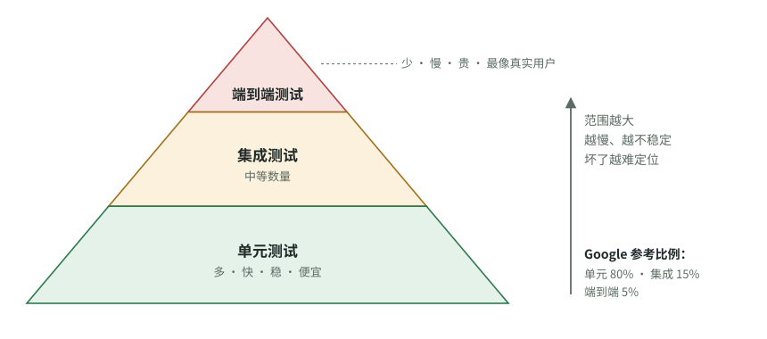

# 测试是什么：好测试、多余的测试和有害的测试

[知识库首页](../../README.md) · [本专题目录](README.md)

> **阅读目标**：从可观察行为判断测试是否有价值，分清检错证据、重复检查与妨碍修改的脆弱断言。

<details>
<summary>本文目录</summary>

- [一、测试解决什么问题](#section-1)
- [二、测试的三个层次](#section-2)
- [三、好测试的标准：测“行为”，不测“写法”](#section-3)
- [四、多余的测试和有害的测试：六种常见形态](#section-4)
- [五、测试覆盖率：一个容易误用的数字](#section-5)
- [六、那应该测多少？](#section-6)
- [七、怎样一眼判断“测试是否过度”](#section-7)
- [自测](#section-8)

</details>

“Codex 经常过度测试，但我看不出来”——要看出来，先要知道**测试本来是干什么的、需要多少、什么样的测试有价值**。这一章不要求你会写测试，但读完后你能看着一份测试清单说出“这几个是有用的，这几个是凑数的”。

<a id="section-1"></a>
## 一、测试解决什么问题

假设你的 AI 应用有一个功能：根据会员等级计算折扣价。

```python
def discount_price(price, level):
    # 金卡 8 折，银卡 9 折，其他不打折
    if level == "gold":
        return price * 0.8
    if level == "silver":
        return price * 0.9
    return price
```


今天它是对的。三个月后，有人（或 Codex）为了加“钻石卡”改了这段代码，不小心把银卡写成了 0.8。如果没有测试，只有用户投诉时才会发现。

**测试就是“检查程序的程序”**：它用固定的输入调用功能，然后**断言**（assert，“断定必须如此”）输出应该是什么。

```python
def test_银卡打九折():
    assert discount_price(100, "silver") == 90   # 断言：100 元银卡价必须是 90

def test_普通用户不打折():
    assert discount_price(100, "normal") == 100
```


以后每次改代码，跑一遍测试（几秒钟），银卡被改错就会立刻报错。**测试的价值 = 它能抓到的真实错误 × 它省下的人工检查时间 − 写它和维护它的成本。**最后那一项很容易被忽略。Martin Fowler 网站上那篇经典文章说得很直白：测试套件里的每一个测试都是额外的负担，不是免费的（Ham Vocke，*The Practical Test Pyramid*，2018）。

<a id="section-2"></a>
## 二、测试的三个层次

按“一个测试覆盖多大范围”分，最常用的是三层：

| 层次 | 测的是什么 | 打个比方 | 速度 | 坏了时好不好定位 |
|---|---|---|---|---|
| **单元测试**（unit） | 一个函数或一个小模块，单独测 | 单独测汽车的一个零件 | 毫秒级 | 很容易，范围小 |
| **集成测试**（integration） | 几个模块连在一起能否配合，比如代码 + 数据库 | 测发动机和变速箱装在一起能否运转 | 秒级 | 中等 |
| **端到端测试**（end-to-end，E2E） | 模拟真实用户从头到尾走一遍，比如打开网页、登录、下单 | 整车上路试驾 | 秒到分钟级 | 难，可能是任何一环出错 |

**测试金字塔**：底层多、上层少。Vocke 的原话是：写大量小而快的单元测试，写一些粒度更粗的测试，**只写很少的高层端到端测试**。Google 的《Software Engineering at Google》第 11 章给出的参考比例是大约 **80% 单元、15% 集成、5% 端到端**。



图 2-1　测试金字塔（据 Ham Vocke《The Practical Test Pyramid》中的金字塔示意和《Software Engineering at Google》第 11 章的比例重绘）。越往上，单个测试覆盖的范围越大，但越慢、越不稳定，所以数量应该越少。

**为什么是金字塔，不是倒过来**：端到端测试慢（一次跑几分钟）、容易因为网络或界面小改动而失败、失败了也很难看出是哪里坏了。单元测试快且准。**一个检查能放在低层做，就不要在高层重复做**——Vocke 称之为“把测试尽量往金字塔下层推”。

Google 还提醒了另一个维度：**测试大小**（是否用网络、多进程等资源）和**测试范围**是两回事。对你来说记住一点即可：**依赖网络、真实数据库、外部 API 的测试越多，测试就越慢、越不稳定。**

<a id="section-3"></a>
## 三、好测试的标准：测“行为”，不测“写法”

**行为**是外部能看到的结果：“银卡 100 元付 90 元”。**写法（实现细节）**是代码内部怎么算出来的：先调用哪个函数、变量叫什么名字。

好测试只关心行为。这样以后代码重写了、优化了，只要行为没变，测试就不用改；行为变错了，测试一定报警。

**反面例子：“变化探测器”测试**（Google 测试博客，Alex Eagle，2015，*Change-Detector Tests Considered Harmful*）：

```python
def test_折扣计算流程():
    # 用“替身”记录内部调用顺序，然后断言调用顺序必须是这样
    verify_called_in_order(load_level, apply_rate, round_price)
```


这个测试不检查价格对不对，只检查“内部按这个顺序调用了这几个函数”。后果：

- 代码算错了价格，只要调用顺序没变，测试照样通过。**抓不到真错误。**
- 有人把代码改得更简洁、行为完全不变，测试却失败，需要跟着改。**制造维护成本。**

那篇文章的结论是：这种测试是**负价值**，应该重写或删除。

### 概念卡：替身（mock / stub / fake）

- **问题**：测“下单”功能时，不想真的扣用户的钱、真的调用大模型 API。
- **白话**：替身是假装成真实依赖的假对象，比如一个“假支付接口”，永远返回“支付成功”。
- **类比**：拍电影时的替身演员。**不成立之处**：替身演员动作和真人一样；软件替身往往只模仿了真实依赖的一小部分行为，可能和真实情况不一致。
- **风险**：替身用得太多，测试测的就是“替身之间的配合”，而不是真实系统。Anthropic 的 Claude Code 最佳实践里，好的任务写法示例就特意加了一句“avoid mocks（避免使用替身）”。

<a id="section-4"></a>
## 四、多余的测试和有害的测试：六种常见形态

| 形态 | 长什么样 | 为什么不好 | 依据 |
|---|---|---|---|
| 测琐碎代码 | 给只是“取一个值、存一个值”的代码写测试 | 没有逻辑可错，测试零收益 | Vocke 2018：测简单的 getter/setter 得不到任何东西 |
| 变化探测器 | 断言内部调用顺序、私有变量的值 | 抓不到错误，阻碍重构 | Google 测试博客 2015 |
| 脆弱测试（brittle） | 把输出的每个细节都写死，比如整段文案、时间戳 | 无关改动也会让它失败 | Google SWE Book 第 11 章 |
| 重复测试 | 同一个规则在单元、集成、端到端各测一遍 | 一处改动要改三处测试，运行时间翻倍 | Vocke 2018 |
| 不稳定测试（flaky） | 有时过有时不过（依赖网络、时间、随机数） | 大家开始无视失败，测试失去公信力 | Google：不稳定率超过 1% 时，测试就失去可信度 |
| 测不可能发生的情况 | 为根本不会出现的输入写大量防御代码和测试 | 增加复杂度，没有用户价值 | Anthropic 文档：追着审查意见修改会导致过度设计和“针对不可能情况的测试” |

还有一种比“多余”更危险的：**假测试**。测试被改到“怎么都能过”，比如把期望值改成程序当前的错误输出、直接跳过某个测试、或者让代码专门识别测试输入返回固定答案。这不是测试多了，而是测试失效了。第 04 章会讲研究中观察到的 AI 编程代理的这类行为，第 06 章讲怎么发现。

<a id="section-5"></a>
## 五、测试覆盖率：一个容易误用的数字

**覆盖率（coverage）**：测试运行时执行到了多少比例的代码行。80% 覆盖率表示有 20% 的代码从没被任何测试执行过。

它能告诉你**哪里完全没测**，但**不能告诉你测得好不好**：一个测试可以执行每一行代码而不检查任何结果。Inozemtseva 与 Holmes（ICSE 2014）的实证研究发现，在控制测试套件大小之后，覆盖率与测试套件发现缺陷的能力只有弱到中等的相关性（本系列已有精读：[《覆盖率与测试有效性》](../testing/07_Coverage_Effectiveness.md)）。

**对你的启示**：不要给 Codex 下“覆盖率达到 90%”这种指标，它会为了数字写出大量低价值测试。要说清楚**哪些行为必须被测试保护**。

<a id="section-6"></a>
## 六、那应该测多少？

Google 的说法是“Beyoncé 规则”：**如果你在乎它，就该给它加个测试**（If you liked it, then you shoulda put a test on it）。反过来读同样有用：**你说不出“在乎它什么”的测试，多半不需要。**

给 Codex 的任务可以按风险分级：

| 改动类型 | 合理的测试要求 |
|---|---|
| 改文案、调样式、改日志 | 通常不需要新测试，跑现有测试确认没坏即可 |
| 修一个 bug | **先写一个能重现这个 bug 的测试**（修之前失败），再修复（修之后通过）。一个到几个测试就够 |
| 新增一个业务规则 | 正常情况 + 边界情况（空值、最大值、非法输入）的单元测试 |
| 涉及钱、权限、数据删除 | 单元测试 + 至少一个集成测试，并要人工审查 |
| 新增一条完整用户流程 | 少量端到端测试覆盖主路径即可，细节放在单元测试 |

### 概念卡：测试驱动开发（TDD）

- **做法**：先写一个会失败的测试（红），写最少的代码让它通过（绿），再整理代码（重构）。如此循环。
- **为什么和 AI 有关**：Kent Beck（TDD 的提出者）在 2025 年描述他用 AI 写代码的经验时，正是用 TDD 加一份计划文件来约束 AI 不跑偏（见第 06 章）。测试先由人确认，AI 只负责让它通过——这样测试的“标准”掌握在人手里，而不是 AI 写完代码再给自己出题。

<a id="section-7"></a>
## 七、怎样一眼判断“测试是否过度”

拿到 Codex 的改动，看测试部分，按顺序问：

1. **测试与改动的比例**：改了 10 行业务代码，新增了 300 行测试？不一定错，但要问清每组测试保护的是什么行为。
2. **测试名字**：好测试的名字读起来像一句业务规则（“银卡打九折”）。如果名字是“test_function_calls_helper”这种描述内部调用的，警惕变化探测器。
3. **替身数量**：一个测试里替身比真实对象还多，测的多半是替身。
4. **是否改了已有测试**：已有测试被修改、删除、标记跳过（`skip`），必须要求说明理由。
5. **端到端测试的数量**：一个小功能就加了好几个浏览器端到端测试，通常过度。
6. **运行时间**：测试套件从 30 秒变成 5 分钟，以后每次检查都要多等。

<a id="section-8"></a>
## 自测

<details>
<summary>1. 用一句话区分单元测试和端到端测试，并说出为什么端到端测试应该少。</summary>

单元测试单独检查一个小功能，快且准；端到端测试模拟用户走完整流程，最接近真实但慢、不稳定、坏了难定位。所以同样的检查能在低层做就不在高层重复。
</details>

<details>
<summary>2. 一个测试检查“函数 A 先调用了 B 再调用了 C”。代码算错了结果，测试会失败吗？这叫什么测试？</summary>

不一定失败——只要调用顺序没变就会通过。这是“变化探测器”测试：抓不到行为错误，却会在无害的重构时失败，Google 测试博客认为它是负价值。
</details>

<details>
<summary>3. 为什么不建议要求 Codex“覆盖率达到 90%”？应该怎么说？</summary>

覆盖率只衡量代码是否被执行，不衡量是否被正确检查；追数字会产生大量低价值测试。应该列出必须被保护的行为和边界情况，例如“银卡、金卡、普通用户的价格，以及价格为 0 和负数时的处理”。
</details>

<details>
<summary>4. 修 bug 时，“先写一个失败的测试”有什么好处？</summary>

它证明这个测试确实能抓到这个 bug（修之前失败），修复后通过就说明修好了；以后同样的 bug 回来，测试会再次报警。如果测试在修之前就能通过，说明它根本没测到问题。
</details>

**延伸阅读**：

- Ham Vocke，*The Practical Test Pyramid*（martinfowler.com，2018）
- 《Software Engineering at Google》第 11 章 *Testing Overview*（免费在线）
- Alex Eagle，*Change-Detector Tests Considered Harmful*（Google Testing Blog，2015）

---

[上一篇](./01_%E6%9C%80%E5%B0%8F%E7%9F%A5%E8%AF%86%E9%9B%86.md) · [下一篇](./03_Codex%E5%A6%82%E4%BD%95%E5%B7%A5%E4%BD%9C.md) · [专题目录](README.md) · [知识库首页](../../README.md)
