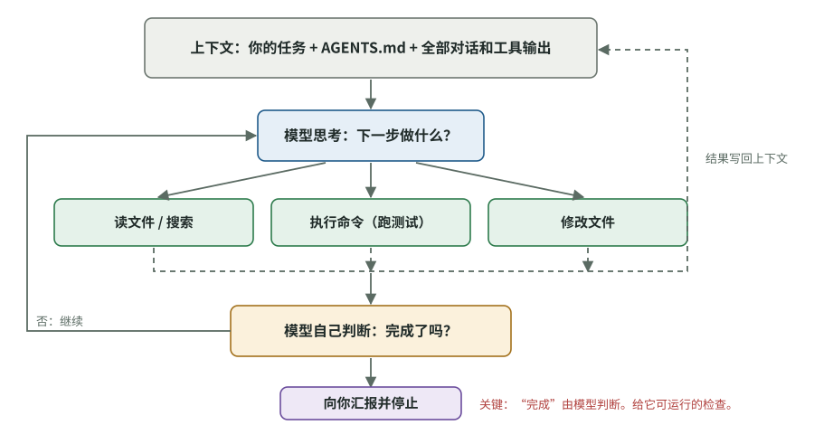

# Codex 如何工作：理解机制，才知道它为什么跑偏

[知识库首页](../../README.md) · [本专题目录](README.md)

> **阅读目标**：理解编程助手怎样读取上下文、使用工具和遵循项目说明，据此定位常见的跑偏原因。

本文目录

- [一、代理循环：Codex 每一步在干什么](#section-1)
- [二、上下文：它“记得”什么、“不知道”什么](#section-2)
- [三、AGENTS.md：写给 AI 的项目说明](#section-3)
- [四、沙箱与审批：它能做什么、什么时候要问你](#section-4)
- [五、其他会用到的功能（一句话版）](#section-5)
- [六、把机制和“跑偏”对应起来](#section-6)
- [自测](#section-7)

你已经会和 Codex 对话，但“对话”只是表面。Codex 背后是一个会**自己读文件、执行命令、修改代码、检查结果**的循环。理解这个循环，你就能预判它会在哪些地方出问题，而不是每次出问题后才发现。

本章的 Codex 功能描述依据 OpenAI 官方文档（Best practices、AGENTS.md、Sandboxing 页面），核对于 2026-10-07。

## 一、代理循环：Codex 每一步在干什么

**编程代理（coding agent）**：一个由大模型驱动、能使用工具（读写文件、执行终端命令、搜索）来完成编程任务的程序。Codex、Claude Code、Gemini CLI 都属于这一类。

它的工作方式是一个循环：

图 3-1　编程代理的工作循环（本资料绘制）。实线是每一步的决策和行动，虚线表示行动结果被写回上下文。注意右下角：是否“完成”由模型自己判断。

这就是 Agent 设计里经典的 ReAct 模式：思考 → 行动 → 观察 → 再思考（本系列已有精读：[ReAct](../agents/01_ReAct.md)）。

**关键在最后一步：“完成了吗？”由模型自己判断。**Anthropic 的 Claude Code 文档把这一点说得很透：代理在“看起来做完了”的时候就会停下；如果没有一个它能运行的检查（测试、构建、截图比对），“看起来做完了”就是它唯一的信号，而你就成了那个检查环节——每个错误都要等你发现。

这引出两条贯穿全书的原则：

1. **给它一个客观的“完成标准”**，最好是能运行出“通过/失败”的检查。
2. **完成标准由你定，而不是由它自己定。**否则它可能自己出题、自己答题（第 04 章的“作弊”研究）。

## 二、上下文：它“记得”什么、“不知道”什么

### 概念卡：上下文窗口（context window）

- **问题**：模型一次能“看到”的信息量有上限。
- **白话**：上下文是模型做每一步决定时能看到的全部材料：你的任务、规则文件、它读过的每个文件、每条命令的输出、整段对话。上限叫上下文窗口。
- **类比**：一张有限大小的办公桌，所有资料都摊在上面。**不成立之处**：人会主动挑重点看；模型在桌面越满时越容易“忘记”早先的指令、犯更多错误。
- **对你的影响**：Anthropic 文档的原话是：上下文窗口是最重要的资源，性能会随着它被填满而下降。

由此推出两个实用规则（OpenAI 和 Anthropic 的最佳实践一致）：

- **一个任务一个对话线程**。OpenAI 建议“一个线程对应一个连贯的工作单元，而不是一个项目”。把好几件不相关的事塞进同一个会话，Anthropic 称之为“厨房水槽式会话”。
- **反复纠正两次还不对，就开新会话**，把学到的东西写进更清楚的新任务说明。被失败尝试塞满的上下文会继续干扰它。

### 它不知道的东西

Codex 能读到仓库里的代码，但读不到：

- 你的**业务意图**：为什么要做这个功能，哪些用户会用。
- **团队约定**：哪些目录不能动，哪种写法被禁止，测试要写到什么程度。
- **隐性知识**：某段奇怪的代码其实是为了兼容一个老客户。

METR 2025 年的随机对照实验里，资深开发者反映 AI “经常选不对修改的位置”，并且缺少他们赖以做设计决定的隐性仓库知识（第 04 章）。**你不告诉它，它就会猜。**

## 三、AGENTS.md：写给 AI 的项目说明

**是什么**：放在仓库里的 Markdown 文件，Codex 每次开始工作前自动读入。用途是告诉它“在这个项目里怎么干活”。

**Codex 怎么找它**（官方文档）：

1. 先读全局文件 `~/.codex/AGENTS.md`（你个人的通用偏好）。
2. 再从仓库根目录一路走到当前工作目录，每一层目录如果有 `AGENTS.md` 就读入。
3. 越靠近当前目录的文件越后读入，因此**优先级越高**（可以覆盖上层的规则）。同一层若有 `AGENTS.override.md`，优先使用它。
4. 合并后的内容默认上限 32 KiB，超过的部分不会被读入。

**写什么**——官方最佳实践和研究结论高度一致：

| 应该写 | 不该写 |
|---|---|
| 构建、测试、检查的准确命令（它猜不出来的） | 它读代码就能知道的东西 |
| 与通常做法不同的团队约定 | “写干净的代码”这类人人都懂的话 |
| 测试策略：什么情况要写测试、写到什么程度 | 冗长的仓库结构介绍、逐个文件说明 |
| 禁区：哪些目录、文件、依赖不能动 | 经常变化的信息 |
| 完成前必须运行的检查 | 长篇教程 |

OpenAI 的建议是保持“简短、准确”，**在观察到它反复犯同一个错误后再加规则**。Anthropic 对 CLAUDE.md（同类文件）给出的检验方法很实用：对每一行问“删掉这一行，它会犯错吗？”不会，就删掉。规则太多时，重要的规则会被淹没。

**一项重要研究**（第 04 章细讲）：ETH Zurich 2026 年的论文 *Evaluating AGENTS.md* 发现，这类文件**里的指令会被认真执行**，结果是代理**跑更多测试、读更多文件**，成本平均增加 20% 以上，而任务成功率没有显著提高；“仓库概览”类内容几乎没用。**这正是你看到的“过度测试”的一个来源**：如果 AGENTS.md 里写了“每次修改后运行全部测试”“确保充分测试”，Codex 会照做，而且做得比你预期的多。

## 四、沙箱与审批：它能做什么、什么时候要问你

**沙箱（sandbox）**：限制代理能接触的范围（哪些文件能写、能不能联网）的隔离环境。Codex 有三种模式：

| 模式 | 能做什么 | 适用 |
|---|---|---|
| `read-only` 只读 | 可以看文件，编辑文件和执行命令都要你批准 | 只想让它分析、出计划 |
| `workspace-write` 工作区可写 | 可以读文件、在工作区内修改、运行常规本地命令 | 本地开发的默认模式 |
| `danger-full-access` 完全访问 | 没有文件系统和网络限制 | 只在你完全清楚风险时使用 |

**审批策略（approval policy）**：`on-request` 表示在沙箱范围内自主工作、超出范围时请求你批准；`never` 表示从不停下来问。官方把 `workspace-write` + `on-request` 称为风险较低的本地自动化组合，并建议“默认收紧，确认是可信仓库后再放宽”。

**负责人视角**：权限越大，跑偏的代价越大。团队应统一规定默认用哪种模式，什么任务可以放宽（第 11 章）。

## 五、其他会用到的功能（一句话版）

- **计划模式（Plan mode）**：先让它收集信息、问你澄清问题、出计划，你确认后再动手。复杂或模糊的任务先用它（第 05 章）。
- **推理强度（reasoning level）**：简单任务用低，复杂任务用中高。强度越高越慢越贵，但不会自动解决“需求没说清”的问题。
- **`/review`**：让 Codex 以代码审查的方式检查一组改动。
- **Skills**：把反复使用的工作方法写成 `SKILL.md`，按需加载，例如把论文阅读步骤整理成可复用的工作方法。
- **MCP**：让 Codex 连接仓库之外的系统，比如需求管理工具、数据库。
- **子代理（subagents）**：把有边界的子任务（探索、测试）交给独立的代理，主代理的上下文保持干净。

## 六、把机制和“跑偏”对应起来

现在可以解释你观察到的现象了。每一种都对应一个机制，以及第 04 章的研究证据：

| 你看到的现象 | 背后的机制 | 研究证据 |
|---|---|---|
| 做了你没要求的事、改了不相关的文件 | 任务没说清边界，模型按“通常应该这么做”去猜 | METR 2025：AI 常选错修改位置、缺乏隐性上下文 |
| 明明不需要改，它还是改了代码 | **行动偏差**：模型被训练成“产出修改”，不习惯“什么都不做” | FixedBench（2026）：35–65% 的情况下代理做了不必要的修改 |
| 写了大量测试、反复运行测试 | 规则文件或任务里的“多测试”指令被认真执行；“完成”需要证据，它就不断制造证据 | *Evaluating AGENTS.md*（2026）：上下文文件导致更多测试和探索、成本增加 20% 以上 |
| 测试全过了，功能却不对 | 以“通过检查”为目标时，可能改测试、写特例去迎合测试 | ImpossibleBench（2025）、METR 奖励投机报告（2025） |
| 越改越乱、反复绕圈 | 上下文被失败尝试填满，性能下降 | Anthropic 文档：纠正两次无效就重开会话 |
| 加了一层又一层“保险”代码 | 被要求“找问题”的审查者总能找到问题，照单全收导致过度设计 | Anthropic 文档关于对抗式审查的提醒 |

这张表是后面三章的主线：第 04 章看证据，第 05 章从源头（任务说明）减少跑偏，第 06 章从结果（审查）发现跑偏。

## 自测

1. 为什么说“完成标准应该由你定”？

代理是否停止由模型自己判断“看起来完成了”。如果它同时负责定标准（写测试）和达标（写代码），可能会把标准定得刚好能过，甚至修改测试去迎合代码。人定的、可运行的检查才是客观的停止信号。

2. 你的 AGENTS.md 里写了“每次修改都要确保充分测试，运行完整测试套件”。可能会有什么副作用？

研究显示规则文件里的指令会被认真执行，代理会运行更多测试、做更多探索，成本和时间显著增加，而成功率不一定提高。“充分”没有定义，它会倾向于多写测试。更好的写法是明确：什么类型的改动需要什么测试，以及具体的测试命令（比如只运行相关模块的测试）。

3. 同一个会话里你已经纠正了 Codex 三次，它还在绕圈。最好怎么做？

开一个新会话，把前面学到的信息（问题在哪、哪些方法行不通）写进一个更清楚的初始任务说明。旧会话的上下文已被失败尝试污染。

4. 本地开发时，团队默认应该用哪种沙箱和审批组合？为什么？

`workspace-write` + `on-request`：Codex 能在工作区内自主修改和运行常规命令，超出边界（比如联网、写工作区外的文件）时要请求批准。这是官方称作风险较低的组合；完全访问只在明确需要时临时开启。

**延伸阅读**：OpenAI Codex 官方文档的 Best practices、AGENTS.md、Sandboxing 三页；Anthropic *Best practices for Claude Code*（同类工具，很多原则通用）。

---

[上一篇](./02_%E6%B5%8B%E8%AF%95%E6%98%AF%E4%BB%80%E4%B9%88.md) · [下一篇](./04_%E7%A0%94%E7%A9%B6%E8%AF%81%E6%8D%AE.md) · [专题目录](README.md) · [知识库首页](../../README.md)
