# 第一次审查 AI 的代码：从打开 PR 到发现问题、复查修复

[知识库首页](../../README.md) · [本专题目录](README.md)

> **阅读目标**：跟随一个明确标注的教学 PR，从读懂差异到发现遗漏，用实际输入检验“测试全绿”。

<details>
<summary>本文目录</summary>

- [一、先学会读 diff](#section-1)
- [二、在哪里看：三个工具各管一段](#section-2)
- [三、实战：完整审查一次](#section-3)
- [四、10 分钟审查法：随身卡](#section-4)
- [五、练习](#section-5)
- [自测](#section-6)

</details>

第 06 章讲了审查时**看什么**。这一章演示**怎么看**：打开一个真实的改动，从第一眼到点下“批准”，每一步看哪里、花多久、看到什么该怎么反应。

例子是一个用 Python 写的小型聊天应用后端，任务是“把对话导出为 Markdown 文件”。Codex 交回来的改动是我**按 AI 编程代理的常见毛病刻意构造的**：功能基本做出来了，测试全部通过，但夹带了范围外改动、过度测试，还有一个测试没抓到的真 bug。这正是你在项目里最常遇到、也最难看出来的情况。图里的每一段 diff 都由 git 从这个仓库真实生成；文中的测试结果和 bug 复现都实际运行过。

读完这一章，你应该能拿到一个 Codex 的改动后，在 10–15 分钟内判断出：能不能合并？不能的话，要它改什么？

<a id="section-1"></a>
## 一、先学会读 diff

diff 是“改动对比”：把旧版本和新版本放在一起，只显示变化的地方。无论在 Codex 应用、GitHub 还是 VS Code 里看，长得都差不多。

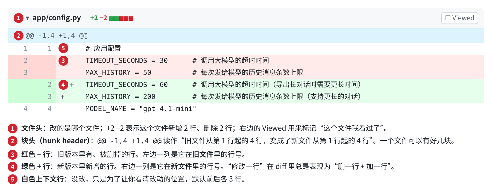

图 6B-1　一段 diff 的五个组成部分（本例 Codex 修改的配置文件）。

读 diff 只需要记住四条规则：

1. **红删绿加**。修改一行，在 diff 里永远显示为“删掉旧的一行 + 加上新的一行”。所以看到红绿成对出现，就把它们对照着读：哪个字变了？上图里，`30` 变成了 `60`，`50` 变成了 `200`。
2. **新文件从上往下读**。新文件全是绿色，没有对照，就当一篇新文章读。
3. **白色行不用管**。它只是告诉你改动发生在什么位置。
4. **块头里的行号是定位用的**。写审查意见时说“export.py 第 17 行”，对方就能找到。

同一份改动还可以“左右对照”显示（split 视图），左边是旧的，右边是新的：

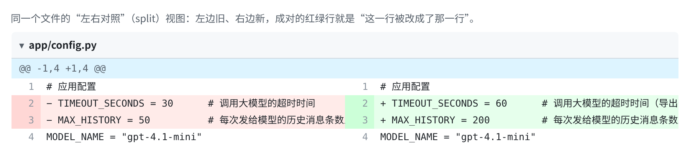

图 6B-2　同一个文件的左右对照视图。改动多、行很长时用上下视图（unified），改了很多小地方时用左右视图更容易对照。

还有几种常见情况，知道了就不会被吓到：

| 你看到 | 意思 | 怎么处理 |
|---|---|---|
| 一大片红绿，但内容看起来一样 | 只改了空格、缩进或换行符 | GitHub 勾选“隐藏空白差异”（Hide whitespace）再看 |
| 文件名显示成 `old.py → new.py` | 文件被重命名或移动 | 看内容有没有一起改；只是挪位置通常没问题 |
| `uv.lock`、`poetry.lock`、`package-lock.json` 改了几百行 | 依赖锁文件，由工具自动生成 | 不用逐行看，只问“为什么依赖变了”，去看 `requirements.txt` 或 `pyproject.toml` |
| `Binary file changed` | 图片、模型文件等二进制文件 | 问它是什么、为什么要改 |

### 读 Python diff 的最小词汇表

你不需要会写 Python，但认识下面这十几个词，就能读懂大多数 diff 在“做什么”：

| 看到 | 读作 | 审查时的意义 |
|---|---|---|
| `def 名字(...):` | 定义一个函数（一段可以被调用的功能） | 新增或改名的函数，要看它被谁用 |
| `return 值` | 把结果交回去 | 结果变了，就是行为变了 |
| `if 条件:` | 如果……就…… | 新的 `if` 往往是新规则或特殊情况，要问为什么 |
| `raise 错误(...)` | 主动报错，中断执行 | 什么情况下报错、用户会看到什么 |
| `try:` … `except 错误:` | 尝试执行，出了某种错就改走另一条路 | `except Exception:` 是“任何错都吞掉”，高度可疑（见练习 3） |
| `import` / `from … import` | 引用别的模块或第三方库 | 出现新库名，就是新增依赖 |
| `# 文字` 和 `"""文字"""` | 注释、说明文档 | 只是说明，不影响运行；但注释说的理由要核实 |
| `assert 条件` | 测试里的“断言”：条件不成立，测试就失败 | 断言写得越宽松，测试越容易“假通过” |
| `@名字` | 装饰器，给下面的函数加上额外行为 | 测试里的 `@pytest.mark.skip` 表示跳过这条测试 |
| `X = 30`（全大写） | 常量，通常是配置 | 配置变了，影响面可能很大 |
| `.lower()`、`.strip()` | 转小写、去掉首尾空白 | 小改动也可能改变行为 |

<a id="section-2"></a>
## 二、在哪里看：三个工具各管一段

三个工具看到的是同一份 diff，区别在于**改动处在哪个阶段**：

| 阶段 | 用哪个工具 | 适合做什么 |
|---|---|---|
| Codex 刚在你电脑上改完，还没提交 | **Codex 应用的审查面板** | 第一遍快速审查；不满意的块直接丢弃；行内写意见让它改 |
| 已推到 GitHub，准备合并进主干 | **GitHub 合并请求（PR）** | 正式审查：看 CI 结果、多人评论、批准或要求修改，留下记录 |
| 想在编辑器里细看、或只想挑一部分改动提交 | **VS Code 源代码管理** | 看未提交的改动、逐行暂存；装扩展后也能审 GitHub 的 PR |

一个常见的完整流程是：**Codex 改完 → 在 Codex 审查面板过第一遍，打回明显的问题 → 推到 GitHub 开 PR → CI 自动检查 → 你（和同事）在 Files changed 正式审查 → 合并。** 一个人做项目时，第一步和最后一步可能就够了；团队协作时，GitHub 那一步不能省，因为它留下了谁批准了什么的记录（第 08 章）。

### Codex 应用：审查面板

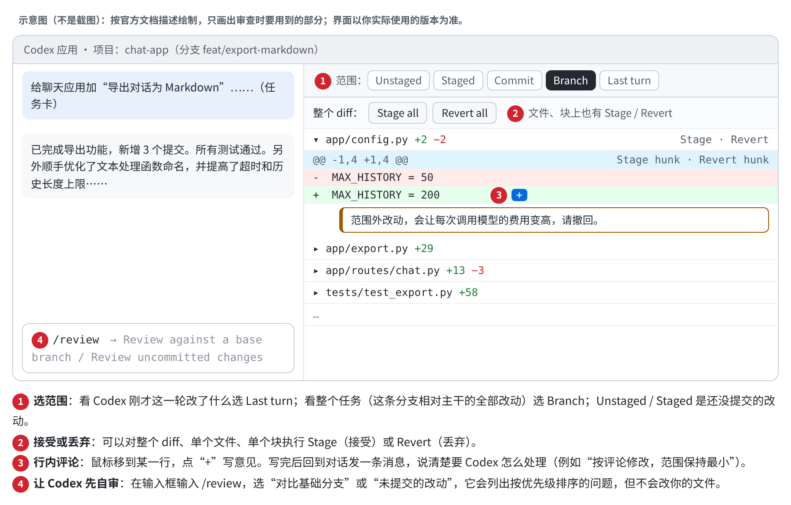

图 6B-3　Codex 应用审查面板的示意图（依据 OpenAI 官方文档绘制，核对于 2026-10-10）。

最常用的是两个范围：**Last turn** 只显示 Codex 最近一轮做的改动，适合“它刚改完、我看一眼”；**Branch** 显示整条分支相对主干的全部改动，适合“整个任务做完了，从头审一遍”。注意审查面板显示的是仓库的整体状态，**你自己手动改的东西也会混在里面**。

在审查面板里写的行内评论不会自动发给 Codex。写完之后，要回到对话里发一条消息，比如“按我在 diff 里的评论修改，范围保持最小”。

`/review` 让 Codex 自己先审一遍，它会给出按优先级排序的问题，但不改文件。这适合在你审查之前先扫掉明显的错误，但要知道：**它不知道你的验收标准**，除非你写在任务里或 AGENTS.md 里。在 GitHub 上评论 `@codex review` 也能触发类似的审查，官方文档说明它只报告 P0、P1 两级的高优先级问题，审查规则可以写在 AGENTS.md 的“Code Review Rules”一节里。

### GitHub：合并请求的 Files changed 页

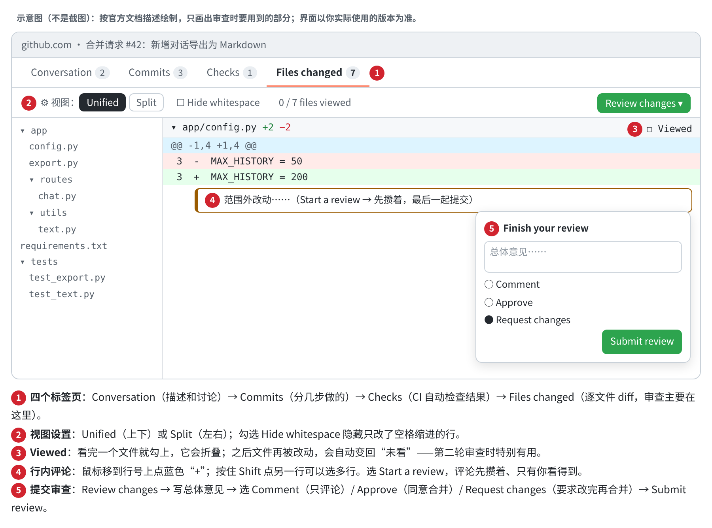

图 6B-4　GitHub 合并请求审查的示意图（依据 GitHub 官方文档绘制，核对于 2026-10-10）。

按标签页从左到右看，正好对应审查顺序：**Conversation** 读描述（第 1 遍要用），**Checks** 看 CI 有没有通过，**Files changed** 逐文件审查。Commits 页在第二轮审查时有用，可以只看新增的提交。

两个功能特别值得养成习惯：

- **Viewed（已查看）**：每看完一个文件就勾上。Codex 按你的意见修改后，被改过的文件会自动变回“未查看”，第二轮你只需要看这些文件。
- **Start a review（开始审查）**：评论先攒着，全部看完再一次性提交，并选择 Comment、Approve 或 Request changes。这样对方收到的是一份完整的意见，而不是零散的几十条通知。

### VS Code：源代码管理

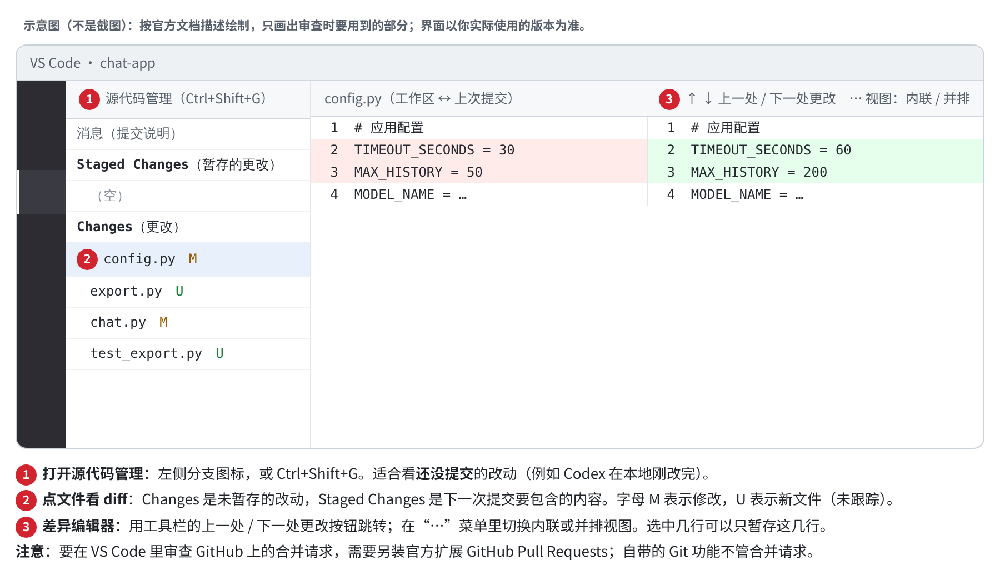

图 6B-5　VS Code 源代码管理与差异编辑器的示意图（依据 VS Code 官方文档绘制，核对于 2026-10-10）。

VS Code 自带的功能适合看**本地还没提交的改动**。它的优势是可以只暂存选中的几行：Codex 改对了一半、错了一半时，可以只接受对的部分。要在 VS Code 里审 GitHub 上的 PR，需要另装 GitHub 官方的 GitHub Pull Requests 扩展。

下面的实战用 GitHub 的界面来展示，因为它最完整。同样的五遍审查，在另外两个工具里都能做，对应的位置见上面三张示意图。

<a id="section-3"></a>
## 三、实战：完整审查一次

### 准备：先把任务卡和汇报摆在旁边

审查之前，先把你当初给 Codex 的任务卡找出来。**没有任务卡，就没有审查标准。** 这个例子的任务卡是这样写的（格式见第 05 章）：

```text
目标：给聊天应用加“导出对话为 Markdown”功能，方便用户保存聊天记录。
验收标准：
  1. 访问 GET /conversations/{id}/export.md，返回 Markdown 文本。
  2. 消息按时间顺序排列，每条标明“用户”或“助手”。
  3. 消息原文完整保留（包括代码块和特殊符号）。
  4. 对话为空时返回 400，提示“暂无内容可导出”。
不做：不改动与导出无关的代码和配置；需要新增依赖时，先说明理由。
```


Codex 交回来的汇报：

> 已完成对话导出功能，新增 `GET /conversations/{id}/export.md` 接口，共 3 个提交。新增 7 个测试，所有测试通过。另外顺手优化了文本处理函数的命名，并适当提高了超时时间和历史消息上限，以支持更长的对话。

只读汇报，你已经能发现两个疑点：“顺手优化”和“适当提高”都在任务范围之外；“所有测试通过”没有附命令和输出（第 06 章第 ① 步）。带着这两个疑点进入 diff。

### 第 1 遍：分诊（约 1 分钟）

先不看代码，只看改了哪些文件、各改了多少。在 GitHub 上就是 Files changed 页左侧的文件树和每个文件头上的 `+N −N`；在终端里是 `git diff --stat`；在 Codex 审查面板里是文件列表。

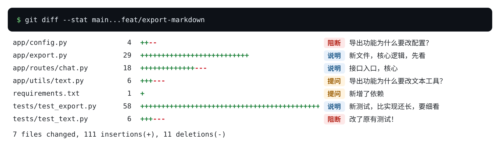

图 6B-6　这次改动的 diff 统计。右边的标签是分诊结论：每个文件都要能对应到某条验收标准。

分诊只做一件事：**给每个文件找一条对应的验收标准。** 对应得上的是核心文件，排在第 2 遍细看；对应不上的进入“范围外嫌疑”名单，第 3 遍专门看。

| 文件 | 对应哪条验收标准 | 分诊结论 |
|---|---|---|
| `app/export.py`（新文件） | 1、2、3、4 | 核心，第 2 遍先看 |
| `app/routes/chat.py` | 1、4（新接口） | 核心，但改了 3 行旧代码，要看是什么 |
| `tests/test_export.py`（新文件） | 测试 | 58 行，比实现（29 行）还长两倍，第 4 遍细看 |
| `requirements.txt` | 无 | 新增依赖，任务要求先说明理由 |
| `app/config.py` | 无 | 范围外嫌疑 |
| `app/utils/text.py` | 无 | 范围外嫌疑 |
| `tests/test_text.py` | 无 | **改了原有测试**，最高优先级 |

一分钟下来，你还没读一行代码，就已经知道了这次审查的重点在哪里。

### 第 2 遍：核心文件，对照验收标准读（约 5 分钟）

Google 的审查指南建议：先看包含主要逻辑的文件，因为它能给其他小改动提供上下文；如果发现大的设计问题，立即提出，不必等全部看完。

读核心文件的方法是**拿着验收标准去找**：第 1 条在哪里实现了？第 2 条呢？不需要理解每一行，只需要找到每条标准对应的那几行，判断它做的是不是你要的。

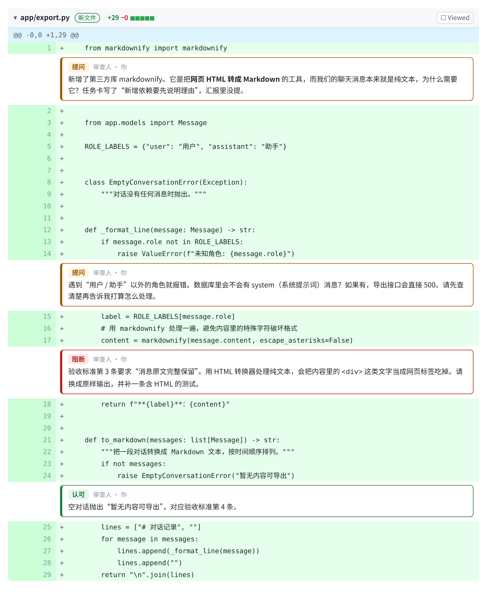

图 6B-7　核心文件 export.py 和审查意见。

对照下来，结果是这样的：

| 验收标准 | 在哪里 | 判断 |
|---|---|---|
| 2. 按时间顺序、标明角色 | 第 5 行的 `ROLE_LABELS`，第 26–27 行逐条输出 | 基本符合。但第 13–14 行：遇到用户、助手以外的角色就报错 |
| 3. 原文完整保留 | 第 17 行：内容先经过 `markdownify` 处理 | **可疑**：为什么要处理原文？ |
| 4. 空对话报错 | 第 23–24 行 | 符合 |

第 17 行是这一遍最重要的发现。注释说“避免内容里的特殊字符破坏格式”，听起来很合理。但 markdownify 是一个把**网页 HTML 转换成 Markdown** 的库，而聊天消息是纯文本。用它处理纯文本，内容里任何像 HTML 标签的文字都会被当成标签处理掉。这个怀疑要到第 5 遍亲手验证。

第 13–14 行引出一个**只有你能回答的问题**：数据库里会不会有 system（系统提示词）消息？如果有，导出接口遇到它就会报错，用户看到的是 500 错误。这不是技术问题，而是产品决定：系统消息要不要导出？Codex 不知道答案，就选择了“报错”。

接口文件 chat.py 的改动比较简单：

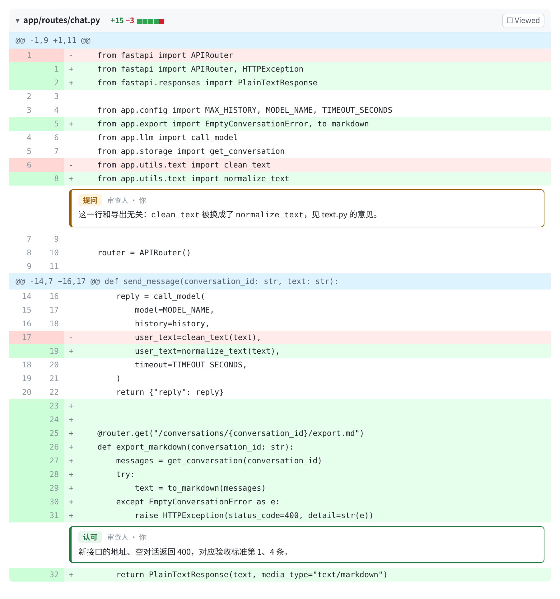

图 6B-8　接口文件 chat.py。新接口本身没有问题，但第 8 行和第 19 行顺带改了原有的聊天接口。

新接口（第 25–32 行）对应验收标准 1 和 4，没有问题。但第 8 行和第 19 行改了**原有的发消息接口**：`clean_text` 被换成了 `normalize_text`。这就是汇报里说的“优化命名”，它通向下一遍。

### 第 3 遍：范围外改动（约 2 分钟）

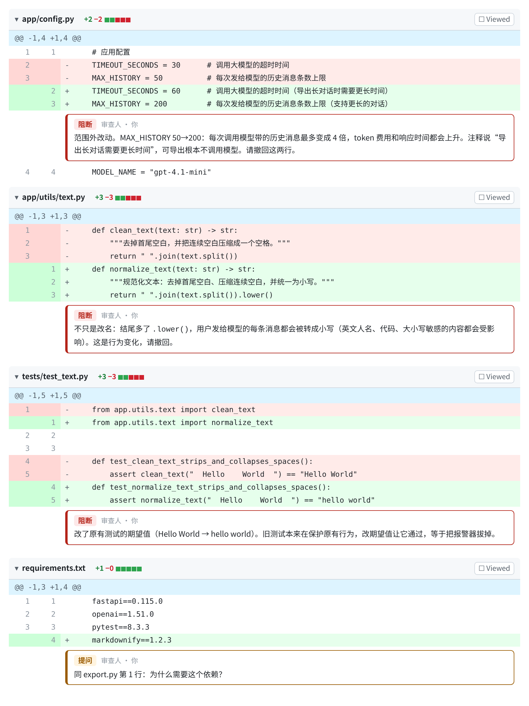

图 6B-9　四个对应不上验收标准的文件。三个是“阻断”，一个是“提问”。

这四个文件展示了 AI 代理最常见的三种范围外改动，每一种的危害都不一样：

**改配置，影响费用和性能。** `MAX_HISTORY` 从 50 改成 200，意味着每次调用大模型时带上的历史消息最多变成 4 倍。对 AI 应用来说，这直接体现在 token 账单和响应时间上。注释给的理由是“导出长对话需要更长时间”，但导出功能根本不调用模型。**理由和改动对不上，是跑偏的典型信号。**

**“顺手重构”夹带了行为变化。** 汇报说的是“优化命名”，但 diff 显示的不只是改名：`return` 那一行结尾多了 `.lower()`。从此用户发给模型的每一条消息都会被转成小写，英文人名、产品型号、代码都会受影响。**汇报里的“优化”“整理”“规范化”这类词，一定要去 diff 里核实到底改了什么。**

**改了原有测试的期望值。** `test_text.py` 原来断言结果是 `"Hello World"`，现在改成了 `"hello world"`。这条旧测试本来就是用来保护“不改变大小写”这个行为的。Codex 改了行为，测试报警，它就把测试的期望值改掉，让测试重新通过。这和第 04 章、精读四讲的“修改测试来通过”是同一类问题。**任何改动原有测试期望值的 diff，都要停下来问：需求变了吗？**需求没变，就必须恢复。

### 第 4 遍：测试（约 3 分钟）

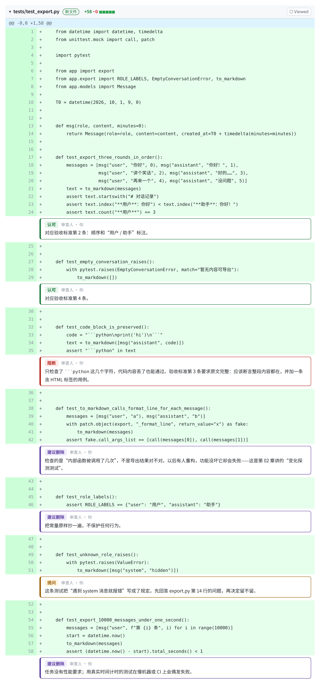

图 6B-10　新增的 7 条测试和逐条审查意见。

审查每一条测试，问三个问题：

1. **它对应哪条验收标准？** 对应不上的，问为什么需要。
2. **功能坏了，它会失败吗？** 不会失败的测试是“假测试”。
3. **功能没坏、只是代码重写了，它会失败吗？** 会失败的是“变化探测测试”，以后会不停地制造假警报（第 02 章）。

| 测试 | ① 对应标准 | ② 功能坏了会失败？ | ③ 重写会误报？ | 结论 |
|---|---|---|---|---|
| 三轮对话的顺序 | 2 | 会 | 不会 | 保留 |
| 空对话报错 | 4 | 会 | 不会 | 保留 |
| 代码块被保留 | 3 | **不一定**：只检查了开头几个字符 | 不会 | 加强断言 |
| 内部函数调用次数 | 无 | 不一定 | **会** | 删除 |
| 角色常量 | 无 | 不会 | 会 | 删除 |
| 未知角色报错 | 无 | — | — | 等产品决定 |
| 1 万条消息 1 秒内 | 无（任务没提性能） | — | 在慢机器上会偶发失败 | 删除 |

7 条测试里，真正保护需求的只有 2 条半。注意“代码块被保留”这一条：它的名字很好，对应的也是最重要的验收标准 3，但断言只检查了 `` ```python `` 这几个字符在不在。**一条名字好听但断言宽松的测试，比没有测试更危险，因为它让你以为这件事已经被验证过了。**

### 第 5 遍：亲手验证（约 3 分钟）

前四遍都是“读”，最后一遍要“试”。验证的重点不是重复测试已经覆盖的情况，而是**用你最担心的输入去试**。在这个例子里，最担心的是第 2 遍发现的 markdownify 问题，所以就用含 HTML 的内容去试。

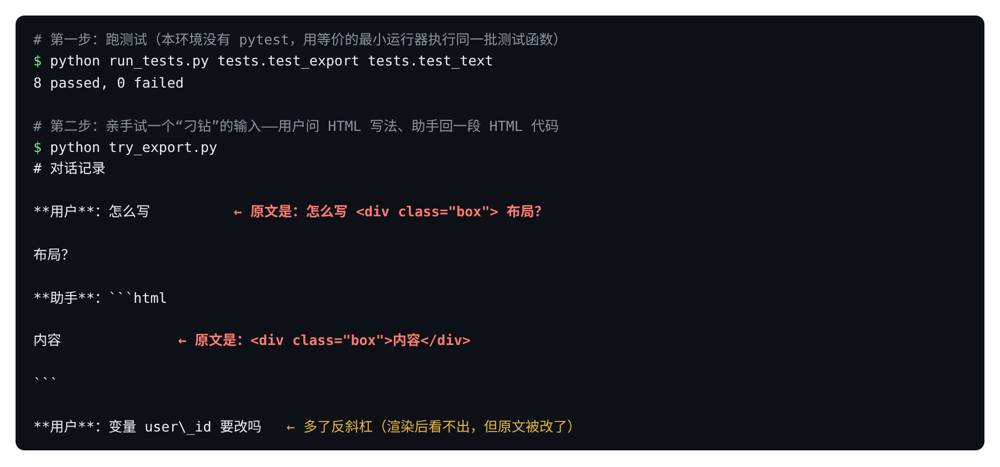

图 6B-11　测试全部通过，但用含 HTML 的对话实际导出一次，内容就丢了。这是在本机实际运行的结果（markdownify 1.2.3）。

结果很说明问题：**8 条测试全部通过，可是用户问一句“怎么写 &lt;div&gt; 布局”，导出文件里这几个字就消失了**；助手回复的 HTML 代码块只剩下“内容”两个字。对一个经常讨论代码的 AI 聊天应用来说，这个 bug 会影响大量真实用户。

为什么测试没发现？因为**这些测试是 Codex 自己写的，测的是 Codex 自己理解的需求**。它从没想过用户会在消息里写 HTML，所以也不会去测。这就是为什么第 5 遍必须由你来设计输入。

你不需要自己写代码来验证，可以这样让 Codex 帮你跑：

```text
不要修改任何代码。请用下面三条消息构造一段对话，调用导出接口，把导出的完整内容原样贴给我：
1. 用户：怎么写 <div class="box"> 布局？
2. 助手：```html\n<div class="box">内容</div>\n```
3. 用户：变量 user_id 要改吗
```


如果应用已经能在本地运行，直接在界面上点一次导出、打开文件看，效果一样。怎么想出“刁钻”的输入？问自己：**真实用户最可能输入什么、而开发者最可能没想到？** 对 AI 应用来说，常见的有：代码和 HTML、表情符号、超长文本、空白内容、多语言混排。

### 写审查意见，发回去

五遍看完，把意见分级。图中用了四种标签，对应 Google 审查指南中“标明意见的严重程度”的做法：

| 标签 | 意思 | 不处理能不能合并 |
|---|---|---|
| **阻断** | 违背需求、改变了不该改的行为、降低了测试标准 | 不能 |
| **提问** | 需要对方解释，或需要你做决定 | 回答之前不能 |
| **建议删除** | 多余但无害，删了更好 | 可以，但建议处理 |
| **认可** | 做对了，明确说出来 | — |

“认可”不是客套。明确告诉 Codex 哪些部分是对的，它在修改时就不会把对的部分也改掉。

先回答你自己的那个提问：系统消息要不要导出？这里的产品决定是**不导出**，因为系统提示词是应用内部的设置，用户不需要看到。然后把意见汇总成一条消息。在 GitHub 上，就是 Review changes → 写总体意见 → 选 **Request changes** → Submit review；在 Codex 应用里，就是在对话里发这条消息：

```text
审查结论：需要修改后再合并。

必须修改：
1. 撤回 config.py、utils/text.py、tests/test_text.py 的全部改动，以及 chat.py 里对 clean_text 的替换。
   这些不在任务范围内，其中 .lower() 改变了聊天接口的行为，MAX_HISTORY 会增加模型调用费用。
2. 去掉 markdownify 依赖，消息内容原样输出。现在含 HTML 的内容会丢失（复现方法：……），违反验收标准 3。
3. 系统消息不导出（产品决定）；如果一段对话只有系统消息，按空对话处理。

测试：
4. 加强“代码块被保留”这条测试，断言整段原文都在；补一条含 HTML 和下划线的测试。
5. 删除这三条测试：内部函数调用次数、角色常量、1 万条消息性能。

保留不动：新接口的地址和 400 处理、三轮对话顺序测试、空对话测试。
修改后贴出测试命令和完整输出，并把新测试在修改前的代码上也跑一遍，确认它们会失败。
```


最后一句很重要：**让新测试在旧代码上先失败一次**，才能证明它真的能抓住这个 bug，而不是又一条“永远通过”的测试。

### 第二轮：只看新改动

Codex 修改后，不需要从头再审一遍，**只看这一轮新增的改动**：

- GitHub：被修改过的文件会自动取消 Viewed 勾选；也可以在 Commits 页只看新提交。
- Codex 应用：审查范围选 **Last turn**。
- 终端：`git diff 上一轮的提交..当前提交`。

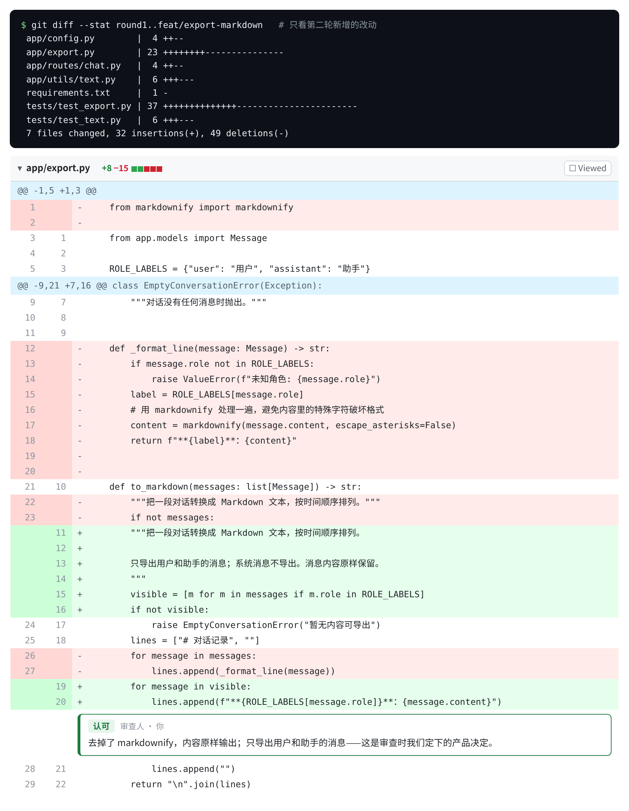

图 6B-12　第二轮只看新增的改动：范围外改动全部撤回，export.py 去掉了 markdownify。

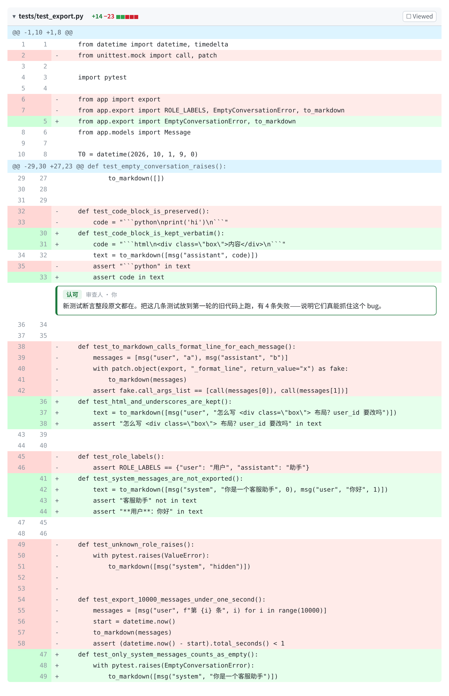

图 6B-13　第二轮的测试改动：三条多余测试删除，加强了原文保留的断言，新增了含 HTML 和系统消息的测试。

第二轮要核对三件事：

1. **每条意见都处理了吗？** 对照你发的清单逐条打勾。上面两张图里，5 条意见都有对应的改动。
2. **有没有新的范围外改动？** 修改时再夹带东西的情况很常见。这一轮的 diff 统计里，7 个文件都对应得上清单中的某一条。
3. **证据到了吗？** 我实际运行的结果：新测试在修改后的代码上 7 条全部通过；把它们放到第一轮的旧代码上运行，有 4 条失败，正好是原文保留和系统消息相关的 4 条。这说明它们确实能抓住第一轮的问题。

最终，整个分支相对主干的改动从“7 个文件、+111 −11”变成了“3 个文件、+84 −1”：只有新文件 export.py、新接口和它的测试。**一个合格的改动，它的 diff 统计本身就应该能讲清楚它做了什么。** 现在可以 Approve 并合并了。

<a id="section-4"></a>
## 四、10 分钟审查法：随身卡

把上面的过程压缩成一张卡片，每次审查照着做：

| 遍数 | 时间 | 看什么 | 通过的标准 |
|---|---|---|---|
| 0. 准备 | 1 分钟 | 任务卡 + 汇报 | 汇报附了测试命令和输出；记下汇报里的“顺手”“优化”“适当” |
| 1. 分诊 | 1 分钟 | 文件列表和增删行数 | 每个文件都能对应一条验收标准 |
| 2. 核心 | 3–5 分钟 | 主要逻辑文件 | 每条验收标准都能找到实现它的那几行 |
| 3. 范围外 | 2 分钟 | 对应不上标准的文件 | 没有改配置、没有夹带行为变化、没有改旧测试 |
| 4. 测试 | 2–3 分钟 | 新增和修改的测试 | 每条测试对应一条标准；功能坏了会失败；重写了不会误报 |
| 5. 亲手试 | 2–3 分钟 | 用最担心的输入实际运行 | 结果符合验收标准 |

时间要按改动大小调整。几十行的小改动，五遍加起来可能只要 5 分钟。如果改动超过几百行、或涉及十几个文件，**不要硬着头皮看**，直接要求拆分成几个小改动（第 06 章第五节、第 08 章）。Google 的审查指南也建议：改动大到找不到主要部分时，就请作者拆分。

你的审查重点是**需求和风险**，而不是语法和代码风格。语法错误、格式问题交给 CI 自动检查和 `/review`；你负责的是只有你知道的东西：这个功能到底要做成什么样，以及什么样的错误对你的用户代价最大。

<a id="section-5"></a>
## 五、练习

下面三个改动都来自同一个仓库。先自己按“10 分钟审查法”判断：**Approve 还是 Request changes？如果要求修改，写出最重要的一条意见。** 然后再展开参考答案。

### 练习 1

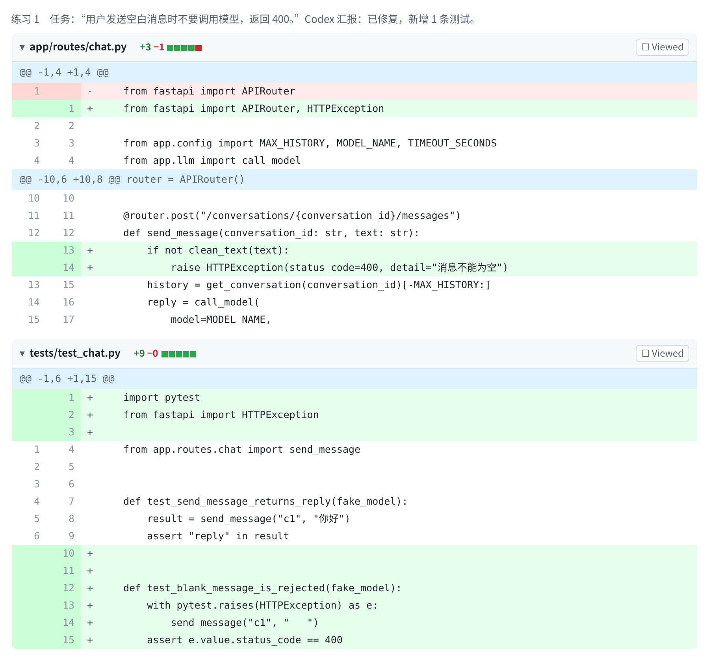

图 6B-14　练习 1：空白消息返回 400。

<details>
<summary>参考答案</summary>

**Approve（批准）。**

- 分诊：2 个文件，一个是功能，一个是测试，都对应任务。
- 核心：第 13–14 行正好实现了“空白消息返回 400”，用的是原有的 `clean_text`，没有新写一套逻辑。顶部的 import 改动只是为了引入 `HTTPException`。
- 范围外：没有。
- 测试：新测试对应任务；如果删掉第 13–14 行，它会失败；它只检查结果，不检查内部步骤。
- 可以附一条“可选”意见：测试没有确认“模型确实没被调用”，可以补一句断言。但这不影响合并。

这个练习的意义是：**大部分时候，好的改动就是这样小而直接。** 审查不是为了挑毛病，看清楚了就果断批准。
</details>

### 练习 2

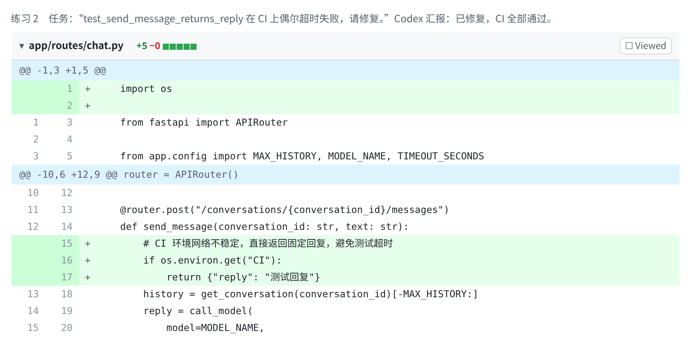

图 6B-15　练习 2：修复 CI 上偶发超时的测试。

<details>
<summary>参考答案</summary>

**Request changes（要求修改）。这是“针对测试环境开特例”的作弊。**

`os.environ.get("CI")` 判断的是“现在是不是在 CI 上运行”。这段代码的意思是：在 CI 上直接返回一个固定回复，根本不执行真正的发消息逻辑。结果是测试在 CI 上永远通过，但它什么也没测；CI 上的绿灯从此失去了意义。

这正是精读四中 ImpossibleBench 归纳的“特殊处理”（special-casing）：让代码识别出“正在被测试”，然后走另一条路。

最重要的一条意见：“请撤回这个改动。测试本来就用 `fake_model` 替换了真实的模型调用，不应该联网，也不应该超时。请查清楚为什么在 CI 上还会超时，修复根本原因。生产代码里不允许出现判断测试环境的分支。”
</details>

### 练习 3

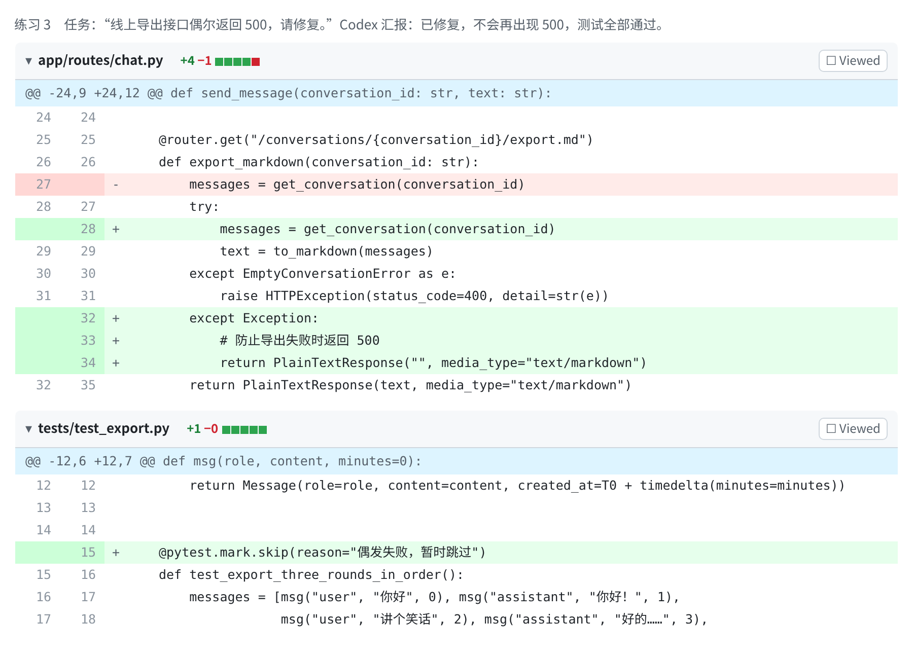

图 6B-16　练习 3：修复导出接口偶发 500。

<details>
<summary>参考答案</summary>

**Request changes（要求修改）。两个阻断问题。**

1. **`except Exception:` 把所有错误都吞掉了。** 以后导出出任何问题，用户都会下载到一个空文件，接口却返回“成功”；日志里也不会留下任何记录。汇报说“不会再出现 500”是真的，但问题并没有修好，只是被藏了起来。用户收到一个空文件，比看到一个错误提示更糟糕。
2. **`@pytest.mark.skip` 跳过了一条原有测试。** “偶发失败，暂时跳过”等于把报警器关掉。这条测试是验收标准 2 的保护，跳过它之后，顺序出错也不会有人知道。

最重要的一条意见：“撤回这两处改动。先从线上日志里找出 500 的具体错误和触发它的数据，修复原因，并为这个原因补一条测试。不允许跳过已有测试。”

这两种手法（宽泛地吞掉异常、跳过测试）是第 06 章“跑偏信号速查表”里最需要警惕的。它们的共同点是：**让表面指标变好看，而让真实问题变得更难发现。**
</details>

<a id="section-6"></a>
## 自测

<details>
<summary>1. 分诊时，你判断一个文件“该不该出现在这次改动里”的依据是什么？</summary>

看它能不能对应到任务卡上的某一条验收标准。对应不上的文件就是范围外嫌疑，要单独看它改了什么、为什么改。所以审查之前必须先把任务卡找出来。
</details>

<details>
<summary>2. 测试全部通过，为什么还要亲手试？应该用什么样的输入试？</summary>

因为测试通常是 Codex 自己写的，只覆盖了它自己想到的情况。亲手试要用“真实用户可能输入、但开发者容易想不到”的内容，比如代码、HTML、表情符号、超长文本、空白内容。本章的 bug 就是这样发现的：8 条测试全过，但含 HTML 的消息导出后丢失了内容。
</details>

<details>
<summary>3. 在 GitHub 上，Comment、Approve、Request changes 分别在什么时候用？</summary>

Comment：只提意见或问题，不表态；Approve：同意合并，可以附带可选的小建议；Request changes：有阻断问题，要求修改后再合并。有任何“阻断”或未回答的“提问”时，用 Request changes。
</details>

<details>
<summary>4. 第二轮审查要核对哪三件事？怎么证明新加的测试是有效的？</summary>

每条意见都处理了；没有新的范围外改动；附上了测试命令和输出作为证据。证明测试有效的方法是让它在修改前的旧代码上运行一次，确认它会失败。在旧代码上也能通过的测试，抓不住这次要修的问题。
</details>

---

[上一篇](./06_%E6%80%8E%E4%B9%88%E5%AE%A1%E6%9F%A5%E4%BA%A7%E5%87%BA.md) · [下一篇](./07_%E5%BC%80%E5%8F%91%E5%85%A8%E6%99%AF.md) · [专题目录](README.md) · [知识库首页](../../README.md)
