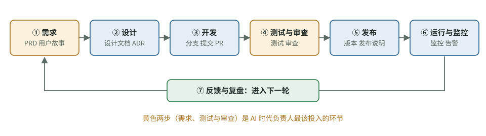

# 代码写完之后，软件为什么还不能交付？看懂开发的完整过程

[知识库首页](../../README.md) · [本专题目录](README.md)

> **阅读目标**：把代码放回需求、协作、运行和维护的过程，理解为什么构建成功仍不足以交付。

<details>
<summary>本文目录</summary>

- [一、软件开发的完整周期](#section-1)
- [二、团队里的角色](#section-2)
- [三、四种关键文档](#section-3)
- [四、环境：为什么不能直接在线上改](#section-4)
- [五、版本号：语义化版本（SemVer）](#section-5)
- [六、两条老定律，在 AI 时代依然成立](#section-6)
- [自测](#section-7)

</details>

用 Codex 一个人做项目时，容易把过程简化成“需求—写代码—能跑”。但真正交付仍要验证需求、质量和运行结果。团队开发多出来的那些步骤和文档，每一个都是为了解决**多人协作**和**长期维护**中出现过的具体问题。这一章画出全景，并说明每一步为什么存在、省掉会怎样。

<a id="section-1"></a>
## 一、软件开发的完整周期



图 7-1　软件开发周期。迭代式开发会在几周内把这个循环走一圈，然后重复。

| 阶段 | 要回答的问题 | 典型产出 | 省掉会怎样 |
|---|---|---|---|
| ① 需求 | 为谁解决什么问题？怎样算成功？ | 需求文档（PRD）、用户故事、验收标准 | 做出来的东西没人要，或和设想不一样 |
| ② 设计 | 大致怎么实现？有哪些取舍？ | 设计文档、架构图、架构决策记录（ADR） | 各人各做一套，后期大面积返工 |
| ③ 开发 | 把设计变成代码 | 分支、提交、PR | — |
| ④ 测试与审查 | 做对了吗？会不会弄坏别的？ | 自动化测试、代码审查记录、测试报告 | 问题流到用户那里 |
| ⑤ 发布 | 怎样安全地交给用户？ | 版本号、发布说明、上线检查清单 | 上线出事无法快速回退 |
| ⑥ 运行与监控 | 线上是否正常？用户在怎么用？ | 监控面板、日志、告警 | 用户比你先发现问题 |
| ⑦ 反馈与复盘 | 学到了什么？下一步做什么？ | 用户反馈、事故复盘、下一轮需求 | 同样的错误反复出现 |

**两种走法**：一种是每个阶段做完再进入下一个，整个项目只走一遍（传统的“瀑布式”）；另一种是每次只做一小块功能，在几周内把这七步快速走一圈，然后不断重复（“迭代式”，敏捷方法属于这一类）。现在绝大多数团队用迭代式，原因是需求在做的过程中一定会变，越早拿到真实反馈越好。第 09 章细讲。

**AI 改变了什么**：第 ③ 步变得非常快，于是瓶颈移到了 ①（需求说不清）和 ④（审查跟不上）。DORA 2025 报告观察到：AI 让交付速度提高，同时交付不稳定性也上升（第 11 章）。**对负责人来说，AI 时代的核心工作恰恰是 ① 和 ④。**

<a id="section-2"></a>
## 二、团队里的角色

小团队里一个人常常身兼多职，但**职责**要分清：

| 职责 | 负责什么 | 在 AI 项目里的特别之处 |
|---|---|---|
| 产品负责人 / 产品经理 | 决定做什么、优先级、验收标准 | 验收标准写得越清楚，AI 越不容易跑偏 |
| 技术负责人 / 架构师 | 技术方案、关键取舍、代码质量底线 | 制定 AGENTS.md、审查规则、AI 使用边界 |
| 开发者 | 实现功能、写测试、审查别人的代码 | 越来越多的时间从“写”转向“说清需求 + 审查” |
| 测试 / 质量保证（QA） | 设计测试、发现问题、守住发布质量 | 专门检查 AI 生成的测试是否真实有效 |
| 运维 / SRE | 部署、监控、处理线上故障 | — |
| 设计师 | 交互和界面 | 设计稿可以直接作为 AI 的验收依据（截图比对） |

**你作为非技术出身的项目负责人**，最需要守住的是产品负责人的职责（需求和验收），并确保团队里**有人承担技术负责人的职责**。如果团队里没有这样的人，就要特别依赖第 08–10 章的流程和自动化检查来弥补。

<a id="section-3"></a>
## 三、四种关键文档

### 1. 需求文档（PRD）与用户故事

说清楚为谁、解决什么问题、怎样算成功。用户故事和验收标准的写法见第 09 章，它们和第 05 章给 Codex 的任务模板是同一件事的两个尺度。

### 2. 设计文档

在动手写大功能之前，用一两页说明：要解决的问题、考虑过的几种方案、选了哪个、为什么。它的价值在于**让别人能在写代码之前提出反对意见**——改文档比改代码便宜得多。用 AI 时，这份文档也可以直接作为 Codex 的计划输入。

### 3. 架构决策记录（ADR）

**它解决什么问题**：半年后，新人（或 Codex）看到一个奇怪的技术选择，想“改掉它”。如果没人记得当初为什么这样选，就可能重蹈覆辙。

Michael Nygard 在 2011 年提出的格式非常简单，每个决定一页：

```markdown
# ADR 3：对话记录存储使用 PostgreSQL 而不是向量数据库

## 状态
已接受（2026-10-07）

## 背景
我们需要存储用户对话。目前只需要按用户和时间查询，暂不需要语义检索。
团队已有 PostgreSQL 运维经验。

## 决定
我们将使用 PostgreSQL 存储对话记录。

## 后果
+ 不增加新的基础设施，运维简单
- 将来如需语义检索，要另外引入检索方案或扩展
```


Nygard 的原意是：每份 ADR 都像是“和未来开发者的一次对话”。在 AI 时代，ADR 还有一个用途：把它放在仓库里，并在 AGENTS.md 中提一句“重大技术选择见 docs/adr/”，可以帮助 Codex 理解已有决定；是否遵循仍需审查实际改动。

### 4. 工单（issue / ticket）

每个具体任务一张工单：描述、验收标准、负责人、状态。工单是团队“正在做什么”的唯一真相来源。OpenAI 内部使用 Codex 的经验之一是：任务说明写得**像一份 GitHub issue 或 PR 描述**时，Codex 的表现更好。

<a id="section-4"></a>
## 四、环境：为什么不能直接在线上改

| 环境 | 用途 | 谁在用 |
|---|---|---|
| 本地开发环境 | 开发者（和 Codex）写代码、跑测试 | 开发者 |
| 测试环境 | 自动化测试和 QA 测试 | 团队内部 |
| 预发布环境（staging） | 尽量和生产一样的“彩排”环境 | 团队内部、少量试用者 |
| 生产环境（production） | 真实用户在用 | 用户 |

**为什么要这么多层**：每一层都是一道“在用户看到之前发现问题”的关口。Fowler 关于持续集成的文章中就有一条：在生产环境的克隆中测试。对 AI 应用来说还多一个理由：生产环境的密钥（比如大模型 API key）权限大、花的是真钱，**开发和测试环境要用单独的、有额度限制的密钥**，Codex 永远不应该接触生产密钥。

<a id="section-5"></a>
## 五、版本号：语义化版本（SemVer）

当你的软件被别人使用（比如提供 API 或 SDK），版本号就是一种承诺。最通行的规则是语义化版本（semver.org）：版本号写成 `主版本.次版本.修订号`，例如 `2.4.1`：

| 变化 | 增加哪一位 | 例子 |
|---|---|---|
| 不兼容的改动（老用法会坏） | 主版本 | 2.4.1 → 3.0.0 |
| 向后兼容的新功能 | 次版本 | 2.4.1 → 2.5.0 |
| 向后兼容的问题修复 | 修订号 | 2.4.1 → 2.4.2 |

看到 Codex 升级了某个依赖的**主版本**，就要格外小心：这意味着那个库有不兼容的改动。

<a id="section-6"></a>
## 六、两条老定律，在 AI 时代依然成立

**布鲁克斯定律**（Fred Brooks，《人月神话》，1975）：向一个已经延期的软件项目增加人手，只会让它更晚。原因是新人需要学习，人越多，沟通成本增长得越快。

**康威定律**（Melvin Conway，*How Do Committees Invent?*，1968）：设计系统的组织，做出来的系统结构会复制这个组织的沟通结构。比如三个互不沟通的小组做一个系统，往往会做出三块彼此别扭拼接的模块。

**延伸到 AI（这是推论，不是两位作者的原话）**：同时开很多个 Codex 任务，就像一下子增加很多人手——如果任务之间边界不清、互相依赖，协调和合并的成本会吃掉并行的收益。并行的前提是**任务被拆成彼此独立的小块**，这正是第 05 章任务拆分和第 08 章分支策略要解决的问题。

<a id="section-7"></a>
## 自测

<details>
<summary>1. 为什么说 AI 让开发阶段变快之后，负责人的工作重心应该转向需求和审查？</summary>

开发变快后，瓶颈移到了“说清楚要什么”（需求）和“确认做对了”（测试与审查）。DORA 2025 报告也观察到 AI 提高速度的同时提高了不稳定性，说明审查和质量环节跟不上。
</details>

<details>
<summary>2. ADR 和设计文档有什么区别？各自什么时候写？</summary>

设计文档在动手前写，讨论一个功能的多种方案，供别人提意见；ADR 记录一个已经做出的重要技术决定及其背景和后果，篇幅短，供日后查阅“为什么这样选”。重大技术选择（数据库、框架、架构方式）都应该留 ADR。
</details>

<details>
<summary>3. 为什么开发环境不能用生产环境的大模型 API 密钥？</summary>

生产密钥权限大、产生真实费用、关联真实数据。开发和测试阶段（尤其是 Codex 自动运行命令时）出错的概率高，用单独的、有额度限制的密钥可以把事故影响控制在小范围。
</details>

<details>
<summary>4. 项目延期了，你打算一下子开 10 个 Codex 并行任务来赶进度。布鲁克斯定律提醒你注意什么？</summary>

并行的收益会被协调和合并成本抵消，尤其当任务互相依赖、改同一批文件时。先把工作拆成彼此独立的小任务，再决定并行数量，并确保你有能力审查这么多产出。
</details>

---

[上一篇](./06B_%E5%AE%9E%E6%88%98%E5%AE%A1%E6%9F%A5%E4%B8%80%E4%B8%AAPR.md) · [下一篇](./08_%E5%A4%9A%E4%BA%BA%E5%8D%8F%E4%BD%9C.md) · [专题目录](README.md) · [知识库首页](../../README.md)
