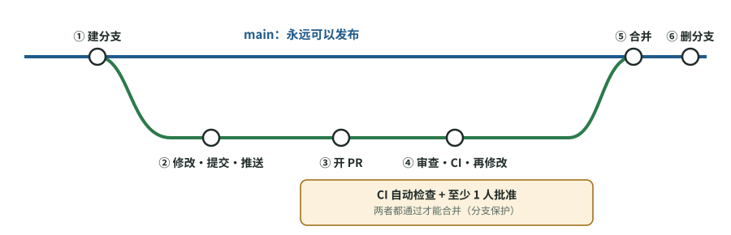

# 同时开多个 AI 任务，为什么反而更乱？分工、分支与合并

[知识库首页](../../README.md) · [本专题目录](README.md)

> **阅读目标**：先划清文件与任务责任，再选择分支与合并方式，避免并行任务互相覆盖。

<details>
<summary>本文目录</summary>

- [一、要解决的根本问题](#section-1)
- [二、分支策略：三种主流做法](#section-2)
- [三、合并请求（PR）：协作的中心](#section-3)
- [四、代码审查（Code Review）](#section-4)
- [五、持续集成（CI）](#section-5)
- [六、和 AI 一起协作的特别规则](#section-6)
- [七、一份起步用的团队协作规则](#section-7)
- [自测](#section-8)

</details>

一个人加一个 Codex，几乎不会遇到协作问题。三个人、每人再开几个 Codex 任务，问题就来了：两个人改了同一个文件；有人的改动把别人的功能弄坏了；主线代码今天跑不起来，没人知道是谁的问题。这一章讲行业里解决这些问题的四件工具，以及**你的团队该怎么选**。

<a id="section-1"></a>
## 一、要解决的根本问题

多人开发的核心矛盾是：**每个人需要独立工作，但最终所有工作要合在一起，而且合在一起后必须仍然能运行。**

- 合得太晚：每个人在自己的分支上干两周，合并时冲突一大堆，而且没人知道合起来之后能不能跑——这叫“集成地狱”。
- 合得太随意：没人检查就往主线里放，主线经常坏掉。

行业的答案是一个组合：**短命的分支 + 合并前审查 + 自动检查 + 频繁合并**。

<a id="section-2"></a>
## 二、分支策略：三种主流做法

### 1. GitHub Flow（最简单，推荐小团队起步用）

GitHub 官方文档描述的流程只有六步：



图 8-1　GitHub Flow 的六步（据 GitHub 官方文档的步骤绘制）。绿色是功能分支，蓝色是 main；第 ④ 步中 CI 和人工审查都通过后，才能进入第 ⑤ 步合并。

1. 从 main 建一个分支，起一个简短、有意义的名字；
2. 在分支上修改、提交、推送，每个提交写清楚说明；
3. 开一个 PR，请同事给意见；
4. 根据审查意见继续修改；
5. 审查通过后合并进 main；
6. 删除这个分支。

规则只有一条：**main 永远是可以发布的状态。**

### 2. 主干开发（Trunk-Based Development）

DORA 研究把它列为提升交付表现的关键能力之一。做法：

- 每个人把工作拆成**小批次**，**每天至少合并进主干一次**；
- 分支通常**只存活几个小时**，而不是几天几周；
- 仓库里同时活跃的分支**不超过三个**；
- 不搞“代码冻结”和单独的“集成阶段”。

DORA 的研究结论是：遵循这些做法的团队，在交付速度、稳定性和可用性上表现更好。它和 GitHub Flow 并不矛盾：可以理解为“分支极短的 GitHub Flow”。

### 3. 发布分支 / Git Flow（适合有正式版本号的软件）

如果你的软件要按版本发布（比如每月发一个 App 版本，同时还要维护旧版本），会额外使用**发布分支**（只接受稳定性修复）和**热修复分支**（紧急修线上问题）。Martin Fowler 的《Patterns for Managing Source Code Branches》（2020）系统整理了这些模式。经典的 Git Flow 模型就是这一类，但它比较重；它的作者 Vincent Driessen 后来也补充说明：对于持续交付的 Web 应用，更简单的 GitHub Flow 往往更合适。

### 怎么选

| 你的情况 | 建议 |
|---|---|
| Web 应用 / 后端服务，随时可以上线 | GitHub Flow，并尽量让分支短命（接近主干开发） |
| 团队成熟、自动化测试完善 | 主干开发 + 功能开关（第 10 章） |
| 移动 App、SDK、桌面软件，要维护多个已发布版本 | 主线开发 + 发布分支 |
| 刚开始、团队里没有资深工程师 | **从 GitHub Flow 开始**，最不容易出错 |

Fowler 的一句话很好记：**如果一件事做起来很痛苦，就更频繁地做它。**合并痛苦，是因为合得太少；合得越频繁，每次合并越小、越容易。

<a id="section-3"></a>
## 三、合并请求（PR）：协作的中心

PR 不只是“申请合并”，它是一个改动的完整档案：改了什么（diff）、为什么（说明）、讨论了什么（评论）、检查结果（CI）。

**一份好的 PR 说明**（同样适用于要求 Codex 写的 PR）：

```markdown
## 做了什么
修复会话超时后无法重新登录的问题。

## 为什么
令牌刷新时没有检查过期时间，导致使用过期令牌请求（关联工单 #123）。

## 没做什么
没有改动登录页样式；没有处理“记住我”功能（另开工单 #130）。

## 怎么验证
- 新增测试 tests/auth/test_session.py::test_超时后可重新登录（修复前失败，修复后通过）
- uv run pytest tests/auth -q：全部通过（输出见下）
- 手动：本地登录 → 等待会话过期 → 再次登录成功
```


**PR 要小**。Google 的工程实践建议一次改动约 100 行比较合适，1000 行通常太大；《Software Engineering at Google》提到约 200 行的改动能被快速审查。PR 越大，审查越草率——这是人的天性，不是态度问题。

<a id="section-4"></a>
## 四、代码审查（Code Review）

### 为什么要审查

《Software Engineering at Google》第 9 章总结了代码审查的四个好处：

1. **正确性**：多一双眼睛，确认改动做到了它想做的事；
2. **可理解性**：审查是“这段代码别人能不能看懂”的第一次检验；
3. **一致性**：让代码遵循团队约定，便于以后维护；
4. **知识共享**：大家通过审查了解别人在做什么、学到新做法。书里说这是最重要却最被低估的好处。

**在 AI 时代，第 4 点格外重要**：如果代码是 Codex 写的，又没人认真审，那么**团队里没有任何人真正了解这段代码**。出了问题，只能再去问 AI。

### 审查者看什么

Google 审查规范列出的要点（选最相关的）：

| 方面 | 问题 |
|---|---|
| 设计 | 各部分的配合合理吗？这段改动放在这里合适吗？ |
| 功能 | 它做到了作者想做的事吗？对用户好吗？ |
| 复杂度 | 比需要的更复杂吗？**是否过度设计：在解决现在需要解决的问题，还是在解决猜测中将来可能出现的问题？** |
| 测试 | 有没有合适的单元、集成或端到端测试？ |
| 命名与注释 | 名字清楚吗？注释是否解释了“为什么”？ |
| 文档 | 如果改变了构建、测试、使用或发布方式，文档更新了吗？ |

审查者可以给不重要的建议加上前缀 **“Nit:”**（吹毛求疵），表示作者可以不改。这能让真正重要的意见不被淹没。

### 审查的节奏

- 审查要快：Google 的规范建议最长不超过一个工作日给出回应。审查拖得越久，作者越容易一次堆更多改动，形成恶性循环。
- 一个主审查者通常就够了，人太多反而没人负责。
- 能自动检查的（格式、风格、简单错误）交给机器，人只看机器看不了的。

<a id="section-5"></a>
## 五、持续集成（CI）

### 概念卡：持续集成

- **问题**：每个人的改动单独看都对，合在一起却坏了；或者有人忘了跑测试就合并了。
- **白话**：持续集成是两件事的组合：团队成员**至少每天**把改动合并进主线；并且**每次推送都自动触发构建和测试**。
- **定义原文**（Martin Fowler，2024 年更新）：持续集成是一种软件开发实践，团队每个成员至少每天一次把自己的改动和同事的改动合并进同一个代码库。
- **在你工作中的作用**：CI 是**不依赖任何人自觉**的检查。Codex 说测试通过了，CI 会在一个干净的环境里再跑一遍。

Fowler 列出的核心做法中，对你最重要的四条：

1. **构建要能自我测试**：自动化测试是构建的一部分。
2. **每次推送到主线都触发构建**。
3. **构建坏了立刻修**：最高优先级，修不好就撤回导致问题的提交。
4. **构建要快**：目标大约 10 分钟以内。这也是为什么第 02 章说过度测试有代价——测试越多越慢，CI 越慢，大家就越不愿意频繁合并。

### 把规则变成机器强制：分支保护

在 GitHub/GitLab 上可以给 main 分支设置保护规则，让流程**不靠人记得**：

| 设置 | 作用 |
|---|---|
| 禁止直接推送到 main | 所有改动必须走 PR |
| 合并前必须通过 CI 检查 | 测试不过不能合并 |
| 合并前至少需要 1 人批准 | 保证每个改动都被人看过 |
| CODEOWNERS 文件 | 指定某些目录（如 `tests/`、`migrations/`、`.github/`）的改动必须由特定的人审批 |

**最后一条直接对付第 04 章的“改测试”问题**：把测试目录和关键配置指定给技术负责人审批，Codex 修改测试就一定会被人看到。

<a id="section-6"></a>
## 六、和 AI 一起协作的特别规则

1. **一个任务一个分支一个 PR**。不要让一个 Codex 会话在一个分支上做多件事。
2. **并行任务用独立的工作目录**。OpenAI 的最佳实践把“不用 git worktree 就同时运行多个任务”列为常见陷阱。

    **概念卡：worktree（工作树）**——同一个仓库可以同时检出多个分支到不同的文件夹，每个 Codex 任务在自己的文件夹里工作，互不干扰。类比：同一份图纸复印几份，几个人各改各的，最后再汇总。

3. **AI 写的代码和人写的代码，审查标准一样**。PR 里标注哪些部分主要由 AI 生成，帮助审查者分配注意力。
4. **合并的人负责**。不管是谁或什么写的代码，点“合并”的人要能解释它做了什么。

<a id="section-7"></a>
## 七、一份起步用的团队协作规则

```markdown
1. main 永远可发布；禁止直接推送，所有改动走 PR。
2. 分支命名：<类型>/<简述>，类型为 feat / fix / refactor / docs / chore。
3. 一个 PR 只做一件事，目标 200 行以内；超过 500 行需说明为什么不能拆。
4. PR 说明必须包含：做了什么、为什么、没做什么、怎么验证。
5. CI（测试 + 代码检查）通过、至少 1 人批准后才能合并。
6. tests/、migrations/、.github/ 的改动需技术负责人批准（CODEOWNERS）。
7. 审查在 1 个工作日内响应；不重要的建议用 “Nit:” 标注。
8. CI 失败的 main 是最高优先级，30 分钟内修不好就回滚。
9. 分支在合并后删除；存活超过 3 天的分支要在站会上说明。
```


<a id="section-8"></a>
## 自测

<details>
<summary>1. 为什么“合并越频繁，合并越容易”？</summary>

每次合并的改动越小，与主线的差异越小，冲突越少、越容易定位；拖得越久，差异越大，冲突越多，而且无法确定合在一起能否运行。
</details>

<details>
<summary>2. Codex 在本地说测试全过了，为什么还需要 CI？</summary>

CI 在干净、统一的环境里重新运行检查，不依赖任何人（或 AI）的自述；它能发现本地环境特有的问题、忘了运行的检查，以及和别人改动合并后的问题。并且可以设置为“不通过就不能合并”。
</details>

<details>
<summary>3. 怎样用工具保证“Codex 修改测试一定会被技术负责人看到”？</summary>

用 CODEOWNERS 把 tests/ 目录指定给技术负责人，并在分支保护中要求代码所有者批准后才能合并。
</details>

<details>
<summary>4. 你们是 3 人团队，做一个 Web 端 AI 助手，随时可以上线。该选哪种分支策略？</summary>

GitHub Flow，并让分支尽量短命（一两天内合并）。它最简单，main 始终可发布，配合 CI 和分支保护就能运转；不需要 Git Flow 那样的发布分支体系。
</details>

---

[上一篇](./07_%E5%BC%80%E5%8F%91%E5%85%A8%E6%99%AF.md) · [下一篇](./09_%E9%A1%B9%E7%9B%AE%E8%8A%82%E5%A5%8F.md) · [专题目录](README.md) · [知识库首页](../../README.md)
