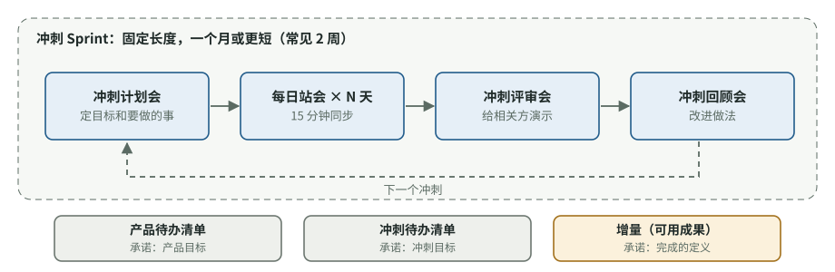

# 项目节奏：敏捷、Scrum、看板，以及怎样写需求

[知识库首页](../../README.md) · [本专题目录](README.md)

> **阅读目标**：从工作如何流动出发比较 Scrum 与看板，把需求切成有用户价值、可验证的小块。

<details>
<summary>本文目录</summary>

- [一、敏捷是一组价值观，不是一套流程](#section-1)
- [二、Scrum：固定节奏的迭代](#section-2)
- [三、看板：不分冲刺的持续流动](#section-3)
- [四、Scrum 还是看板？](#section-4)
- [五、写好需求：用户故事与 INVEST](#section-5)
- [六、估算与计划：给非技术负责人的提醒](#section-6)
- [自测](#section-7)

</details>

第 07 章说过，现在多数团队用“迭代式”：每次做一小块，快速走完需求到上线的一圈，然后重复。这一章讲两套最常见的迭代组织方式（Scrum 和看板），以及迭代中最关键的技能：**把需求写成可以检验的小块**。这个技能同时决定了团队协作的质量和 Codex 产出的质量。

<a id="section-1"></a>
## 一、敏捷是一组价值观，不是一套流程

2001 年，17 位软件开发者发表了《敏捷软件开发宣言》，提出四条价值观：

| 我们更看重 | 胜过 |
|---|---|
| 个体和互动 | 流程和工具 |
| 可工作的软件 | 详尽的文档 |
| 与客户合作 | 合同谈判 |
| 响应变化 | 遵循计划 |

宣言最后一句常被忽略：**右边的事物也有价值，只是左边的更重要。**敏捷不是“不写文档、不做计划”，而是不要让文档和计划妨碍你交付可用的软件、响应变化。

Scrum 和看板是落实这些价值观的两种具体框架。

<a id="section-2"></a>
## 二、Scrum：固定节奏的迭代

以下依据官方《Scrum 指南》（2020 年 11 月版）。

### 三种职责

| 职责 | 负责什么 |
|---|---|
| **产品负责人**（Product Owner） | 让产品价值最大化：管理待办清单、决定优先级、说清产品目标 |
| **开发者**（Developers） | 每个冲刺做出可用的增量：制定冲刺计划、保证质量、每天调整 |
| **Scrum Master** | 帮团队用好 Scrum：引导、扫清障碍、教练 |

注意 Scrum 里的“开发者”泛指所有做出产品的人，包括测试、设计。

### 五个事件



图 9-1　Scrum 冲刺（据《Scrum 指南》2020 年版绘制）：虚线框内是一个冲刺中的四个事件（冲刺本身是第五个事件，是装下其他事件的容器），下方是三个工件及各自的承诺。

### 三个工件及其“承诺”

| 工件 | 是什么 | 对应的承诺 |
|---|---|---|
| 产品待办清单（Product Backlog） | 所有可能要做的事，按优先级排列 | **产品目标**：产品想达到的未来状态 |
| 冲刺待办清单（Sprint Backlog） | 本冲刺选中的事 + 计划 | **冲刺目标**：本冲刺唯一的目标 |
| 增量（Increment） | 本冲刺做完的、可用的成果 | **完成的定义**（Definition of Done） |

### 概念卡：完成的定义（Definition of Done，DoD）

- **问题**：A 说“做完了”指代码写完了；B 说“做完了”指测试、审查、上线都完成了。
- **白话**：DoD 是团队统一的“做完”标准，对**所有**工作项都适用。《Scrum 指南》的定义是：对满足产品质量要求时增量所处状态的正式描述。
- **例子**：

```markdown
我们的“完成的定义”：
- 代码已合并到 main，CI 全部通过
- 至少 1 人审查批准
- 验收标准中的每一条都有对应测试或手动验证记录
- 涉及界面的改动已附截图
- 用户可见的变化已写进更新说明
- 已部署到预发布环境并试用过
```


- **它和“验收标准”的区别**：验收标准是**某一个**需求特有的（“空对话不能导出”）；DoD 是**所有**需求共同的（“代码已审查、CI 通过”）。两者同时满足才算真正完成。
- **与 AI 的关系**：DoD 可以几乎原样写进 AGENTS.md 的“完成前必须做的事”，让 Codex 的“完成”和团队的“完成”是同一个意思。

<a id="section-3"></a>
## 三、看板：不分冲刺的持续流动

以下依据《看板指南》（The Kanban Guide，2025 年 5 月版）。

看板没有固定长度的冲刺，工作像流水线一样持续流动。它的三个做法：

1. **定义并可视化工作流程**：把工作的各个阶段画成一块板上的若干列。
2. **主动管理流程中的工作项**：最核心的是**限制在制品数量**（WIP limit）——指南的说法是，必须明确控制从开始到完成之间的工作项数量，只有在有空余能力的明确信号时才开始新工作。
3. **持续改进工作流程**。

**待办**

导出 PDF

多语言

……

**进行中（≤3）**

登录超时修复

计费页面

提示词模板

**审查中（≤2）**

对话导出 MD

**待发布**

**已完成**

首页文案

图 9-2　看板示例。列标题括号里的数字是该列的在制品上限：“进行中”已经满 3 个，在有任务完成之前，不能再开新任务。

**为什么要限制“进行中”的数量**：同时开工的事越多，每件事完成得越慢，切换成本越高，问题暴露得越晚。看板指南要求跟踪四个流动指标：在制品数量、吞吐量（单位时间完成数）、工作项年龄（已开始多久）、周期时间（从开始到完成用了多久）。

**在 AI 时代尤其重要**：Codex 让“开工”几乎零成本，你可以同时开十个任务。但第 06 章说过，**审查才是瓶颈**。给“审查中”这一列设一个上限，比如不超过 3 个，就能防止产出堆积成没人审得过来的一大堆。

<a id="section-4"></a>
## 四、Scrum 还是看板？

| 情况 | 更适合 |
|---|---|
| 需要固定节奏和相关方定期看成果；团队需要更多结构 | Scrum |
| 工作不断涌入、优先级经常变（运维、客服问题、快速迭代的 AI 功能） | 看板 |
| 小团队、刚起步 | 轻量看板 + 每周一次评审和回顾 |

很多团队实际用的是混合方式：用看板管理日常流动，保留 Scrum 的评审和回顾会。**选什么框架不如坚持三件事重要：工作拆小、限制同时进行的数量、定期回顾改进。**

<a id="section-5"></a>
## 五、写好需求：用户故事与 INVEST

### 用户故事的格式

Dan North 在 2006 年介绍行为驱动开发时给出的模板，后来成为写用户故事的通用格式：

```text
作为 <某种用户>
我想要 <做某件事>
以便 <得到某种价值>
```


例子：**作为**经常整理资料的用户，**我想要**把对话导出为 Markdown 文件，**以便**存进我的笔记软件。

“以便”这一句最常被省略，却最重要：它让开发者（和 Codex）在细节上做选择时，知道往哪个方向选。

### 好故事的六个标准：INVEST

Bill Wake 在 2003 年提出的检查清单：

| 字母 | 含义 | 检查问题 |
|---|---|---|
| **I**ndependent 独立 | 尽量不依赖其他故事 | 能单独做、单独上线吗？ |
| **N**egotiable 可协商 | 是讨论的起点，不是死合同 | 细节还能和团队商量吗？ |
| **V**aluable 有价值 | 对用户或客户有价值 | 做完了用户能感受到吗？ |
| **E**stimable 可估算 | 团队能估出大概工作量 | 大家对要做什么有足够理解吗？ |
| **S**mall 小 | 能在一个迭代内完成 | 能在几天内做完吗？ |
| **T**estable 可测试 | 能判断是否完成 | 写得出验收标准吗？ |

Wake 对“可测试”的解释特别值得记住：写下一个故事，就隐含着一个承诺——“我对自己想要什么理解得足够清楚，**清楚到可以为它写一个测试**”。如果你写不出验收标准，说明你自己还没想清楚，这时候交给 Codex，它只能替你猜。

Wake 还强调故事要**纵向切**（每个故事穿过界面、逻辑、数据各层，交付一小块完整价值），而不是**横向切**（先做完所有数据库，再做所有界面）。

### 从用户故事到 Codex 任务


图 9-3　从用户故事到完成：每一层由上一层推导出来。

这条链上每一层都可以由不同的人写，但**上一层写不清，下一层一定会走样**。

<a id="section-6"></a>
## 六、估算与计划：给非技术负责人的提醒

- **别让任何人（包括 Codex）对模糊需求给出精确时间**。先把需求拆到满足 INVEST 的大小，估算才有意义。
- **AI 改变了估算**：写代码的时间缩短了，但审查、联调、修复 AI 引入的问题的时间常被低估。Simon Willison 把“更新估算方法”列为用 AI 负责任地开发所需的能力之一。METR 实验里，开发者对 AI 带来的加速估计偏差将近 40 个百分点（第 04 章）。
- **用历史数据代替拍脑袋**：看板的周期时间、Scrum 每个冲刺实际完成的故事数，比任何人的估计都可靠。

<a id="section-7"></a>
## 自测

<details>
<summary>1. “完成的定义”和“验收标准”有什么区别？举例说明。</summary>

验收标准针对某一个需求，例如“空对话时导出按钮不可点击”；完成的定义适用于所有需求，例如“代码已审查、CI 通过、已部署到预发布环境”。一个需求要同时满足它自己的验收标准和团队的完成定义，才算完成。
</details>

<details>
<summary>2. 团队用 Codex 后，“进行中”的任务从 3 个变成 12 个，但每周实际上线的功能没变多。看板方法会建议怎么做？</summary>

限制在制品数量，尤其给“审查中”设上限。瓶颈在审查而不是编码；同时开工太多只会让每件事等更久、问题更晚暴露。先把审查中的完成，再开新任务。
</details>

<details>
<summary>3. 用 INVEST 检查这个故事：“作为用户，我想要系统更智能。”</summary>

不满足：没有说清价值（V 弱）、无法估算（E）、不够小（S），最关键的是不可测试（T），写不出验收标准。需要拆成具体、可检验的故事，例如“作为客服，我想要系统根据历史对话自动推荐三个回复，以便更快回复用户”，并写出验收标准。
</details>

<details>
<summary>4. 为什么用户故事里“以便……”这一句很重要，尤其是交给 Codex 时？</summary>

它说明了价值和目的。在需求没写到的细节上，开发者和 Codex 都要靠目的来做判断；没有目的，它只能按“通常做法”猜，更容易跑偏。
</details>

---

[上一篇](./08_%E5%A4%9A%E4%BA%BA%E5%8D%8F%E4%BD%9C.md) · [下一篇](./10_%E4%BA%A4%E4%BB%98%E4%B8%8E%E8%B4%A8%E9%87%8F.md) · [专题目录](README.md) · [知识库首页](../../README.md)
