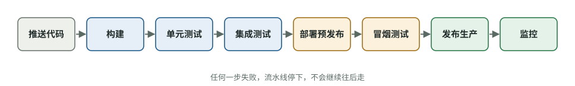

# 测试通过之后，还要确认什么？软件上线与质量判断

[知识库首页](../../README.md) · [本专题目录](README.md)

> **阅读目标**：区分部署、发布和真实使用，用质量与交付指标帮助决策，而不是替代判断。

本文目录

- [一、持续交付与持续部署](#section-1)
- [二、功能开关：把“部署”和“发布”分开](#section-2)
- [三、AI 应用的特殊质量问题：评测（evals）](#section-3)
- [四、DORA 指标：用数据衡量交付表现](#section-4)
- [五、技术债：有意的和无意的](#section-5)
- [六、出了事怎么办：回滚与无责复盘](#section-6)
- [自测](#section-7)

代码合并进 main 只是一半。另一半是：怎样把它安全地交给用户？上线后出问题怎么办？怎样衡量团队整体做得好不好？以及——AI 应用特有的——模型的输出每次都不一样，怎样保证质量？

## 一、持续交付与持续部署

第 08 章的持续集成（CI）解决“合在一起能不能跑”。再往后两步：

| 概念 | 含义 | 上线需要人点按钮吗？ |
|---|---|---|
| 持续集成（CI） | 每次合并都自动构建、测试 | — |
| 持续交付（Continuous Delivery） | 每次通过检查的版本**随时可以**一键发布 | 需要 |
| 持续部署（Continuous Deployment） | 每次通过检查的版本**自动**发布到生产 | 不需要 |

通常合称 **CI/CD**。一条典型的发布流水线：

图 10-1　一条典型的 CI/CD 发布流水线。灰色是触发，蓝色是持续集成，黄色是预发布验证，绿色是上线与监控。

**为什么要自动化发布**：手动发布步骤多、容易漏，所以大家不敢频繁发布；越不频繁，每次发布的改动越多、风险越大。自动化让发布变得无聊而安全，于是可以小步快跑。

## 二、功能开关：把“部署”和“发布”分开

### 概念卡：功能开关（feature toggle / feature flag）

- **问题**：一个大功能要做两周，但主干开发要求每天合并（第 08 章）。没做完的代码合进 main，会不会被用户看到？
- **白话**：在代码里加一个开关，功能代码已经部署上线，但开关关着，用户看不到。准备好了再打开，出问题了立刻关掉，不用重新发布。
- **类比**：新店已经装修好，但门口挂着“暂停营业”的牌子。

Pete Hodgson 在 Martin Fowler 网站上的文章（2017）把开关分成四类：

| 类型 | 用途 | 例子 |
|---|---|---|
| 发布开关 | 让未完成的功能安全上线但不启用 | 新的导出功能先关着 |
| 实验开关 | A/B 测试，让不同用户看到不同版本 | 一半用户用新提示词，比较满意度 |
| 运维开关 | 出事或高负载时快速关闭或降级某功能 | 模型 API 故障时关掉“自动总结” |
| 权限开关 | 只对特定用户开放 | 内测用户、付费用户先用 |

**代价**：文章特别警告，开关应被视为有持有成本的“库存”。开关越积越多，测试组合爆炸、出错风险上升；文章举了 Knight Capital 的例子——一个旧开关被误用，造成 4.6 亿美元的损失。所以**每个开关都要有删除计划**。

**对 AI 应用格外有用**：更换模型、修改系统提示词，都可以用实验开关先给小部分用户，确认效果后再全量；模型服务出问题时，用运维开关快速降级。

## 三、AI 应用的特殊质量问题：评测（evals）

普通软件同样的输入永远给出同样的输出，测试可以写“断言等于 90”。大模型应用不是这样。OpenAI 的评测最佳实践文档说：模型有时对同样的输入给出不同输出，这让传统软件测试方法对 AI 架构来说不够用。

### 概念卡：评测（eval）

- **白话**：评测是一组有代表性的输入（比如 100 个真实用户问题）加上评分方法，用来衡量 AI 功能的整体表现。它是 AI 应用版的“测试”。
- **和普通测试的区别**：普通测试看“对不对”（通过/失败）；评测看“有多好”（比如 100 个问题里 87 个回答合格），并且要比较改动前后的变化。
- **评分方法**：可以是程序检查（格式对不对、有没有包含必须的信息）、人工打分，或者用另一个大模型当评分员。OpenAI 的建议是：先确认大模型评分员和人工评分足够一致，再大规模使用它。

OpenAI 建议的流程：确定评测目标 → 收集数据集（最好包含真实生产数据）→ 定义指标 → 运行并比较 → **每次改动都持续评测**。文档的原话是：尽早评测、经常评测。

**对你意味着什么**：在 AI 应用项目里，**改提示词、换模型、改检索逻辑，都要先跑评测**。这条规则应该写进团队的完成定义（第 09 章）。没有评测时，“改提示词让这个例子变好了”很可能让另外十个例子变差，而你不会知道。

## 四、DORA 指标：用数据衡量交付表现

DORA（DevOps Research and Assessment，现属 Google）十多年来调研了大量软件团队，提炼出衡量**软件交付表现**的指标。当前官方定义分两组：

| 组 | 指标 | 定义 |
|---|---|---|
| **吞吐量** | 变更前置时间 | 一个改动从提交到部署上线需要多久 |
| | 部署频率 | 一段时间内部署的次数 |
| | 失败部署恢复时间 | 一次需要紧急干预的失败部署，多久能恢复 |
| **不稳定性** | 变更失败率 | 部署后需要立即干预（回滚或紧急修复）的比例 |
| | 部署返工率 | 因为生产事故而进行的计划外部署所占比例 |

**这组指标的价值**：它同时看“快”和“稳”。DORA 的长期研究发现，表现好的团队往往两者兼得——速度和稳定不是此消彼长的关系。

**对 AI 时代特别重要**：DORA 2025 报告发现 AI 的采用与**吞吐量提高**相关，同时也与**不稳定性提高**相关（第 11 章）。只看“我们上线了多少功能”会产生错觉；**变更失败率和返工率**才能告诉你 AI 有没有在悄悄增加问题。

**小团队怎么用**：不需要专门的平台，一张表就行：每周记录部署次数、有几次需要回滚或紧急修复、出问题后多久恢复。持续几个月，趋势就很清楚。

## 五、技术债：有意的和无意的

**技术债**：为了快，选择了一种以后要付出额外代价的做法，就像借钱——现在拿到了速度，以后要还“利息”（维护更难、改动更慢）。

Martin Fowler 的“技术债四象限”（2009）区分了两个维度：是**有意**还是**无意**，是**审慎**还是**鲁莽**：

| | 鲁莽 | 审慎 |
|---|---|---|
| **有意** | “我们没时间做设计。”（知道该怎么做，却低估代价） | “必须先上线，后果我们清楚，之后再还。” |
| **无意** | “什么是分层设计？”（不知道自己欠了债） | “现在我们才知道当初应该怎么设计。”（不可避免，应当预期） |

**AI 时代的新风险**：AI 能极快地产出代码，也就能极快地制造**无意的鲁莽债**——团队里没人真正理解的代码、多余的抽象、过量的测试、没人记得为什么加的依赖。FixedBench 论文的作者也指出，代理对不需要修改的代码做多余修改，长期会积累技术债（第 04 章）。

**管理方法**：把已知的技术债记成工单；每个迭代留出固定比例的时间偿还（很多团队用 10–20%）；审查时问“这会不会增加以后的维护负担”。

## 六、出了事怎么办：回滚与无责复盘

**回滚优先**：线上出问题时，第一目标是**恢复服务**，而不是找原因。能回滚到上一个版本、或用开关关掉新功能，就先这样做，再慢慢查。这也是“小步发布”的另一个好处：改动小，回滚影响小。

**无责复盘（blameless postmortem）**：Google《SRE》一书第 15 章介绍的做法。核心假设是：事故中每个人在当时掌握的信息下都是善意的、做了合理的事。书里的原话是：**你无法“修好”人，但可以修好系统和流程**，让人更容易做出正确的选择。

什么时候写复盘：用户可见的停机或性能下降超过阈值、任何数据丢失、需要值班人员介入（回滚、切流量）、处理时间超过限定、监控没发现而靠人工发现的问题。**要事先定好这些标准**。

一份复盘至少包括：发生了什么（时间线）、影响多大、根本原因、做得好的地方、**行动项**（每项有负责人和期限）。

**在 AI 时代多问一句**：这个问题是 AI 生成的代码引入的吗？如果是，审查流程为什么没拦住？答案应该转化为 AGENTS.md 规则、CI 检查或审查清单的改进（第 06 章第六节），而不是“以后不让 AI 写代码”。

## 自测

1. 持续交付和持续部署的区别是什么？

持续交付保证每个通过检查的版本随时可以一键发布，但发布要人决定；持续部署则自动把每个通过检查的版本发布到生产，不需要人工点按钮。

2. 你想把应用的模型从 A 换成 B。用这一章的知识，设计一个安全的上线方式。

先在评测集上比较 A 和 B（质量、格式、成本、延迟）；通过后用实验开关把 B 给一小部分用户，监控满意度、错误率和成本；没问题再逐步全量；保留开关，以便 B 出问题时立刻切回 A。

3. 团队用 AI 后每周部署次数翻倍了。根据 DORA 指标，你还应该看哪两个数？为什么？

变更失败率和部署返工率（以及失败部署恢复时间）。DORA 2025 发现 AI 提高吞吐量的同时也与不稳定性提高相关，只看部署次数会忽略质量问题。

4. 线上出了严重问题，团队想先花一小时找到根本原因再修。这样做对吗？

通常不对。第一目标是恢复服务：先回滚或用开关关闭新功能，然后再查原因、写复盘。

---

[上一篇](./09_%E9%A1%B9%E7%9B%AE%E8%8A%82%E5%A5%8F.md) · [下一篇](./11_AI%E6%97%B6%E4%BB%A3%E7%9A%84%E5%9B%A2%E9%98%9F%E5%8D%8F%E4%BD%9C.md) · [专题目录](README.md) · [知识库首页](../../README.md)
