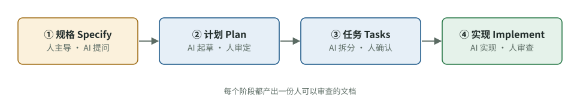

# AI 写代码越来越快，团队该把时间花在哪里？

[知识库首页](../../README.md) · [本专题目录](README.md)

> **阅读目标**：讨论 AI 加速编码之后的团队瓶颈，连接规格、审查责任、协作习惯和实际效果。

<details>
<summary>本文目录</summary>

- [一、DORA 2025：AI 是镜子，也是放大器](#section-1)
- [二、规格驱动开发：先写清楚，再让 AI 写](#section-2)
- [三、“氛围编程”与负责任的 AI 编程](#section-3)
- [四、OpenAI 自己的团队怎么用 Codex](#section-4)
- [五、给团队定一份 AI 使用规则](#section-5)
- [六、AI 时代团队最容易踩的三个坑](#section-6)
- [自测](#section-7)

</details>

前面几章讲的是行业几十年积累的做法。这一章回答：**当团队里的每个人都在用 Codex 这样的代理时，这些做法要怎么调整？**结论先放在这里：AI 没有让基本功变得不重要，反而让基本功的差距被放大了。

<a id="section-1"></a>
## 一、DORA 2025：AI 是镜子，也是放大器

Google 的 DORA 团队在 2025 年 9 月发布了《AI 辅助软件开发现状》报告，用于观察行业实践，不能替代具体团队的因果实验。主要发现：

| 发现 | 数据 |
|---|---|
| 采用非常普遍 | 约 90% 的软件从业者使用 AI，Google 的摘要称比上一年增长 14%；每天使用时间中位数约 2 小时 |
| 多数人感觉有帮助 | 超过 80% 认为 AI 提高了生产力，59% 认为提高了代码质量 |
| 但信任度不高 | 只有 24% 表示“很信任”或“非常信任”，30% 只信任“一点”或“完全不信任” |
| 速度提高了 | AI 采用与软件交付**吞吐量**提高正相关 |
| 稳定性下降了 | AI 采用同时与交付**不稳定性**提高相关：更多变更失败、更多返工 |

报告的核心观点是：**AI 是一面镜子，也是一个放大器。**在组织良好的团队里，它放大效率；在流程混乱的团队里，它放大并暴露已有的问题。

### DORA AI 能力模型：七项决定 AI 效果的能力

报告提出，决定团队能否从 AI 中获益的，是以下七项能力（技术和文化混合）：

| 能力 | 白话解释 | 本资料对应章节 |
|---|---|---|
| 清晰且传达到位的 AI 立场 | 团队明确规定 AI 能用在哪、怎么用、谁负责 | 本章第五节 |
| 健康的数据生态 | 数据质量好、可获取、有治理 | — |
| AI 可访问的内部数据 | AI 能接触到它需要的内部上下文（文档、规范） | 第 03、05 章（AGENTS.md、任务上下文） |
| 扎实的版本控制实践 | 分支、提交、回滚用得好 | 第 01、08 章 |
| 小批量工作 | 改动小、合并频繁 | 第 05、08 章 |
| 以用户为中心 | 始终围绕用户价值决定做什么 | 第 09 章（用户故事） |
| 高质量的内部平台 | 好用的构建、测试、部署基础设施 | 第 08、10 章（CI/CD） |

注意这张表：七项里至少有五项，是“AI 出现之前就该做好”的基本功。这就是“放大器”的含义。

<a id="section-2"></a>
## 二、规格驱动开发：先写清楚，再让 AI 写

GitHub 在 2025 年 9 月开源了 Spec Kit，并提出“规格驱动开发”（spec-driven development）。它的出发点是：编程代理擅长模式识别，但**仍然需要无歧义的指令**。作者建议把代理当作“**按字面理解的结对程序员**”，而不是搜索引擎——模糊的提示会迫使模型猜测没说出口的需求，结果是代码“看起来对，但不完全能用”。

它把开发分成四个阶段，每个阶段都产出一份人可以审查的文档：



图 11-1　规格驱动开发的四个阶段（据 GitHub 博客文章的描述绘制，“谁主导”一行是本资料按负责人视角补充的分工建议）。

| 阶段 | 产出 | 谁主导 |
|---|---|---|
| ① 规格（Specify） | 用户旅程、体验、成功标准 | 人（产品负责人），AI 协助提问 |
| ② 计划（Plan） | 技术方案：技术栈、架构、约束 | AI 起草，人（技术负责人）审定 |
| ③ 任务（Tasks） | 拆成可独立实现、可审查的小任务 | AI 拆分，人确认 |
| ④ 实现（Implement） | 针对每个任务的代码改动 | AI 实现，人审查 |

这和本资料前面讲的是同一件事：第 09 章的用户故事和验收标准对应 ①，第 07 章的设计文档对应 ②，第 05 章的任务拆分对应 ③，第 06 章的审查对应 ④。**规格驱动开发并不是新发明，而是把传统的需求和设计环节，重新放回 AI 编程的前面。**

<a id="section-3"></a>
## 三、“氛围编程”与负责任的 AI 编程

“氛围编程”（vibe coding）指完全靠对话驱动、不关心代码实际怎么工作的开发方式。它适合做原型和个人小工具，但不适合要长期维护、多人协作、对用户负责的产品。

Simon Willison（Django 框架的联合创建者）在 2025 年 10 月提出了一个对照概念“**vibe engineering**”：经验丰富的专业人员用大模型加速工作，同时对自己交付的软件**保持完全的、自信的责任**。他列出这种工作方式依赖的能力：

1. 自动化测试——有健壮、稳定的测试套件，编程代理才能“飞起来”；
2. 事先规划；
3. 完善的文档；
4. 良好的版本控制习惯；
5. 有效的自动化（CI/CD、自动格式化等）；
6. 代码审查文化——他的原话是，如果你审代码又快又好，和大模型一起工作会顺利得多；
7. 人工质量检查（手动测试）；
8. 研究能力（实现前了解多种方案）；
9. 预览环境（上线前安全试用）；
10. 判断哪些事交给 AI、哪些要靠人；
11. 更新的估算方法。

Kent Beck 在 2025 年 6 月提出类似的区分，称为“**增强编程**”（augmented coding）：和氛围编程不同，在增强编程里**你在乎代码本身、它的复杂度、测试和测试覆盖**。他用一份计划文件加测试驱动开发来约束 AI，并时刻警惕三个跑偏信号：陷入循环、添加没要求的功能、删除或禁用测试（第 06 章）。

**这两份清单有一个共同点**：没有一项是“更好的提示词技巧”，全部是软件工程的基本功。这也是这套资料把 A 线（驾驭 Codex）和 B 线（开发流程）放在一起讲的原因。

<a id="section-4"></a>
## 四、OpenAI 自己的团队怎么用 Codex

OpenAI 公开的《How OpenAI uses Codex》总结了内部团队的用法。用途包括：理解陌生代码、跨很多文件的重构和迁移、性能优化、补充测试（尤其是边界情况）、处理小而必要的零碎任务、保持专注（把临时想法交给 Codex 记录或做原型）、探索不同方案。

他们给出的六条实践：

1. **大改动先用提问模式要一份实现计划**，再切换到写代码。
2. **把环境配置好**（启动脚本、环境变量），能显著降低 Codex 的错误率。
3. **任务写得像 GitHub issue 或 PR 描述**，包括文件路径、组件名称。
4. **用任务队列当轻量待办清单**，记录顺带想到的点子和零碎修复。
5. **维护 AGENTS.md**，写命名约定、业务逻辑等。
6. **同时生成多个方案**（best-of-N），比较后挑最好的。

第 6 条值得补充一句：多个方案意味着多份审查工作量。**只在方向不确定、值得比较时使用**，并且只认真审最终选中的那一份。

<a id="section-5"></a>
## 五、给团队定一份 AI 使用规则

DORA 七项能力的第一项就是“清晰且传达到位的 AI 立场”。下面是一份可以直接改用的范本：

```markdown
# 团队 AI 编程使用规则（v1）

## 1. 责任
- 谁合并，谁负责。合并者必须能解释改动做了什么、为什么。
- AI 生成的代码与人写的代码使用相同的审查标准。

## 2. 任务
- 使用统一的任务说明模板（目标、上下文、约束、不做什么、测试要求、完成标准、出口条款）。
- 不确定方案、跨多个文件的任务，先出计划并经人确认。
- 一个任务一个分支一个 PR；并行任务使用独立的 worktree。

## 3. 权限
- 默认：工作区可写 + 越界时请求批准。
- 禁止让 AI 接触生产环境密钥和生产数据库。
- 完全访问权限只在技术负责人同意后临时使用。

## 4. 审查
- PR 必须附验证命令和输出；涉及界面的附截图。
- 对已有测试的修改、删除、跳过，必须在 PR 中逐条说明，由技术负责人批准（CODEOWNERS）。
- 新增依赖需在 PR 中说明理由。
- 认证、支付、数据删除、数据库结构、密钥配置的改动，必须有技术同事审查。

## 5. AI 应用质量
- 改提示词、换模型、改检索逻辑，必须先跑评测集并附结果。

## 6. 度量与回顾
- 每周记录：部署次数、回滚/紧急修复次数、PR 平均审查等待时间。
- 每两周回顾一次：AI 相关的问题有哪些？应该改哪条规则或 AGENTS.md？
```


<a id="section-6"></a>
## 六、AI 时代团队最容易踩的三个坑

1. **审查成为瓶颈，于是开始“走过场”**。编码速度翻倍，审查能力没变，大家就开始草草批准。对策：限制同时进行的任务数（第 09 章看板），让改动更小（第 05、08 章），把能自动化的检查交给 CI。
2. **知识流失：没有人真正理解代码**。代码审查最被低估的好处是知识共享（第 08 章）。如果审查流于形式，几个月后团队里没人能独立维护系统。对策：要求合并者能讲清改动；定期让人讲解系统关键部分。
3. **用感觉评估效果**。METR 实验中开发者的感觉和实际测量相差近 40 个百分点（第 04 章）。对策：用 DORA 指标和返工数据说话（第 10 章）。

<a id="section-7"></a>
## 自测

<details>
<summary>1. 用一句话解释 DORA 2025 说的“AI 是放大器”。</summary>

AI 会放大团队已有的状态：流程和基本功好的团队效率更高，流程混乱的团队问题被放大和暴露，例如交付不稳定性上升。
</details>

<details>
<summary>2. 规格驱动开发的四个阶段分别是什么？在你的团队里，人在哪个阶段的参与最不能省？</summary>

规格、计划、任务、实现。规格阶段最不能省：它决定做什么、怎样算成功，AI 只能协助提问，不能替你做产品决定。计划和实现阶段的审查也必须有人负责。
</details>

<details>
<summary>3. Simon Willison 和 Kent Beck 列出的能力清单有什么共同点？这对你的学习计划意味着什么？</summary>

两份清单都是软件工程基本功（测试、规划、版本控制、审查、自动化），而不是提示词技巧。意味着要用好 AI，应该投资学习和建立这些基本功与流程，而不只是研究怎么写提示词。
</details>

<details>
<summary>4. 团队开始用 AI 后，PR 数量翻了三倍，但大家审查越来越快，基本都是直接批准。这是好事吗？该怎么做？</summary>

很可能不是好事：审查成了走过场，质量风险和知识流失在积累。应限制同时进行的任务和待审 PR 数量，要求改动更小、附验证证据，并观察变更失败率和返工率是否上升。
</details>

---

[上一篇](./10_%E4%BA%A4%E4%BB%98%E4%B8%8E%E8%B4%A8%E9%87%8F.md) · [下一篇](./12_%E6%83%85%E5%A2%83%E4%B8%8E%E6%96%B9%E6%B3%95%E5%86%B3%E7%AD%96%E8%A1%A8.md) · [专题目录](README.md) · [知识库首页](../../README.md)
