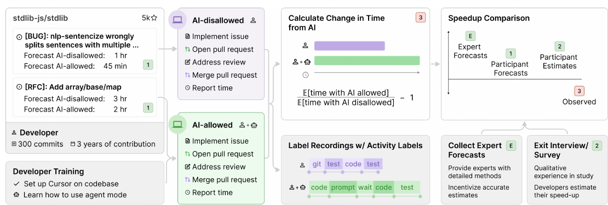
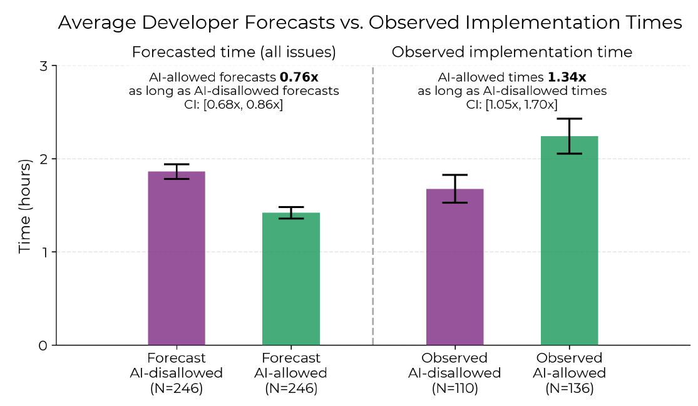
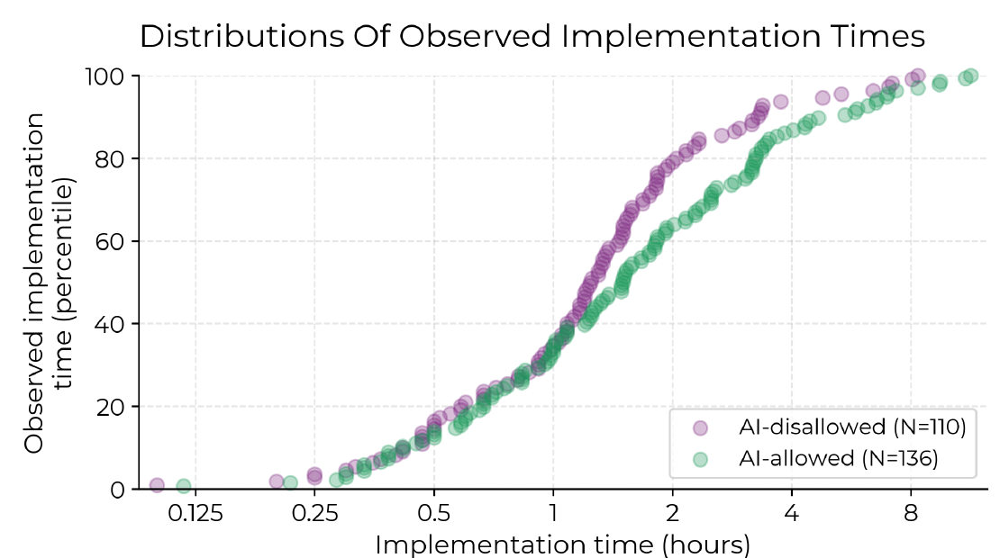
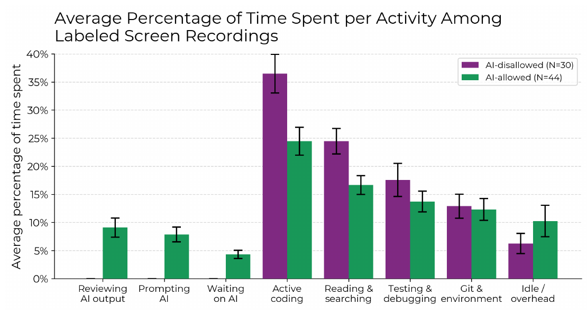
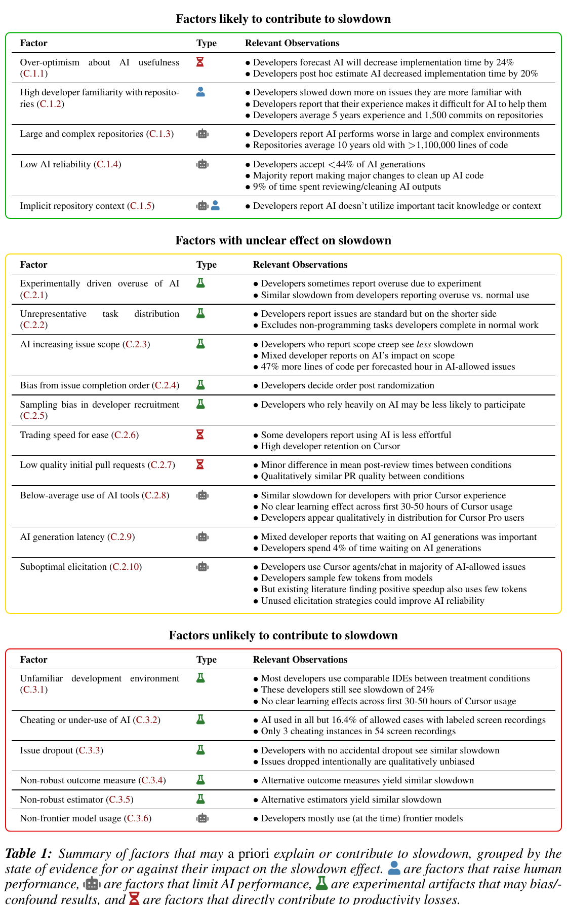
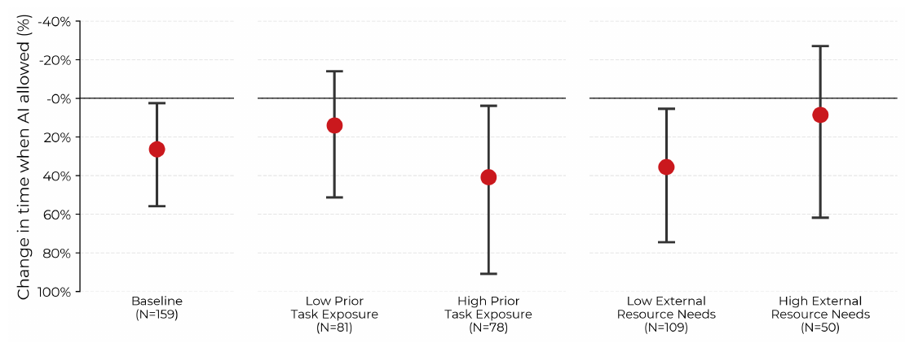
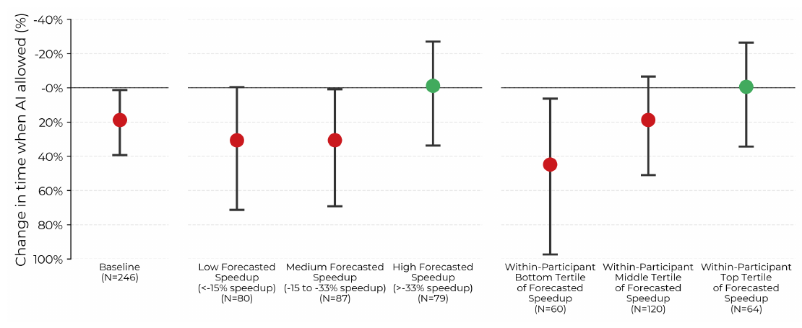
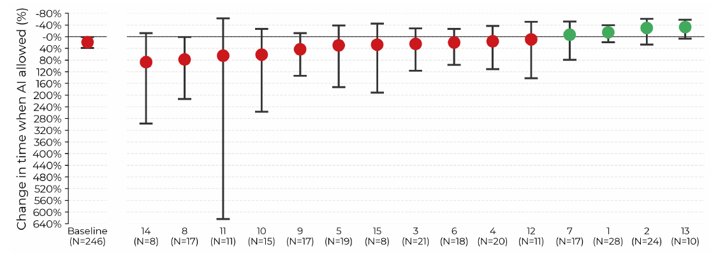

# 用了 AI 反而慢 19%？读懂 METR 实验的结果与适用范围

[知识库首页](../../README.md) · [本专题目录](README.md)

> **阅读目标**：读懂随机分配任务和耗时测量，解释“感觉更快”和实际变慢为什么可以同时发生。

<details>
<summary>本文目录</summary>

- [第一层：5 分钟读懂这篇论文](#section-1)
- [第二层：先补几个概念](#section-2)
- [第三层：实验是怎么设计的](#section-3)
- [第四层：结果，逐图读懂](#section-4)
- [第五层：作者怎样解释，又怎样排除其他解释](#section-5)
- [局限：这篇论文没有证明什么](#section-6)
- [对你意味着什么](#section-7)
- [术语表](#section-8)
- [自测](#section-9)

</details>

**原文**：Joel Becker、Nate Rush、Beth Barnes、David Rein（METR，Model Evaluation & Threat Research），*Measuring the Impact of Early-2025 AI on Experienced Open-Source Developer Productivity*，arXiv:2507.09089v2，2025-07-25，51 页。[原文 PDF](https://arxiv.org/pdf/2507.09089v2)。下文页码均为 PDF 页码。

**为什么精读这篇**：它通过真实开源任务中的随机分配，研究 AI 对开发耗时的影响。对你来说，它的价值不只在“慢了 19%”这个数字，而在于**怎样可信地测量 AI 的效果**，以及 **AI 在什么情况下帮得上忙、什么情况下帮倒忙**。这两点都直接关系到你怎么管理一个用 AI 开发的团队。

<a id="section-1"></a>
## 第一层：5 分钟读懂这篇论文

**一句话**：16 位资深开源开发者在自己维护多年的大型项目上完成 246 个真实任务，每个任务随机决定能不能用 AI。结果用 AI 的任务**平均多花了 19% 的时间**，而开发者自己事前以为会快 24%、事后仍然以为快了 20%。

**三个最重要的发现**：

1. **感觉和现实相反**：开发者、经济学家、机器学习专家都预测 AI 会让时间缩短约 20%–40%，实测却是变长。
2. **时间去哪了**：用 AI 时，写代码和查资料的时间少了，但多出了写提示词、等 AI 输出、审查 AI 代码，以及发呆的时间。开发者只接受了不到 44% 的 AI 生成内容。
3. **不是处处都慢**：开发者越熟悉的任务，AI 越帮倒忙；而开发者自己预判“AI 会大幅加速”的任务，实际上并没有变慢。

**对你最直接的三条启示**：

- 不要用“感觉”评估 AI 的效果，要测量。
- 审查和返工 AI 代码的成本是真实存在的，而且容易被忽略。
- 这项实验主要观察熟悉大型项目的资深开发者；新项目、新手或陌生技术中的收益需要另行测量，不能从该结果直接推出。

<a id="section-2"></a>
## 第二层：先补几个概念

### 1. 随机对照实验（RCT）

**问题**：想知道 AI 有没有让人变快，最直接的办法是比较“用 AI 的任务”和“不用 AI 的任务”的耗时。但如果让开发者自己选哪些任务用 AI，他们可能把简单的任务留给 AI，或者把难的交给 AI——两组任务本身就不一样，比较结果就说明不了 AI 的作用。

**白话**：随机对照实验用**抛硬币**来决定每个任务用不用 AI。这样两组任务在难度、类型上平均是一样的，唯一系统性的差别就是“能不能用 AI”，于是耗时的差别可以归因于 AI。

**类比**：新药试验中，随机决定谁吃药、谁吃安慰剂。**不成立之处**：药物试验通常是“双盲”的，病人不知道自己吃的是什么；这个实验做不到——开发者当然知道自己能不能用 AI，这可能影响他们的行为（作者在因素分析里讨论了这一点）。

### 2. 现场实验 vs 实验室实验

以往很多研究让开发者做**人造的小任务**，比如“用 JavaScript 写一个简单的 HTTP 服务器”，而且自动测试都摆在开发者面前（第 3 页）。这种任务与真实工作差别很大，而且和 AI 训练数据很像，对 AI 有利。

还有一些研究在真实环境中测量“写了多少行代码”“提交了多少次”“合并了多少个请求”。问题是 AI 可以让这些数字变大，生产力却没有提高——代码更啰嗦，或者把一个任务拆成几个小请求。

这篇论文的做法是：**任务在随机分组之前就定义好**，然后测量“完成这个任务花了多久”。任务内容固定，结果就只能是时间的长短（第 2 页脚注 1）。

### 3. 加速比 S

论文定义（第 6 页）：

```text
S = 用 AI 时的平均完成时间 ÷ 不用 AI 时的平均完成时间 − 1
```

- S = −50%：用 AI 只花一半时间（加速）。
- S = 0：一样快。
- S = +19%：用 AI 多花 19% 的时间（论文称为“减速”）。

### 4. 用“难度预测”做校正的回归

**问题**：抛硬币之后，两组任务的难度**平均**相同，但这次具体抛出来的结果可能碰巧不均衡。比如 AI 组碰巧分到了更多难题，那 AI 组慢一点也不能全怪 AI。

**做法**：每个任务开始前，开发者先预测“如果不用 AI 要多久”。这个预测是在抛硬币之前给出的，不受分组影响，可以作为任务难度的指标。论文用的模型是（第 28 页，公式 1）：

```text
log(实际耗时) = α + β × (是否允许 AI) + δ × log(不用 AI 的预测耗时) + 误差
```

**白话**：先根据难度预测，算出每个任务“理应”花多少时间；再看允许用 AI 的任务，比“理应”的时间多出或少出多少。β 就是 AI 的作用。

**为什么用对数（log）**：耗时差别是**按比例**的——一个 10 分钟的任务慢 2 分钟，和一个 100 分钟的任务慢 20 分钟，都是慢 20%。取对数后，“乘以 1.2”变成了“加上一个固定值”，这样不同长短的任务可以放在一起比较。

**怎么从 β 算出 19%**：S = e<sup>β</sup> − 1。如果估计出 β ≈ 0.174，那么 e<sup>0.174</sup> ≈ 1.19，S ≈ +19%。

### 5. 置信区间与误差线

图中每个点上下的竖线是 95% 置信区间：真实值大概率落在这个范围内。区间越宽，结果越不确定。如果区间完全在 0 的一侧，就说明结果的方向是可信的。

<a id="section-3"></a>
## 第三层：实验是怎么设计的



论文原图 2（PDF 第 4 页）：实验设计。**从左往右读**：① 每位开发者从自己的项目里列出真实任务，并对每个任务预测“用 AI”和“不用 AI”各要多久（左边例子：一个 bug 预测不用 AI 1 小时、用 AI 45 分钟）；② 随机分为“不允许 AI”（紫色）和“允许 AI”（绿色）两组，各自完成任务、提交合并请求、处理审查意见、报告用时；③ 计算两组耗时比；④ 同时收集屏幕录像并逐段标注在做什么；⑤ 收集专家预测、做离场访谈；⑥ 最后把专家预测、开发者预测、开发者事后估计和实际结果放在一起比较。

### 参与者和项目（第 4 页）

| 项目 | 数据 |
|---|---|
| 开发者 | 16 人，通常有十年以上编程经验；在自己的项目上平均工作 5 年（占项目历史的 59%），平均提交过 1,500 次；报酬 150 美元/小时 |
| 项目 | 平均 2.3 万个 GitHub 星标、110 万行代码、约 10 年历史、710 位贡献者；对代码质量要求很高 |
| AI 经验 | 93% 用过 ChatGPT 这类工具；只有 44% 用过 Cursor；一般有几十到几百小时的大模型使用经验 |

### 任务和分组（第 5 页）

- 任务是开发者自己项目里的**真实工作**：bug 报告、功能需求、待办事项。超过 2 小时的任务要拆小，平均每个任务 2 小时。
- 分组用模拟的公平抛硬币。最终允许 AI 的 136 个，不允许的 110 个。
- **允许 AI**：可以用任何 AI 工具，也可以选择不用。主要用的是 Cursor Pro（一个带 AI 聊天和代理模式的编辑器，作者提供订阅并做了基础培训），模型主要是 Claude 3.5/3.7 Sonnet。
- **不允许 AI**：不能用任何生成式 AI，包括基于大模型的自动补全；普通搜索引擎可以用。
- 任务完成后照常提交合并请求，由项目其他维护者审查，按意见修改后合并。开发者报告审查前后各花了多少时间。

### 收集了哪些数据（第 6–8 页）

1. **自报用时**：主要结果指标。
2. **屏幕录像**：作者人工标注了 128 段、143 小时的录像（占全部工作时间的 29%），以约 10 秒为单位标注开发者在做什么。剔除录像损坏、自报时间与录像时间相差 20% 以上、发现违规使用 AI 的，剩下 74 段、84 小时用于分析。
3. **预测**：开发者每个任务的事前预测；结束后的事后估计；34 位经济学专家和 54 位机器学习专家对实验结果的预测（预测得越准奖金越多）。
4. **Cursor 使用数据**：建议了多少行代码、接受了多少行。
5. **访谈和笔记**：开发者记录使用 AI 的体验，结束后做访谈和问卷。

<a id="section-4"></a>
## 第四层：结果，逐图读懂

### 结果一：所有人的预期都和现实相反


论文原图 1（PDF 第 2 页）：纵轴是“允许 AI 时耗时的变化”，**注意方向：越往上表示越快（负数），越往下表示越慢（正数）**。从左到右：经济学专家预测、机器学习专家预测、开发者事前预测、开发者事后估计（四个绿点），以及实际结果（红点）。**怎么读**：四个绿点都在 0 线上方（预期加速 20%–40%），只有红点在 0 线下方（实际减速 19%）；红点的误差线下端略低于 0 线，上端接近 +40%。

最值得注意的是第四个绿点：**开发者亲身做完全部任务之后，仍然估计 AI 让他们快了 20%**。作者在讨论部分强调，这说明不能依赖开发者调查或专家判断来评估 AI 的效果，需要有可靠指标的现场实验（第 10–12 页）。

但开发者的预测也不是毫无价值：他们预测的任务时长与实际时长的相关系数为 0.64（允许 AI）和 0.59（不允许 AI）。也就是说，**他们能准确判断哪个任务难、哪个容易，只是把 AI 的作用方向猜反了**（第 9 页）。

### 结果二：为什么原始数据显示慢了 34%，论文却说 19%



论文原图 4（PDF 第 8 页）：左半边是事前预测的平均时间，右半边是实际平均时间；紫色是不允许 AI，绿色是允许 AI。**怎么读**：左边绿色比紫色矮（预测用 AI 只需 0.76 倍时间），右边绿色比紫色高（实际用 AI 花了 1.34 倍时间）。上方的 CI 是置信区间：实际比值 1.34 倍的区间是 1.05–1.70 倍。

直接用两组平均时间相除，AI 组慢了 34%。论文报告的 19% 更小，原因是第二层讲的校正：抛硬币后，AI 组的任务**按事前预测碰巧略难一点**（差异不显著，第 31 页 Table 4）。回归把难度差异扣除后，剩下的 19% 才归因于 AI（第 9 页脚注 12）。作者还用了多种其他估计方法，结果都显示类似的减速（附录 D）。

### 结果三：不是个别极端任务拉低了平均



论文原图 5（PDF 第 9 页）：两组任务完成时间的累积分布。**怎么读**：横轴是完成时间（对数刻度），纵轴是百分位。读法是“在纵轴某个高度画一条水平线”：比如纵轴 60 处，紫色（不允许 AI）对应约 1.4 小时，绿色（允许 AI）对应约 2 小时——即 60% 的不用 AI 的任务在 1.4 小时内完成，而用 AI 的要到 2 小时。**结论**：绿色曲线在大部分高度都在紫色右边，说明几乎所有分位上用 AI 的任务都更慢，不是少数几个异常任务造成的。

### 结果四：时间花到哪里去了



论文原图 6（PDF 第 10 页）：基于标注过的屏幕录像，各类活动占总时间的比例。紫色是不允许 AI（30 段录像），绿色是允许 AI（44 段）。从左到右：审查 AI 输出、写提示词、等待 AI、写代码、阅读和搜索、测试和调试、Git 与环境、空闲。**怎么读**：前三类只有绿色（不用 AI 时当然没有）；中间“写代码”和“阅读搜索”绿色明显更矮；最右边“空闲”绿色更高。

从图中读出的近似比例：

| 活动 | 不用 AI | 用 AI |
|---|---|---|
| 写代码 | 约 36% | 约 24% |
| 阅读和搜索 | 约 24% | 约 17% |
| 测试和调试 | 约 17% | 约 14% |
| 审查 AI 输出 | — | 约 9% |
| 写提示词 | — | 约 8% |
| 等待 AI | — | 约 4% |
| 空闲 | 约 6% | 约 10% |

**这张图是理解“为什么会慢”的关键**：AI 确实替开发者省下了写代码和查资料的时间，但这部分节省被“和 AI 打交道”的新工作（提示、等待、审查）以及更多空闲时间抵消，甚至超过了。

<a id="section-5"></a>
## 第五层：作者怎样解释，又怎样排除其他解释

### 21 个候选因素

作者事先列出 21 个可能导致减速的因素，按证据分成三类（第 11 页 Table 1）：



论文原表 1（PDF 第 11 页）：绿色框是“可能导致减速”的 5 个因素，黄色框是“作用不明确”的 10 个，红色框是“不太可能导致减速”的 6 个。每个因素右边列出了相关证据。“Type”列的图标代表因素类型：沙漏＝直接降低效率，人像＝提高了人的表现，机器人＝限制了 AI 的表现，烧瓶＝实验本身的副作用。

**可能导致减速的 5 个因素**（附录 C.1，第 18–20 页）：

| 因素 | 证据 | 开发者原话（译） |
|---|---|---|
| 对 AI 过于乐观 | 事前预测快 24%，事后估计快 20%；不用 AI 本是允许的，乐观使他们过度使用 | — |
| 开发者对项目太熟悉 | 越熟悉的任务慢得越多（见下方图 7） | “如果我是这部分代码的专职维护者，代理模式不可能做得比我好。” |
| 项目大而复杂 | 平均 10 年、110 万行 | “它在代码别的地方做了一些奇怪的改动，我花时间找出来删掉……它引入的错误和修好的一样多。” |
| AI 可靠性低 | 接受的 AI 生成内容不到 44%；75% 的人会逐行阅读 AI 代码；56% 经常需要大改；约 9% 时间用于审查清理 | “我先用 AI 试着解决，浪费了至少一个小时，最后全部撤回，自己写。” |
| 缺少隐性的项目知识 | AI 不知道团队心里有数的那些约定 | “AI 选不对修改的位置。”“它不知道我们要照顾一个奇怪的向后兼容情况，所以必须保留这一行。” |

**被排除的解释**（附录 C.3）：

- **不熟悉 Cursor 编辑器**？平时就用类似编辑器的开发者，同样慢了 24%。
- **开发者偷偷不用 AI 或违规用 AI**？标注的录像中，允许 AI 的任务只有 16.4% 没用 AI；不允许 AI 的 54 段录像中只发现 3 次违规。
- **有任务没做完、被丢弃**？排除有任务未完成的开发者后，减速仍然存在。
- **测量方法或估计方法的问题**？改用录像时长代替自报时长，得到 25% 的减速（第 27 页）；换用其他估计方法，结果类似。
- **用的不是最先进的模型**？开发者主要用的是当时最先进的模型。

**作用不明确的因素**里，有两个值得你注意：

- **AI 让任务范围变大**：用 AI 的任务，每预测小时多写了 47% 的代码。但报告“范围蔓延”的开发者反而减速更少，所以无法确定这是原因。
- **以速度换轻松**：有开发者说用 AI “感觉没那么费劲”，而且 69% 的开发者实验结束后继续使用 Cursor。可能 AI 让工作更轻松，即使不更快。

### AI 在哪些任务上帮倒忙，在哪些上没有



论文原图 7（PDF 第 19 页）：按任务特征分组的耗时变化（纵轴向下为更慢）。中间一组比较“以前做过很少类似任务”（Low Prior Task Exposure）和“以前做过很多”（High）；右边一组比较“需要大量查资料”（Low External Resource Needs 的反面）和“几乎不用查资料”。**怎么读**：开发者越熟悉、越不需要查资料的任务，红点越靠下（AI 帮倒忙越多）；不熟悉、需要查资料的任务，红点接近 0。注意误差线很宽，作者称这是“中等强度”的证据。



论文原图 18（PDF 第 33 页）：按“开发者事前预测 AI 能加速多少”分组。中间一组：预测加速很少（不到 15%）、中等（15%–33%）、很多（超过 33%）；右边一组是在每位开发者内部比较。**怎么读**：预测加速很多的那一组（绿点）落在 0 附近——开发者认为 AI 会大幅帮忙的任务，确实没有变慢；预测帮助小的任务反而明显变慢。



论文原图 17（PDF 第 32 页）：每位开发者的耗时变化，横轴下方是开发者编号和他完成的任务数。**怎么读**：大多数点在 0 线下方（变慢），右侧几位是绿点（变快）。论文统计 75% 的开发者变慢了。每个人的任务数只有十几个，所以个人的误差线很宽。

把这三张图合起来，可以得到一个对实际工作很有用的结论：**AI 的作用不是一个固定的百分比，而是取决于任务和人**。对开发者不熟悉的任务、需要查资料的任务，AI 的帮助大；对开发者驾轻就熟的任务，AI 反而拖慢。而且开发者对“哪些任务 AI 能大幅帮忙”有一定判断力——他们只是对整体效果过于乐观。

### 学习曲线能解释吗

一种常见的反驳是：开发者只是还不会用 Cursor。作者检查了：排除每人最初的 1 到 8 个用 AI 的任务，减速比例相近（图 11）；按 Cursor 使用时长分组，最初 50 小时内没有明显的进步（图 12）。超过 50 小时经验的开发者太少，无法下结论（第 24 页）。

<a id="section-6"></a>
## 局限：这篇论文**没有**证明什么

作者在附录 B（第 17 页 Table 2）专门列出了“对本研究的常见误解”。以下结论**都不能**从这篇论文得出：

1. 现在的 AI 不能让大多数开发者变快——参与者和项目不代表大多数软件开发工作。
2. AI 不能让其他领域的人变快。
3. 在同样的环境里，未来的 AI 也不会让开发者变快——进展很难预测。
4. 没有更好的方法使用现有 AI——Cursor 采样的 token 很少，提示和代理框架也未必最优。
5. AI 经验多得多的开发者也不会变快——这一点合理，但没有测过。
6. 这些开发者在任何任务上都没有变快——有些开发者、有些任务确实变快了。

还有几个需要你自己记住的条件：

- **时间**：任务大多在 2025 年 2–3 月完成，使用的是 Claude 3.5/3.7 Sonnet，远早于今天的 Codex 和更强的模型。作者自己也提到，他们的初步数据显示，完全自主的代理已经能正确实现许多任务的核心功能，只是常漏掉文档、风格检查和关键测试（第 12 页）。
- **场景**：资深专家 + 熟悉的大型成熟项目 + 很高的质量标准。作者明确说，结果与“小型新项目或在陌生代码库开发时 AI 带来显著加速”是一致的（第 12 页）。
- **方法**：不是双盲；16 人的样本较小，分组分析没有足够的统计功效，作者提醒不要过度解读任何单项证据（第 10 页）。

<a id="section-7"></a>
## 对你意味着什么

| 论文发现 | 你可以怎么做 |
|---|---|
| 感觉和实际相反 | 用数据评估：任务完成时间、返工次数、审查时间、线上问题数（第 10 章 DORA 指标） |
| 审查和清理 AI 代码占 9% 的时间，接受率不到 44% | 在排期时把审查时间算进去；任务拆小，让每次审查的量可控（第 05、08 章） |
| AI 缺少隐性项目知识，“选不对修改位置” | 在任务说明里写清楚上下文、相关文件和禁区；关键约定写进 AGENTS.md（第 05 章，精读二） |
| 熟悉的任务 AI 帮倒忙，陌生的任务帮助大 | 你和新团队面对的大多是陌生领域，AI 更可能有帮助；但不要强制资深成员在自己最熟悉的模块里处处用 AI |
| 开发者能判断哪些任务 AI 会大幅帮忙 | 让成员自己决定一个任务要不要用 AI、用到什么程度，并记录结果，逐步积累团队经验 |
| 实验导致部分人“为了用而用” | 避免把“AI 使用率”当作考核指标 |

<a id="section-8"></a>
## 术语表

| 中文 | 英文 | 白话 |
|---|---|---|
| 随机对照实验 | randomized controlled trial, RCT | 抛硬币决定谁接受处理，以便判断因果 |
| 现场实验 | field experiment | 在真实工作环境里做的实验 |
| 加速比 / 减速 | speedup / slowdown | 用 AI 与不用 AI 的平均耗时之比减 1 |
| 协变量 | covariate | 用来校正的辅助变量，这里是难度预测 |
| 对数线性回归 | log-linear regression | 对耗时取对数后做的回归，比较的是比例差 |
| 累积分布函数 | empirical CDF | 显示“多少比例的任务在多少时间内完成”的曲线 |
| 异质性效应 | heterogeneous effects | 效果因人、因任务而不同 |
| 统计功效 | statistical power | 样本量是否足够发现真实存在的差别 |
| 隐性知识 | tacit knowledge | 没写下来、只在人脑子里的经验和约定 |

<a id="section-9"></a>
## 自测

<details>
<summary>复述：为什么这个实验要“先定义任务，再抛硬币”？</summary>

如果先决定用不用 AI 再定义任务，AI 可能改变任务本身（比如让人把一个任务拆成几个、写更多代码），那么“任务数”“代码行数”等指标就不能反映真实生产力。先定义任务，结果就只取决于完成同一件事花了多久。抛硬币则保证两组任务在难度上平均相同。
</details>

<details>
<summary>计算：如果回归估计的 β = −0.105，加速比 S 是多少？这意味着什么？</summary>

S = e<sup>−0.105</sup> − 1 ≈ 0.90 − 1 = −10%。负数表示加速：用 AI 的任务平均少花约 10% 的时间。
</details>

<details>
<summary>理解：原始平均时间显示慢了 34%，论文却报告 19%。哪个更可信？为什么？</summary>

19% 更可信。抛硬币后 AI 组碰巧分到了略难的任务，直接相除会把难度差异也算作 AI 的影响。回归用事前（分组前）的难度预测做了校正，只留下 AI 本身的作用。
</details>

<details>
<summary>读图：在图 6 中，用 AI 时节省的时间主要来自哪两类活动？多出来的时间主要花在哪几类？</summary>

节省主要来自“写代码”（约 36% → 24%）和“阅读搜索”（约 24% → 17%）。多出来的是“审查 AI 输出”（约 9%）、“写提示词”（约 8%）、“等待 AI”（约 4%），以及“空闲”时间增加（约 6% → 10%）。
</details>

<details>
<summary>批判：有人引用这篇论文说“AI 编程工具没用，团队别用了”。你怎么回应？</summary>

论文明确说不能得出这个结论：它只研究了资深专家在自己极熟悉的大型成熟项目上、使用 2025 年初工具的情况；作者指出结果与“新项目、陌生代码库中 AI 显著加速”是一致的；而且有些开发者和任务确实变快了。正确的结论是：AI 的效果取决于任务和人，要测量而不是凭感觉，并且要把审查成本算进去。
</details>

<details>
<summary>迁移：你想在团队里评估 Codex 到底有没有帮助。借鉴这篇论文，你会怎么设计一个简单的内部试验？</summary>

先列出一批真实任务，每人对每个任务预测用与不用 Codex 各要多久；随机决定哪些任务允许用 Codex；记录每个任务从开始到合并的总时间（包括审查和返工），以及上线后是否出问题；持续几周后比较两组，并按任务熟悉程度分开看。注意样本小时结论不稳，不要用单个人或几个任务下结论。
</details>

---

[上一篇](./13_%E6%9C%AF%E8%AF%AD%E8%A1%A8.md) · [下一篇](./P2_%E7%B2%BE%E8%AF%BB_AGENTS%E8%AF%84%E6%B5%8B.md) · [专题目录](README.md) · [知识库首页](../../README.md)
