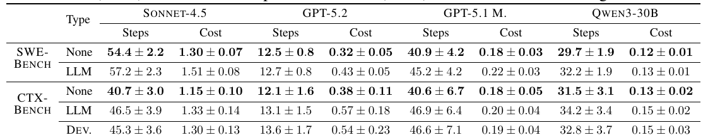
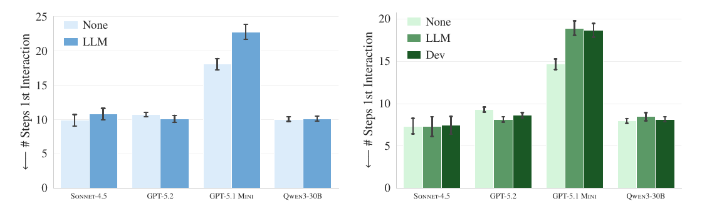
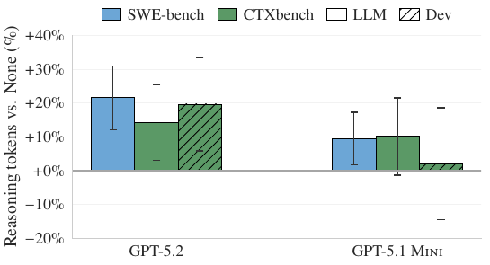
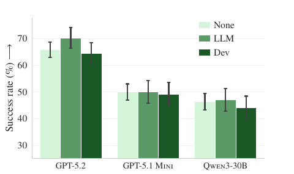

# AGENTS.md 越长越好吗？论文怎样检验仓库说明的真实作用

[知识库首页](../../README.md) · [本专题目录](README.md)

> **阅读目标**：检查仓库说明怎样改变代理行为，并区分有用背景、冗余指令和额外执行成本。

<details>
<summary>本文目录</summary>

- [第一层：5 分钟读懂这篇论文](#section-1)
- [第二层：先补几个概念](#section-2)
- [第三层：研究是怎么设计的](#section-3)
- [第四层：结果，逐图读懂](#section-4)
- [第五层：作者怎样排除其他解释](#section-5)
- [局限：这些结论在哪里可能不成立](#section-6)
- [对你意味着什么：一份 AGENTS.md 检查表](#section-7)
- [术语表](#section-8)
- [自测](#section-9)

</details>

**原文**：Thibaud Gloaguen、Niels Mündler、Mark Müller、Veselin Raychev、Martin Vechev，*Evaluating AGENTS.md: Are Repository-Level Context Files Helpful for Coding Agents?*，ICLR 2026（arXiv:2602.11988v2，2026-06-23 版，24 页）。作者来自 ETH Zurich 与 LogicStar.ai。[原文 PDF](https://arxiv.org/pdf/2602.11988v2)。下文页码均为 PDF 页码。

**为什么精读这篇**：它直接回答你每天都会碰到的问题——给 Codex 写的项目说明文件，到底有没有用、该写什么、为什么 Codex 会“过度测试”。而且它是少数**真的测了 Codex** 的研究。

**这一章怎么读**：分五层，越往下越深。只有 5 分钟就读第一层；想真正学会就读到第五层。

<a id="section-1"></a>
## 第一层：5 分钟读懂这篇论文

**一句话**：给编程代理加上 AGENTS.md 这类说明文件，任务成功率**没有显著提高**，成本却**平均增加 20% 以上**；原因是代理会**认真执行文件里的指令**（多跑测试、多读文件、多用指定工具），而文件里最常见的“项目结构概览”并不能帮它更快找到要改的地方。

**三个最重要的发现**：

1. 自动生成的说明文件（用 `/init` 一类命令生成的）平均让成功率**略降**（0.5%–2%，不显著），成本增加 20%–23%。
2. 开发者自己写的说明文件平均让成功率**略升**（2.4%，不显著），明显好于自动生成的。
3. 当仓库里**没有其他文档**时，自动生成的说明文件反而能把成功率平均提高 2.7%——它的价值取决于“它补充了多少别处没有的信息”。

**对你最直接的三条启示**：

- 你看到 Codex “过度测试”，很可能是它在照着 AGENTS.md 里的测试指令做事。
- AGENTS.md 只写**仓库里找不到**的信息：特殊约定、准确命令、禁区。删掉项目概览。
- 你的新项目如果几乎没有文档，一份简短的说明文件是有价值的；文档完善之后，它就容易变成重复信息。

<a id="section-2"></a>
## 第二层：先补几个概念

### 1. 说明文件（context file）

**白话**：放在代码仓库根目录、专门写给 AI 代理看的说明。Codex 读 `AGENTS.md`，Claude Code 读 `CLAUDE.md`。代理每次开始任务时会自动把它放进上下文。

**论文里的背景**（第 2–3 页）：厂商普遍推荐使用这类文件，很多代理提供 `/init` 命令自动生成；据 AGENTS.md 官方统计，已有超过 6 万个公开 GitHub 仓库包含这类文件。但此前**没有人系统测量过它到底有没有用**——只有开发者零散的“感觉好用了”。

### 2. 任务实例（instance）与成功率

研究沿用 SWE-bench 的考题格式（第 3 页，§3.1）。一道题由四样东西组成：

| 组成 | 白话 |
|---|---|
| 问题描述 I | 一份 bug 报告或功能需求 |
| 仓库状态 R | 问题出现时的代码 |
| 测试 T | 用来判断是否解决的一组测试 |
| 标准答案 X* | 当初真实合并的那份修改，只用来出题和验证，不给代理看 |

代理交出一份修改 X̂。把它应用到仓库上、运行测试 T，**全部通过**就算解决。**成功率 S** = 解决的题数 ÷ 总题数。

论文里写作 exec<sub>R∘X̂</sub>(T) = PASS，读作“在仓库 R 应用修改 X̂ 之后执行测试 T，结果为通过”。∘ 表示“先 R 再应用 X̂”。

### 3. 步数、成本、推理 token

- **步数**：代理与环境交互一次算一步，比如执行一条命令、修改一个文件。
- **成本**：完成一道题调用大模型花的钱（美元）。
- **推理 token**：模型在给出行动之前“内部思考”所用的文字量。GPT-5 系列会对它认为更难的任务自动多想，所以推理 token 的增减可以粗略反映“模型觉得任务变难了没有”。

### 4. 误差线与显著性检验

图里每根柱子顶上的黑色短线叫**误差线**，表示这个数字可能的波动范围。两根柱子的误差线大面积重叠，通常意味着差别可能只是随机波动。

论文用了两种检验来判断差别是否“显著”（第 6 页 Table 3、第 16 页 Table 6）。你只需要知道它们在回答同一个问题：**同一批题、同一批模型，换了说明文件后，结果的差别能不能用运气解释？** p 值小于 0.05 时，才认为不能用运气解释。（p 值的白话解释见[第 04 章](./04_%E7%A0%94%E7%A9%B6%E8%AF%81%E6%8D%AE.md)。）

<a id="section-3"></a>
## 第三层：研究是怎么设计的

### 难点：现成的考题里没有说明文件

研究者想比较“有说明文件”和“没有说明文件”，但遇到两个障碍（第 1–2 页）：

1. 说明文件是 2025 年 8 月左右才流行起来的，经典的 SWE-bench 考题全部早于此，**根本没有开发者写的说明文件**。
2. SWE-bench 的考题来自 Django、scikit-learn 这类超大型流行项目，它们的文档极其完善、而且模型在训练时很可能“见过”这些项目，**不代表大多数普通项目**。

所以作者做了两套实验，互相补充：

| 考题集 | 来源 | 说明文件 | 能回答的问题 |
|---|---|---|---|
| SWE-bench Lite | 11 个流行 Python 项目，300 道题 | 只能用代理自动生成 | 自动生成的说明文件在大项目上有没有用 |
| **CTXBench**（作者新建） | 12 个较小众、但开发者自己写了说明文件的 Python 项目，138 道题 | 开发者写的、自动生成的都有 | 真实使用中的说明文件有没有用 |


论文原图 1（PDF 第 2 页）：评测流程。**从左往右读**：左边是代码仓库；中间三条线是三种设置——开发者写的说明文件（Developer-provided）、没有说明文件（None，图标是 404）、代理自动生成（LLM-generated）；把仓库、说明文件和问题报告（Issue）一起交给代理；右边两个结果：“行动轨迹”（Action Trace，代理每一步想了什么、做了什么）用来分析行为，“补丁”（Patch）拿去跑测试，判断是否解决。

### CTXBench 是怎么做出来的（第 3–5 页）

1. **找仓库**：用 GitHub 搜索根目录有 AGENTS.md 或 CLAUDE.md、主要语言是 Python、有测试、至少 400 个合并请求的项目。
2. **筛选合并请求**：必须关联一个问题报告、改了 Python 文件，并且由一个 AI 判断“这次改动的行为是确定的、可以用测试检验的”。
3. **搭建运行环境**：让一个代理为每个仓库写好“安装依赖、运行测试、保存结果”的脚本；能跑出至少一个通过测试的才保留（87% 保留下来）。
4. **改写问题描述**：小项目的问题报告常常写得很随意，甚至是空的。作者让 AI 按固定格式重写成六段（描述、重现步骤、期望行为、实际行为、规格说明、补充信息），并要求**不泄露答案**；作者人工检查了全部考题。
5. **生成测试**：小项目的合并请求大多不带测试，作者让 AI 生成“任何正确实现都应通过”的测试，确认它们在修改前失败、修改后通过，再人工修正那些“只认标准答案写法”的测试。最终测试平均覆盖被修改代码的 75%。

**这一步对你有启发**：作者为了让考题“可以被公平评分”，做的恰恰是第 05 章说的事——把模糊的需求改写成有重现步骤、有期望行为、有规格的说明，再配上能判断对错的测试。

最终从 5,694 个合并请求中得到 138 道题。题目的基本统计（第 5 页 Table 1）：问题描述平均 212 个词；标准答案平均改动 119 行、2.5 个文件；开发者写的说明文件平均 641 个词、约 10 个小节。

### 测了谁

四种“代理 + 模型”组合（第 5 页）：Claude Code + Sonnet 4.5；**Codex + GPT-5.2**；**Codex + GPT-5.1 mini**；Qwen Code + Qwen3-30B-Coder。都用默认设置，温度设为 0（尽量减少随机性），每道题跑一次。自动生成的说明文件使用各代理官方推荐的初始化命令和模型。

<a id="section-4"></a>
## 第四层：结果，逐图读懂

### 结果一：成功率几乎没变


论文原图 3（PDF 第 6 页）：四个模型的成功率。左图是 SWE-bench（浅蓝 None 无说明文件，深蓝 LLM 自动生成），右图是 CTXBench（绿色由浅到深：None、LLM、Dev 开发者写的）。纵轴是成功率（%）。**怎么读**：先看同一个模型的几根柱子高度差多少，再看黑色误差线是否重叠。几乎每组都重叠——差别很可能是随机波动。

具体看几组（数字为从图中读出的近似值）：

- 左图 SWE-bench：Sonnet 4.5 从约 60% 降到约 58.5%；GPT-5.2 从约 56.5% 降到约 54%；GPT-5.1 mini 几乎不变；Qwen 略升。**8 组设置中有 5 组下降。**
- 右图 CTXBench：开发者写的文件让 GPT-5.1 mini 和 Qwen 明显好于自动生成的；但 Sonnet 4.5 最好的反而是“没有说明文件”。

显著性检验（第 6 页 Table 3）把这些数字压成四个 p 值：

| 比较 | p 值 | 结论 |
|---|---|---|
| SWE-bench：无 vs 自动生成 | 0.87 | 没有差别的证据 |
| CTXBench：无 vs 自动生成 | 0.37 | 没有差别的证据 |
| CTXBench：无 vs 开发者写的 | 0.21 | 没有差别的证据 |
| CTXBench：自动生成 vs 开发者写的 | **0.038** | 开发者写的显著更好 |

### 结果二：成本明确上升



论文原表 2（PDF 第 6 页）：每道题的平均步数（Steps）和成本（Cost，美元），越低越好，粗体是最好的设置。**怎么读**：每个模型看两列，再从上往下比较 None 和 LLM（以及 CTXBench 的 Dev）。粗体几乎全部落在 None 行——不给说明文件时最省步数、最省钱。

举两个例子算一算：

- Codex + GPT-5.2 在 CTXBench 上：无说明文件每题 0.38 美元，自动生成的 0.57 美元，增加 (0.57 − 0.38) ÷ 0.38 ≈ **50%**。
- Claude Code + Sonnet 4.5 在 SWE-bench 上：1.30 → 1.51 美元，增加约 16%；步数 54.4 → 57.2。

平均下来，自动生成的说明文件让步数增加 2.45（SWE-bench）和 3.92（CTXBench），成本增加 **20% 和 23%**；开发者写的让步数增加 3.34、成本最多增加 19%。这一组差别是显著的（p 远小于 0.05，第 16 页 Table 6）。

### 结果三：“项目概览”没有帮代理更快找到地方

厂商推荐在说明文件里写项目结构概览。作者统计发现：12 份开发者写的文件中 8 份有概览；自动生成的文件几乎全有（Sonnet 4.5 生成的 100%、GPT-5.2 生成的 99%）。

概览如果有用，代理应该**更快碰到真正需要修改的文件**。作者就测了这个：代理在第几步第一次打开或修改了标准答案里改过的文件。



论文原图 4（PDF 第 7 页）：代理第一次接触到“该改的文件”之前走了多少步（越低越好）。左 SWE-bench，右 CTXBench。**怎么读**：如果概览有用，有说明文件的柱子（深色）应该更矮。实际上大多数模型几乎一样高，GPT-5.1 mini 反而明显更高。

作者人工查看了 GPT-5.1 mini 的行动轨迹：它会花好几条命令去**寻找**说明文件，并且**反复阅读**——尽管文件内容早已自动放进了它的上下文。这种行为只在仓库里存在说明文件时出现（第 7 页）。

### 结果四：代理认真执行了指令——所以测试更多了


论文原图 5（PDF 第 8 页）：加上说明文件后，各类操作平均次数的**变化量**。四个小图对应四个模型；每一行是一种操作：Edit 编辑、Write 写文件、Grep 搜索、Read 读文件、TodoWrite 写待办、**pytest 运行 Python 测试**、python 运行脚本、find/ls 找文件、git、pip/uv 包管理工具等。竖线 0 表示和没有说明文件时一样，点在右边表示次数增加。浅绿是自动生成，深绿是开发者写的。**怎么读**：先找 pytest 那一行——四个模型的点都在 0 的右边；再看 Grep、Read，大多也在右边。

两个具体数字（第 8 页）：

- 说明文件里提到 `uv`（一个 Python 包管理工具）时，代理平均每题用它 1.6 次；没提到时不到 0.01 次。
- 说明文件提到的项目专用工具，平均每题被用 2.5 次；没提到时不到 0.05 次。

**这说明代理对说明文件是“言听计从”的。**写进去的每一条指令，都会变成实实在在的操作和成本。

### 结果五：说明文件让模型“觉得任务更难”



论文原图 6（PDF 第 8 页）：与没有说明文件相比，推理 token 的变化（%）。左边一组是 GPT-5.2，右边一组是 GPT-5.1 mini；蓝色是 SWE-bench，绿色是 CTXBench；斜线柱是开发者写的文件。**怎么读**：柱子都在 0 以上，表示模型都“想得更多”了；GPT-5.2 增加约 14%–22%。

作者的解释：说明文件给任务增加了额外要求，模型需要花更多思考来同时满足这些要求。

<a id="section-5"></a>
## 第五层：作者怎样排除其他解释

一个好的研究不只报告结果，还要回答“会不会是别的原因”。这篇论文做了五组补充实验（第 8–9 页、附录 B）。

| 可能的质疑 | 作者的检验 | 结果 |
|---|---|---|
| 自动生成的文件差，是因为生成它的模型太弱？ | 用更强的模型（GPT-5.2、Sonnet 4.5）生成文件，给弱模型用 | SWE-bench 上平均好 2%，CTXBench 上反而差 3%——**更强的模型不一定写出更好的说明文件** |
| 是生成文件的提示词不好？ | 分别用 Codex 和 Claude Code 的初始化提示词生成 | 没有哪个提示词稳定更好，差别很小 |
| 是文件太长了？ | 按文件长度分组看成功率和成本 | 长度和结果没有明显关系 |
| 是某一类内容（概览、工具说明、测试说明）在起作用？ | 逐类删除后重新测 | 删掉任何一类都没有显著变化 |
| 说明文件是不是只是和 README 重复了？ | **把仓库里所有文档删掉**（.md 文件、示例代码、docs/ 目录），只保留说明文件 | 自动生成的说明文件平均**提高 2.7%**，而且超过了开发者写的 |



论文原图 12（PDF 第 16 页）：删掉仓库里所有其他文档之后，CTXBench 上的成功率。**怎么读**：对比本章前面的图 3——在正常仓库里，中间那根（LLM 自动生成）常常最低；在没有文档的仓库里，GPT-5.2 的中间那根变成了最高。

**最后一组实验是理解整篇论文的钥匙。**把所有发现串起来，作者给出的因果链是：

```text
说明文件的内容  ──┬──> 项目概览、技术栈介绍 ──> 与 README 等现有文档重复 ──> 不带来新信息
                 │                                                   （仓库没文档时才有用）
                 └──> 操作指令（跑测试、用某工具）──> 被认真执行 ──> 步数和成本上升
                                                                   ──> 成功率不一定提高
```


这也解释了为什么很多开发者“感觉加了说明文件后代理变好了”：他们的项目往往文档很少，说明文件确实补了信息。作者在附录中也提到了这一点。

<a id="section-6"></a>
## 局限：这些结论在哪里可能不成立

按对你的影响从大到小：

1. **只测了“能不能把题做对”**。说明文件可能在其他方面有用——代码风格是否符合团队约定、是否遵守安全规则、是否避开禁区。这些论文没有测（作者在第 9 页列为未来工作）。对团队来说，这恰恰是说明文件的主要用途之一。
2. **考题的问题描述被 AI 改写得很规范**。真实工作中的任务说明往往更模糊，说明文件提供的背景可能更有用，也可能更容易被误用。
3. **只测了 Python**。模型对 Python 生态非常熟悉，说明文件里的工具和依赖信息它可能本来就知道。对小众语言或内部工具链，说明文件可能更有价值（作者在第 9 页明确指出）。
4. **每道题只跑一次**，CTXBench 也只有 138 道题，较小的差别（比如 2%）很难被可靠检测出来。“不显著”不等于“完全没有用”。
5. **工具和模型更新很快**。研究用的是 2026 年上半年的版本；Codex 读取说明文件的方式以后可能改变。

<a id="section-7"></a>
## 对你意味着什么：一份 AGENTS.md 检查表

| 问自己 | 依据 |
|---|---|
| 这条内容在 README 或代码里能找到吗？能找到就删 | 结果三 + 删除文档实验 |
| 这条指令会让 Codex 多做什么操作？这些操作值得花钱和时间吗？ | 结果四（言听计从）+ 结果二（成本） |
| “测试”相关指令是否具体到命令和范围？ | 结果四：pytest 次数明显增加 |
| 项目文档很少吗？那就写一份简短的项目说明，等文档完善后再精简 | 删除文档实验 |
| 有没有用 `/init` 生成后就没再看过？ | 自动生成的文件不显著提高成功率，却增加成本 |
| 改了说明文件后，有没有观察几次任务，确认行为真的变好了？ | 作者的结论：任何改进都应先验证 |

<a id="section-8"></a>
## 术语表

| 中文 | 英文 | 白话 |
|---|---|---|
| 说明文件 | context file（AGENTS.md / CLAUDE.md） | 写给 AI 代理的项目说明 |
| 任务实例 | instance | 一道考题：问题描述 + 代码 + 测试 + 标准答案 |
| 标准答案 | golden patch | 真实合并的修改，只用于出题和验证 |
| 成功率 | success rate / resolution rate | 测试全部通过的题目比例 |
| 步数 | steps | 代理与环境交互的次数 |
| 推理 token | reasoning tokens | 模型内部思考所用的文字量 |
| 行动轨迹 | trace | 代理每一步想了什么、做了什么的记录 |
| 消融实验 | ablation | 去掉或替换某个部分，看结果怎么变 |
| 误差线 | error bar | 数值可能的波动范围 |

<a id="section-9"></a>
## 自测

<details>
<summary>复述：用三句话向同事解释这篇论文的结论。</summary>

给编程代理加 AGENTS.md，成功率没有显著提高，成本却平均增加两成以上。原因是代理会认真执行文件里的指令，多跑测试、多读文件，而文件里常见的项目概览和已有文档重复，没带来新信息。只有在仓库缺少文档时，说明文件才明显有帮助，所以它应该只写仓库里找不到的内容。
</details>

<details>
<summary>计算：Table 2 中 Codex + GPT-5.1 mini 在 SWE-bench 上，无说明文件每题 0.18 美元、40.9 步；自动生成说明文件时 0.22 美元、45.2 步。成本和步数各增加了百分之多少？</summary>

成本：(0.22 − 0.18) ÷ 0.18 ≈ 22%。步数：(45.2 − 40.9) ÷ 40.9 ≈ 10.5%。
</details>

<details>
<summary>理解：为什么“删除所有文档”这个实验对理解论文特别重要？</summary>

它检验了“说明文件之所以没用，是因为和现有文档重复”这个解释。删掉文档后，说明文件成了唯一的信息来源，自动生成的文件就开始显著帮忙（平均提高 2.7%）。这说明说明文件的价值不在“文件本身”，而在于它补充了多少别处没有的信息。
</details>

<details>
<summary>迁移：你的 AGENTS.md 里有一句“每次修改后运行完整测试套件并确保覆盖率不下降”。根据这篇论文，会发生什么？怎么改？</summary>

代理会认真执行：每次修改都跑完整测试、检查覆盖率，步数和成本明显增加，而且容易为了覆盖率补写低价值测试。改成具体规则：修改时只运行相关模块的测试（写明命令），完成前运行一次完整测试；测试范围按任务说明中的验收标准来定，不以覆盖率为目标。
</details>

<details>
<summary>批判：论文说开发者写的说明文件让成功率提高 2.4%（p = 0.21）。能不能说“开发者写的说明文件没用”？</summary>

不能。p = 0.21 只说明证据不足以确认有提高，不等于证明没有作用；样本只有 138 道题、每题跑一次，2% 左右的差别本来就很难检测。而且论文只测了成功率，没有测风格、安全、遵守约定等方面，这些可能正是说明文件的主要价值。
</details>

---

[上一篇](./P1_%E7%B2%BE%E8%AF%BB_METR%E5%AE%9E%E9%AA%8C.md) · [下一篇](./P3_%E7%B2%BE%E8%AF%BB_FixedBench.md) · [专题目录](README.md) · [知识库首页](../../README.md)
